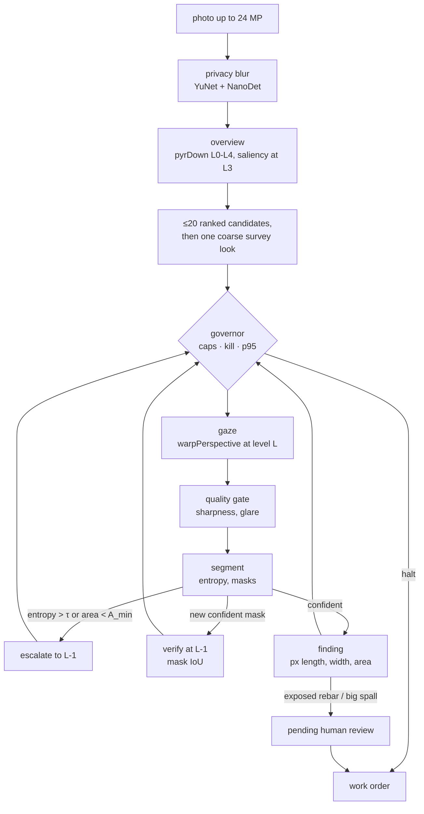

# Drishyam

**A virtual-PTZ inspector for bridge photos**, entered in the OpenCV AI Competition 2026, powered by AWS. It is for
bridge inspectors working through photo backlogs (624,939 US bridges, 41,148 in poor condition, each routinely
inspected at intervals of up to 24 months; [docs/impact-sources.md](docs/impact-sources.md)). Drishyam (Sanskrit:
*that which is seen*) decides where to look in a huge photo, zooms until it is sure, drafts findings with pixel
measurements, asks a human to sign anything critical, and stops looking when the next look is worth less than it
costs. Every camera move is an OpenCV `pyrDown` /
`warpPerspective` / `resize` call. The live demo runs the stock opencv-python-headless 5.0.0 wheel on Lambda arm64,
whose build already includes KleidiCV 26.03 and carotene (`cv2.getBuildInformation()`: "Custom HAL: YES (carotene
(ver 0.0.1) KleidiCV (ver 26.03))").

- **Live demo:** https://d1xg58guluup8c.cloudfront.net (stock OpenCV 5 on AWS Lambda arm64 behind CloudFront, *not COOL*; [docs/aws.md](docs/aws.md))
- **Report:** [docs/report.md](docs/report.md) · **Architecture:** [docs/architecture.png](docs/architecture.png) · **Agent loop:** [docs/agent-loop.svg](docs/agent-loop.svg) · **Claude driving it over MCP (recorded):** [docs/mcp-session/transcript.md](docs/mcp-session/transcript.md) · **Why it matters, with sources:** [docs/impact-sources.md](docs/impact-sources.md)
- **PRD:** [docs/PRD.md](docs/PRD.md) · **Requirement traceability:** [docs/requirements.md](docs/requirements.md) · **Security model:** [docs/security.md](docs/security.md) · **API:** [docs/api-contract.md](docs/api-contract.md) · **MCP:** [docs/mcp.md](docs/mcp.md)

## What it does



1. **Look where it matters.** A saliency prior from imgproc ops (Sobel, black-hat, adaptive threshold, CLAHE, rust-hue `inRange`) ranks up to 20 candidate windows on the 1/8-scale overview.
2. **Zoom until sure.** The next look is `argmax p·s·(1+u)·a / t̂` (prior × severity × uncertainty × unseen area ÷ predicted ms). An uncertain look (entropy > τ) or a tiny mask zooms one pyramid level finer on what it saw; a new confident mask is verified one level finer by mask IoU.
3. **Stop when a look is not worth its cost.** The job ends when the best next look is worth less than a quarter of the value per ms realised so far, inside pixel, $ and seconds caps and a p95-latency governor (switches model, then coarsens). Every step records the cause that chose it.
4. **A human signs anything critical.** Exposed rebar and large spalling wait in `pending_review`; only a human (web review, or `drishyam review`) can approve or reject. The agent, the MCP tools and the optional LLM planner have no path to that transition.

No LLM runs in the live demo: the deployed agent is the rule policy above, and its planner failure drills use planners scripted to time out or answer junk. The LLM path is the MCP server; in a [recorded session](docs/mcp-session/transcript.md) Claude chose each call from the measured IoU and entropy (its prompt states the decision rules). The full system, AWS included, is in [docs/architecture.png](docs/architecture.png), and the loop in [docs/agent-loop.svg](docs/agent-loop.svg).

## Run it

```bash
uv sync --all-extras
```

Web app and UI on http://127.0.0.1:8000 (same CSP as production):

```bash
make serve
```

```bash
uv run drishyam run public/samples/bridge_03.jpg --pixel-cap 0.3
```

`run` ends by printing its work order path and a review command template; use that job id in place of `j_XXXXXX`:

```bash
uv run drishyam review runs/j_XXXXXX/work_order.json f1 approve --by "Your Name"
```

MCP server over stdio (12 allow-listed tools, no approve tool, no shell):

```bash
uv run drishyam mcp
```

Tests: `make test` (unit, API, MCP, CLI, evals; same as CI) · browser e2e under the production CSP: `uv pip install playwright && .venv/bin/playwright install chromium && make e2e` · CI runs on x86 and arm64.

## Results

Every policy uses one segmenter and one matching rule; the 95 % intervals are a paired bootstrap over images, and "chance" is each policy's own boxes moved to random places. Methods, the per-cap tables and the caveats are in the [report, section 8](docs/report.md#8-evaluation).

- **200 held-out synthetic images (2048×1536):** at a 30 % pixel cap Drishyam finds 0.47 of the defects using 0.25 of the image's pixels: 0.86× exhaustive tiling's recall (95 % CI 0.80–0.93) at 0.15× its pixels, so the PRD hypothesis (≥ 0.9× tiling recall at ≤ 0.3× its pixels) is **not met**. A single 1024-px downscale at the same pixels does as well (0.96×, 95 % CI 0.90–1.02). Chance scores 0.02.
- **100 synthetic images at CODEBRIM's 4608×3456:** zooming beats one downscale, narrowly (0.50 against 0.45, 1.10×, 95 % CI 1.01–1.20), but a coarse L2 tiling grid finds 0.53 with a third of Drishyam's pixels.
- **200 real CODEBRIM photos:** every policy, Drishyam included, finds about one labelled defect in five (Drishyam at 30 %: 0.20, chance 0.14; IoU-only 0.09, chance 0.02). The classical segmenter, tuned on synthetic images, is the limit: it misses spalling (0.00) and exposed rebar (0.01). CODEBRIM's licence bars sharing the photos, so only numbers and text descriptions of the failures are published.
- **Agent control:** 100 % of steps carry a cause; 40 of 40 planner drills and 10 of 10 governor drills recovered. At the 30 % pixel cap the cap, not the stop rule, ends 152 of 200 synthetic and 195 of 200 CODEBRIM jobs; uncapped, the stop rule ends 182 of 200 synthetic jobs. The FR-21 ablations (random gaze order, no uncertainty term, no survey, no verify, no governor) have not been run, so nothing yet shows that the image-driven choices beat the same budget spent without them.


(The live site's FIG. 4.1, rendered from the committed `public/results/summary.json`: bars are the 95 % intervals, dotted ticks the chance level.)

Full numbers: [public/results/summary.json](public/results/summary.json), [public/results/large/summary.json](public/results/large/summary.json), [public/results/codebrim/summary.json](public/results/codebrim/summary.json); every prediction and trace: [public/results/per_image.json.gz](public/results/per_image.json.gz); failure gallery: [public/results/failures.json](public/results/failures.json), also on the live site.

## COOL on Graviton (not run)

COOL on Graviton was not run: the Marketplace AMI could not be subscribed from our AWS account (a payment-method restriction); the three-arm scripts are in [bench/](bench/README.md).

**What COOL could buy end to end, from the x86 laptop.** An 8-image macro run on the local x86 laptop ([results/local-macos-x86/macro.json](results/local-macos-x86/macro.json)) puts 9 % of a job in KleidiCV-covered imgproc, 69 % in the classical segmenter (imgproc plus NumPy), 3 % in crack thinning, 8 % in decode and 12 % in Python. So if COOL made the covered ops 1.8× faster, a whole job would get about 1.04× faster. The gaze path itself is cheap; most of the time is in segmentation, which is where a COOL or DNN speed-up would have to land. The stock aarch64 wheel the live demo runs already links KleidiCV 26.03, so any COOL gain would come on top of that.

## Honest scope

| Built and tested here | Deployed on AWS (us-east-1) and smoke-tested | Not done |
| --- | --- | --- |
| Agent loop, governor, planner fallback, findings and human approval, privacy blur, MCP server, CLI, web API + UI, evaluation harness, benchmark scripts, dacl10k training notebook and ONNX export, CI on x86 and Arm | CDK stack: CloudFront + OAC + WAF, Lambda arm64 (Function URL, AWS_IAM), DynamoDB kill flags, Secrets Manager HMAC key, CloudWatch (EMF, 4 alarms, dashboard), X-Ray, Budget. The alarms and the budget publish to an SNS topic with no subscriber yet ([docs/aws.md](docs/aws.md)) | COOL three-arm benchmark (AMI subscription blocked); approval store (not built: the web demo is stateless and the signed `work_order.json` is the audit trail); FR-21 ablations |

- The live demo runs the classical evidence-map engine (`classical-v1`, no weights), so it needs no downloads. A dacl10k-trained ONNX model ([models/README.md](models/README.md)) runs on OpenCV 5 DNN `ENGINE_NEW` with `DRISHYAM_ONNX=/path/model.onnx` (see [training/](training/README.md)); it is **not the live segmenter**, and its CC BY-NC 4.0 weights are not committed. So the live demo uses no OpenCV-5-only API.
- Measurements are image pixels. There are no millimetres and no safety ratings.
- The web demo is stateless: the signed `work_order.json` is the audit trail. There is no approval database: the PRD's DynamoDB/SNS approval store was not built ([docs/security.md](docs/security.md), "Known limits").

## Team

- Vaibhav Jangid, lead engineer (agent policy, OpenCV pipeline, evaluation, AWS deployment)
- Bhavya Dhoot, design, demo and presentation (site design, video)

## Licence

MIT. Bundled models: YuNet (MIT) and NanoDet-Plus (Apache 2.0) from OpenCV Zoo, see [models/README.md](models/README.md). Fonts: SIL OFL 1.1.

The trained `drishyam_dacl10k` segmenter is not covered by the MIT licence: its weights are [CC BY-NC 4.0](https://creativecommons.org/licenses/by-nc/4.0/) (non-commercial; trained on [dacl10k](https://github.com/phiyodr/dacl10k-toolkit)), are not committed to this repository, and carry their own licence file, [models/LICENSE.drishyam_dacl10k](models/LICENSE.drishyam_dacl10k).
