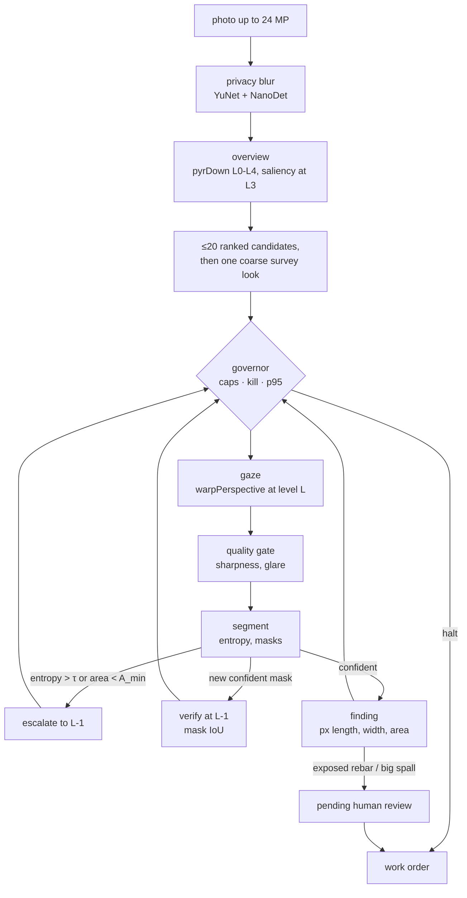

# Drishyam

**A virtual-PTZ inspector for bridge photos.** Drishyam (Sanskrit: *that which is
seen*) decides where to look in a huge photo, zooms until it is sure, drafts
findings with pixel measurements, asks a human to sign anything critical, and
spends compute in proportion to risk. Every camera move is an OpenCV 5
`pyrDown` / `warpPerspective` / `resize` call, so the agent's own actions are
the workload COOL accelerates on Graviton.

**What COOL can buy end to end, measured.** An 8-image macro run on the local x86 laptop ([results/local-macos-x86/macro.json](results/local-macos-x86/macro.json)) puts 9 % of a job in KleidiCV-covered imgproc, 69 % in the classical segmenter (imgproc plus NumPy), 3 % in crack thinning, 8 % in decode and 12 % in Python. So if COOL makes the covered ops 1.8× faster, a whole job gets about 1.04× faster. The gaze path itself is cheap; most of the time is in segmentation, which is where a COOL or DNN speed-up would have to land.

- **Live demo:** https://<cloudfront-domain> (stock OpenCV 5 on AWS Lambda arm64 behind CloudFront, *not COOL*; [docs/aws.md](docs/aws.md))
- **Demo video (49 s):** [drishyam-demo.mp4](https://github.com/vj-io/drishyam/releases/latest/download/drishyam-demo.mp4) — a real job on the live site: survey, zoom, a human-signed critical finding, a planner failure drill and KILL
- **PRD:** [docs/PRD.md](docs/PRD.md) · **Requirement traceability:** [docs/requirements.md](docs/requirements.md) · **Security model:** [docs/security.md](docs/security.md) · **API:** [docs/api-contract.md](docs/api-contract.md) · **MCP:** [docs/mcp.md](docs/mcp.md)

## What it does



1. **Look where it matters.** A saliency prior from imgproc ops (Sobel, black-hat, adaptive threshold, CLAHE, rust-hue `inRange`) ranks up to 20 candidate windows on the 1/8-scale overview.
2. **Zoom until sure.** The next look is `argmax p·s·(1+u)·a / t̂` (prior × severity × uncertainty × unseen area ÷ predicted ms). An uncertain look (entropy > τ) or a tiny mask zooms one pyramid level finer on what it saw; a new confident mask is verified one level finer by mask IoU.
3. **Spend in proportion to risk.** Pixel, $ and seconds caps, a p95-latency governor (switches model, then coarsens), and a stop rule when the next look is worth less than a quarter of the average value per ms so far. Every step records the cause that chose it.
4. **A human signs anything critical.** Exposed rebar and large spalling wait in `pending_review`; only a human (web review, or `drishyam review`) can approve or reject. The agent, the MCP tools and the optional LLM planner have no path to that transition.

## Run it

```bash
uv sync --all-extras
```

Web app and UI on http://127.0.0.1:8000 (same CSP as production):

```bash
make serve
```

```bash
uv run drishyam run public/samples/bridge_03.jpg --pixel-cap 0.3
```

`run` ends by printing its work order path and a review command template; use that job id in place of `j_XXXXXX`:

```bash
uv run drishyam review runs/j_XXXXXX/work_order.json f1 approve --by "Your Name"
```

MCP server over stdio (12 allow-listed tools, no approve tool, no shell):

```bash
uv run drishyam mcp
```

Tests: `make test` (unit, API, MCP, CLI, evals; same as CI) · browser e2e under the production CSP: `uv pip install playwright && .venv/bin/playwright install chromium && make e2e` · CI runs on x86 and arm64.

## Results

Measured on **200 held-out labelled synthetic images** (seed 7; policy changes were tuned only on a separate 60-image dev split, seed 4242, `make eval-dev`), one segmenter and one matching rule for every policy (a ground-truth box is found by a same-class component with IoU ≥ 0.3 or containing its centre; "IoU-only" drops the centre clause). The 95 % intervals are a bootstrap over images, paired across policies. "Chance" moves each policy's own boxes (same class and size) to random places in the photo and scores them again. Precision is one-to-one: in confidence order each prediction claims at most one ground-truth box, so a defect reported again from a second look is a false box; "hits per matched box" counts the predictions that land on each box found (1 = no duplicates). All of it runs on the **fixed cost model** (`--cost-model fixed`): every op the agent times costs its p50 from the `job_ops` table in [results/local-macos-x86/micro.json](results/local-macos-x86/micro.json) on every call, so its t̂, stop rule and governor see the same costs on a busy machine as on an idle one and `make eval` reproduces these numbers exactly. $ is that modelled time × $0.339/h (untimed Python is not charged), not a bill.

| Policy | pixels (× image) | recall (95 % CI) | IoU-only recall | chance recall (IoU-only) | precision | false boxes / image | hits per matched box | $ / image (modelled) |
| --- | --- | --- | --- | --- | --- | --- | --- | --- |
| downscale once (1024 px) | 0.25 | 0.50 (0.46–0.54) | 0.43 | 0.02 (0.01) | 0.120 | 12.2 | 1.03 | 0.000030 |
| tiling, L2 grid | 0.06 | 0.44 (0.41–0.48) | 0.40 | 0.02 (0.01) | 0.148 | 8.5 | 1.04 | 0.000008 |
| tiling, L1 grid | 0.50 | 0.55 (0.52–0.59) | 0.48 | 0.02 (0.01) | 0.096 | 17.3 | 1.05 | 0.000060 |
| tiling, L0 (exhaustive, 20 % overlap) | 1.67 | 0.55 (0.51–0.59) | 0.47 | 0.03 (0.01) | 0.021 | 83.4 | 1.08 | 0.000196 |
| **Drishyam**, cap 5 % | 0.02 | **0.00** (no 512² look fits after the overview on a 3 MP image) | 0.00 | 0.00 (0.00) | – | 0.0 | – | 0.000002 |
| **Drishyam**, cap 10 % | 0.10 | **0.30** (0.27–0.34) | 0.27 | 0.01 (0.00) | 0.125 | 7.0 | 1.05 | 0.000012 |
| **Drishyam**, cap 20 % | 0.18 | **0.43** (0.39–0.47) | 0.39 | 0.02 (0.01) | 0.114 | 11.2 | 1.45 | 0.000022 |
| **Drishyam**, cap 30 % | 0.25 | **0.47** (0.44–0.51) | 0.43 | 0.02 (0.01) | 0.099 | 14.5 | 1.49 | 0.000030 |
| **Drishyam**, cap 50 % | 0.35 | **0.52** (0.49–0.56) | 0.46 | 0.04 (0.02) | 0.083 | 19.4 | 1.64 | 0.000043 |
| **Drishyam**, cap 100 % | 0.46 | **0.53** (0.50–0.57) | 0.47 | 0.05 (0.02) | 0.069 | 24.4 | 1.79 | 0.000056 |

- At a **30 % cap** Drishyam finds **0.47** of the defects using **0.25** of the image's pixels: **0.86×** exhaustive tiling's recall (95 % CI 0.80–0.93) at **0.15×** its pixels. Against a single downscale at the same pixels it is 0.96× (95 % CI 0.90–1.02): **one downscale does as well.**
- At a **50 % cap**: **0.52** at 0.35 of the pixels = **0.95×** tiling's recall at **0.21×** its pixels. Uncapped, the stop rule ends 182 of 200 jobs by itself, at 0.46 of the pixels with **0.97×** tiling's recall. **Verdict on the PRD hypothesis (≥ 0.9× tiling recall at ≤ 0.3 of the full-resolution pixels): not met** — at 0.25 of the pixels Drishyam reaches 0.86× (its interval reaches 0.93, so 0.9 is not ruled out either). Measured against tiling's real pixel spend (1.67× the image, because tiles overlap), it reaches 0.95× at 0.21× from the 50 % cap.
- **Well above chance**: the same boxes at random places score 0.00 to 0.05 for every policy.
- **False boxes**: precision 0.099 for Drishyam at 30 % (14.5 false boxes per image) against 0.120 for one downscale (12.2) and 0.021 for exhaustive tiling (83.4). Drishyam reports a defect again from each look in its evidence trail (1.49 predictions per matched box, against 1.03 for one downscale), so it makes more false boxes than one downscale, though far fewer than exhaustive tiling.
- **Hairline cracks** (87 of the 227 crack boxes are 1–2 px wide; the flag is in the ground truth): exhaustive tiling finds 0.25 of them, one downscale 0.10, Drishyam 0.09 at the 30 % cap and 0.17 uncapped. Zooming everywhere finds the most hairlines; Drishyam's selective zoom does not beat one downscale on them at 30 %. Only 16 boxes are under 96² px, too few to read anything into (`strata` in the summary).
- Honest caveats: the best tiling grid (L1, 0.55 at 0.50) still beats Drishyam at equal pixels, and the hysteresis segmenter shipped with this policy lifted every baseline too, so it is not a Drishyam-only gain.
- Critical false-accept rate (critical prediction with no critical ground truth): Drishyam @30 % 0.52 vs exhaustive tiling 0.79 (the PRD asks for ≤ tiling); a single downscale (0.49) and L2 tiling (0.42) are lower still.
- Agent: 100 % of steps carry a cause; 40 of 40 injected planner drills were recovered by the rule planner and 10 of 10 governor drills (the drills run on the same fixed costs, so each job reaches its injection step on any machine load); escalation rate 17 %; at the 30 % cap, 3 looks and 0.27 of the pixels per image (p50 = p95). Human-approval latency is not measured (the web demo is stateless) and the FR-21 ablations were not run.

The images are procedural (`evals/synth.py`): 2048×1536 weathered concrete with drawn cracks, spalls, efflorescence, exposed rebar and rust run-off, plus graffiti, formwork lines, water stains, blur and glare as distractors. The eight bundled samples in `public/samples/` come from the same generator. The same harness on real photos is [below](#real-bridge-photos-codebrim).


(The live site's FIG. 4.1, rendered from the committed `public/results/summary.json`: bars are the 95 % intervals, dotted ticks the chance level.)

| per-class recall | crack | spalling | efflorescence | exposed_rebar | corrosion |
|---|---|---|---|---|---|
| Drishyam @30 % | 0.44 | 0.62 | 0.15 | 0.51 | 0.57 |
| tiling L0 | 0.47 | 0.70 | 0.25 | 0.52 | 0.75 |
| downscale | 0.48 | 0.57 | 0.22 | 0.44 | 0.66 |

Full numbers: [public/results/summary.json](public/results/summary.json); every prediction and trace: [public/results/per_image.json.gz](public/results/per_image.json.gz); failure gallery (12 measured cases from the synthetic run, 6 categories): [public/results/failures.json](public/results/failures.json), also on the live site.

**Fixed costs against measured wall time.** `make eval-live` reruns the synthetic set the way the app runs, on measured wall time ([public/results/live/summary.json](public/results/live/summary.json)), here with the machine's load average near 39 from other jobs: Drishyam at 30 % found 0.48 (0.45–0.52) at 0.25 of the pixels, 0.88× tiling (0.82–0.94), and the governor never switched the model but shrank the gaze and batched on 6 warp spikes. The stop rule ended fewer jobs at the 30 % cap (29 of 200, against 47 with fixed costs), because a measured step includes the Python around each look while the fixed model charges only the timed ops. Live numbers move with the machine; the fixed ones are the comparison. On the 60-image dev split the policy was tuned on (`make eval-dev`), the 30 % ratio to tiling is 0.96× (0.86–1.08), against 0.86× on these held-out images.

Everything above is measured, on a **labelled synthetic** dataset, with the
**classical** segmenter (no learned weights). They show the looking policy, not
segmentation quality.

### At CODEBRIM's size: 100 synthetic images at 4608×3456

`make eval-large` builds 100 images with the same generator (seed 7) at 4608×3456, the size of most CODEBRIM photos, and runs the same harness, to test the problem statement's claim that zooming should beat one downscale as photos grow. Published as it came out: [public/results/large/summary.json](public/results/large/summary.json) (FIG. 4.1's note on the site).

| Policy | pixels (× image) | recall (95 % CI) | IoU-only recall | chance recall | false boxes / image |
| --- | --- | --- | --- | --- | --- |
| downscale once (1024 px) | 0.05 | 0.45 (0.39–0.51) | 0.40 | 0.02 | 16.0 |
| tiling, L2 grid | 0.10 | 0.53 (0.47–0.59) | 0.48 | 0.02 | 70.4 |
| tiling, L1 grid | 0.40 | 0.53 (0.47–0.59) | 0.45 | 0.02 | 529.5 |
| tiling, L0 (exhaustive, 20 % overlap) | 1.63 | 0.32 (0.26–0.38) | 0.20 | 0.01 | 215.5 |
| **Drishyam**, cap 10 % | 0.10 | **0.43** (0.38–0.50) | 0.38 | 0.03 | 63.9 |
| **Drishyam**, cap 30 % | 0.29 | **0.50** (0.45–0.55) | 0.43 | 0.03 | 95.0 |
| **Drishyam**, cap 100 % | 0.54 | **0.51** (0.46–0.57) | 0.45 | 0.03 | 141.9 |

- **Against one downscale, zooming now wins, narrowly**: Drishyam at 30 % finds 0.50 against 0.45, 1.10× (95 % CI 1.01–1.20), where on the 2048×1536 set it was 0.96× (0.90–1.02). The downscale shrinks these images 4.5× instead of 2×.
- **A coarse tiling grid still does better**: L2 tiling (512-px tiles on the quarter-scale image) finds 0.53 at 0.10 of the pixels, a third of Drishyam's. Exhaustive L0 tiling falls to 0.32 (spalling 0.16, exposed rebar 0.00): the generator scales spalls with the image, so here they are about 225 to 860 px across and a 512-px full-resolution tile often holds only part of one. The headline ratio against L0 tiling (1.58×, which formally "meets" the 0.9× target) therefore says more about L0 tiling than about Drishyam.
- Hairline cracks (39 boxes) stay nearly invisible to every policy: 0.15 for L0 tiling, 0.10 for L1, 0.03 to 0.05 for Drishyam, 0.03 for one downscale. Uncapped, the stop rule ends 97 of 100 jobs by itself.

### Real bridge photos (CODEBRIM)

The same harness, segmenter and matching rule on **200 real inspection photos** from CODEBRIM: a seeded subset (seed 7) of the 1,052 annotated originals, mostly 4608×3456 px (2 to 24 MP), holding 1,008 defect boxes with 1,685 class labels (a box showing several defects is scored once per class) and at least 175 labels in every class. `make data` downloads and checks the 8.3 GB archive and `make eval-real` runs it; the 200 file names are committed in `evals/codebrim_eval200.txt`. The dataset's licence is non-commercial and bars sharing the photos, so only the numbers and a text description of each failure are published (the failure crops stay in the git-ignored `results/codebrim/`).

Two matching rules are reported side by side here, because on these photos they disagree: the lenient one (IoU ≥ 0.3 or containing the centre) and IoU-only. Same fixed cost model as above.

| Policy | pixels (× image) | recall (95 % CI) | IoU-only recall (95 % CI) | chance recall (IoU-only) | boxes per image |
| --- | --- | --- | --- | --- | --- |
| downscale once (1024 px) | 0.07 | 0.20 (0.17–0.23) | 0.08 (0.06–0.10) | 0.10 (0.02) | 184 |
| tiling, L2 grid | 0.10 | 0.21 (0.19–0.24) | 0.08 (0.06–0.10) | 0.09 (0.02) | 254 |
| tiling, L1 grid | 0.42 | 0.22 (0.19–0.25) | 0.08 (0.06–0.10) | 0.09 (0.02) | 930 |
| tiling, L0 (exhaustive, 20 % overlap) | 1.62 | 0.21 (0.17–0.24) | 0.06 (0.04–0.07) | 0.08 (0.01) | 3,144 |
| **Drishyam**, cap 5 % | 0.04 | **0.11** (0.08–0.14) | 0.04 (0.03–0.05) | 0.07 (0.01) | 95 |
| **Drishyam**, cap 10 % | 0.09 | **0.13** (0.11–0.17) | 0.05 (0.04–0.07) | 0.09 (0.01) | 265 |
| **Drishyam**, cap 20 % | 0.19 | **0.19** (0.16–0.22) | 0.08 (0.06–0.10) | 0.12 (0.03) | 601 |
| **Drishyam**, cap 30 % | 0.29 | **0.20** (0.17–0.23) | 0.09 (0.07–0.11) | 0.14 (0.02) | 920 |
| **Drishyam**, cap 50 % | 0.42 | **0.22** (0.19–0.26) | 0.10 (0.08–0.12) | 0.14 (0.03) | 1,324 |
| **Drishyam**, cap 100 % | 0.44 | **0.22** (0.19–0.26) | 0.10 (0.08–0.12) | 0.14 (0.03) | 1,363 |

| per-class recall | crack | spalling | efflorescence | exposed_rebar | corrosion |
|---|---|---|---|---|---|
| Drishyam @30 % | 0.31 | 0.00 | 0.05 | 0.01 | 0.53 |
| tiling L0 | 0.31 | 0.01 | 0.02 | 0.00 | 0.58 |
| downscale | 0.29 | 0.01 | 0.06 | 0.00 | 0.55 |

- **The PRD's hypothesis test (G1, defined on these photos) passes on paper and means little.** At a 30 % cap Drishyam reaches **0.97×** exhaustive tiling's recall (95 % CI 0.88–1.08, so not clearly above 0.9) at **0.18×** its pixels (1.54×, 1.26–1.92, when a match needs IoU ≥ 0.3), and 1.01× a single 1024-px downscale (0.93–1.10) that uses a quarter of its pixels. Every baseline, and Drishyam from the 20 % cap up, finds only about one labelled defect in five (0.19 to 0.22).
- **Much of that lenient score is chance.** Each policy's own boxes, moved to random places, already score 0.07 to 0.14 under the lenient rule, because thousands of boxes per image (920 for Drishyam at 30 %, 3,144 for L0 tiling) contain many ground-truth centres by luck. Under IoU-only, recall is 0.04 to 0.10 and chance 0.01 to 0.03: above chance, but low for every policy.
- **On real photos the segmenter, not where the agent looks, limits recall.** The classical engine was tuned on synthetic images. Precision (one-to-one) is 0.0005 to 0.008, and 98 to 100 % of every policy's critical predictions match no critical ground truth. It finds cracks (0.31) and corrosion (0.53) and effectively misses spalling (0.00) and exposed rebar (0.01).
- **The agent's control carries over.** 100 % of steps carry a cause; 40 of 40 planner drills and 10 of 10 governor drills recovered. With fixed costs the governor never had to step in (an earlier run on measured wall time with 8 workers saw 77 SLA breaches and 14 warp spikes). At the 30 % cap a job takes 17 looks (p50; 26 at p95), against 3 on the smaller synthetic images; uncapped, the stop rule ends all 200 jobs, at 0.44 of the pixels.
- **Failure cases** (8): cracks missed under the 30 % cap that the full budget finds, and exposed rebar or spalling reported as corrosion. They are published as text ([public/results/codebrim/failures_text.json](public/results/codebrim/failures_text.json), and under FIG. 5 on the site); the crops stay in the git-ignored `results/codebrim/`.
- **Next:** the dacl10k-trained segmenter ([training/](training/README.md), a Kaggle notebook) is what these numbers call for. After `scripts/install_model.sh`, `make eval-model DACL10K=<the dacl10k folder> CODEBRIM=data/codebrim` runs the leakage check between dacl10k and this subset (`evals/leakage.py`: a 255-bit pHash of each image with its lighting removed, in four rotations, finds candidates, and normalised cross-correlation confirms them. Calibrated on CODEBRIM with `python -m evals.leakage --codebrim data/codebrim`: resized, rotated, recompressed and re-exposed copies of 50 eval images sit at hash distance ≤ 10 and correlation ≥ 0.93, and each eval image's nearest other CODEBRIM photo at ≥ 56 and ≤ 0.43, so the thresholds 32 and 0.8 separate them; crops that drop 5 % of the frame are not found. The 9×8 dHash it replaces put 70 of the 200 eval images within 10 of 64 of an unrelated CODEBRIM photo. Not yet run against dacl10k), then this comparison and the synthetic one with `DRISHYAM_ONNX` set, refuses to compare unless each summary names the segmenter it should, and publishes the model's numbers next to these (`public/results/codebrim_dacl10k/`), leaving the classical ones in place.

Full numbers: [public/results/codebrim/summary.json](public/results/codebrim/summary.json), also on the live site (FIG. 4.2). CODEBRIM: Mundt, Majumder, Murali, Panetsos and Ramesh, "Meta-learning Convolutional Neural Architectures for Multi-target Concrete Defect Classification with the COncrete DEfect BRidge IMage Dataset", CVPR 2019.

## Honest scope

| Built and tested here | Needs the owner's AWS account |
| --- | --- |
| Agent loop, governor, planner fallback, findings and human approval, privacy blur, MCP server, CLI, web API + UI, evaluation harness, benchmark scripts, Kaggle training and ONNX export, CI on x86 and Arm | COOL 3.1 AMI on c8g (Graviton4) and the three-arm benchmark, DynamoDB/SNS approval store, CloudWatch, CDK stack, EC2 auto-stop |

- The demo segmenter is a classical evidence-map engine so the agent runs with zero downloads; a dacl10k ONNX model drops in with `DRISHYAM_ONNX=/path/model.onnx` (see [training/](training/README.md)).
- Measurements are image pixels. There are no millimetres and no safety ratings.
- The web demo is stateless: the signed `work_order.json` is the audit trail.

## Licence

MIT. Bundled models: YuNet (MIT) and NanoDet-Plus (Apache 2.0) from OpenCV Zoo, see [models/README.md](models/README.md). Fonts: SIL OFL 1.1.
