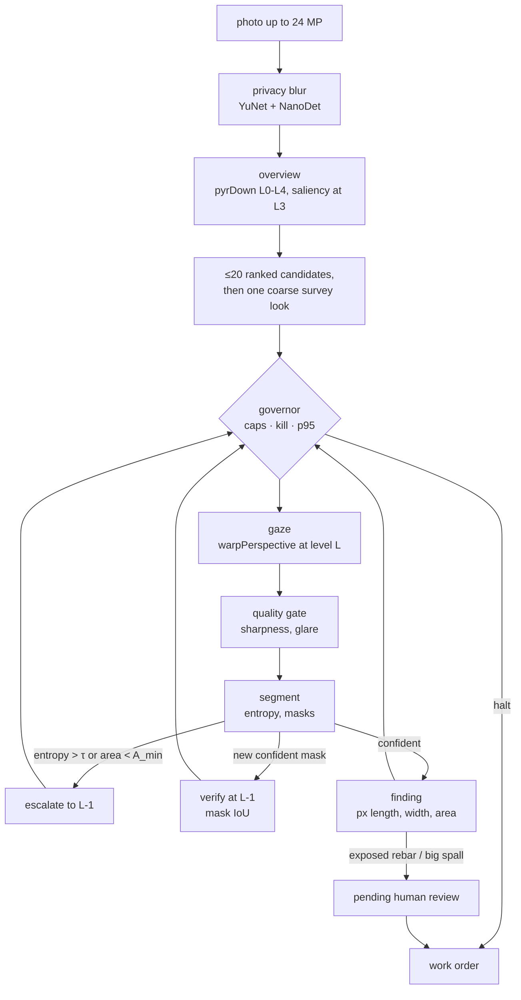

# Drishyam

**[Watch the film (4:27)](https://github.com/vj-io/drishyam/releases/download/v1.1.2/drishyam.mp4)** (also on
the live site) · **[Try the live demo](https://d1xg58guluup8c.cloudfront.net)**

Drishyam is an inspection agent for bridge photos, for inspectors with a backlog of large photos to check. On each
photo it decides where to look, zooms one level finer where its segmenter is unsure, drafts findings such as cracks
and spalling in image pixels, and stops when one more look is worth less than it costs. A person signs every critical
finding; the agent cannot. On 200 real bridge photos the live segmenter, v1, finds 0.49 of the labelled defects, 2.5
times what the classical engine finds, but boxes placed at random would already find 0.30, and a plain L2 tiling grid
finds 0.50. It rarely finds exposed rebar: 0.14 of it on these photos and 0.02 on synthetic ones.

It is built on OpenCV 5 for the OpenCV AI Competition 2026, powered by AWS. Drishyam is Sanskrit for *that which is
seen*.

- **Live demo:** https://d1xg58guluup8c.cloudfront.net (stock OpenCV 5 on AWS Lambda arm64 behind CloudFront, *not COOL*; [docs/aws.md](docs/aws.md))
- **Report:** [docs/report.md](docs/report.md) · **Architecture:** [docs/architecture.png](docs/architecture.png) · **Agent loop:** [docs/agent-loop.svg](docs/agent-loop.svg) · **Claude driving it over MCP (recorded):** [live v1 engine, 2026-10-21](docs/mcp-session-v1/transcript.md) · [classical engine, 2026-10-18](docs/mcp-session/transcript.md) · **Why it matters, with sources:** [docs/impact-sources.md](docs/impact-sources.md)
- **PRD:** [docs/PRD.md](docs/PRD.md) · **Requirement traceability:** [docs/requirements.md](docs/requirements.md) · **Security model:** [docs/security.md](docs/security.md) · **API:** [docs/api-contract.md](docs/api-contract.md) · **MCP:** [docs/mcp.md](docs/mcp.md)

## Results at a glance

Recall is the share of labelled defects found at the 30 % pixel cap, with paired 95 % bootstrap intervals over
photos; chance is the same model's boxes moved to random places, and IoU-only drops the contains-the-centre match
([report, section 8](docs/report.md#8-evaluation)). Each row was scored once on each held-out set
([results/heldout_models.json](results/heldout_models.json)), but v1 had been scored on CODEBRIM eval200 and synth200
once before (2026-10-18, unpublished): its row is its second scoring there, and v1-policy2's is v1's third read
(report, section 8); `tests/test_report_doc.py` fails if a number here
drifts from that file or, for the Lambda timings, from [docs/aws.md](docs/aws.md).

| Segmenter | CODEBRIM recall (95 % CI) | chance | IoU-only (chance) | synth200 recall (95 % CI) | clean photos with a box | critical boxes per CODEBRIM photo (parts of findings) |
| --- | --- | --- | --- | --- | --- | --- |
| v1 (first look policy) | 0.49 (0.44–0.54) | 0.30 | 0.25 (0.08) | 0.64 (0.61–0.67) | 0 of 51 | 9.60 |
| **v1-policy2 (live)** | 0.49 (0.44–0.53) | 0.31 | 0.26 (0.09) | 0.62 (0.59–0.66) | 0 of 51 | 8.75 |
| v2a | 0.48 (0.43–0.52) | 0.30 | 0.24 (0.08) | 0.61 (0.57–0.64) | 9 of 51 | 4.38 |
| v2b | 0.49 (0.44–0.53) | 0.28 | 0.25 (0.08) | 0.57 (0.53–0.61) | 9 of 51 | 4.65 |
| v2c | 0.48 (0.44–0.53) | 0.28 | 0.23 (0.07) | 0.57 (0.54–0.61) | 22 of 51 | 3.71 |
| classical engine | 0.19 (0.16–0.23) | 0.12 | 0.08 (0.03) | 0.48 (0.44–0.52) | 34 of 51 | 1.73 |

A person signs critical findings, not boxes: about 2.17 per CODEBRIM photo under v1's first policy and 1.15 under
v1-policy2, the live one ([report, section 8](docs/report.md#v1-policy2-held-out-one-read)). The last column counts
boxes: each connected part of a finding's mask, in every look that drew it, that is critical by class and area. That
is the unit the scorer matches, and one finding has several.

- **v1 runs live since 2026-10-21**, with the v1-policy2 look policy since 2026-10-22 (deployed commit 1227371, smoke-tested: [docs/aws.md](docs/aws.md)). It was
  chosen on the dev splits only ([results/dev/model_choice_dev.json](results/dev/model_choice_dev.json)); held out
  it is again the only model with no measurable loss against any other. These are its second scorings (one earlier,
  unpublished). Its CC BY-NC 4.0 weights are release assets of v1.1.0, not in git.
- **v1-policy2, live since 2026-10-22 (first deployed from commit adf9474):** one configuration chosen on the dev splits by a rule committed before its run and scored once held out (v1's third read; section 8). On CODEBRIM a person signs about 1.15 critical findings per photo instead of 2.17, and the critical boxes fall to 8.75 per photo from 9.60 (0.91×, CI 0.84–0.98); it lists 0.20 masks per photo as needs-a-look for a person to check by eye; recall is unchanged (0.99×, CI 0.97–1.01), on synth200 0.98× (0.95–1.00); critical-class recall is not higher (0.99×, 0.96–1.02; exposed rebar 0.14 against 0.16). On CODEBRIM verify now fires on 14.1 % of looks (5.0 % confirm looks) instead of 9.4 %, escalation on 5.8 %. It still does not beat L2 tiling: 0.98× its recall at 1.40× its pixels, and 0.83× (0.76–0.89) at the 10 % cap.
- **What the held-out runs measured:** the governor off and the 512-px FP32 net on every look. Live, the v1
  profile's SLA is 1500 ms, so looks stay on the 512-px FP32 net unless steps exceed 1.5 s. v1's finest look is L1
  (half size) on a 2048-px photo and L2 on a 4608-px one, so on these photos it never looks at full resolution.
- **How much v1 zooms, and a tiling grid it does not beat:** on CODEBRIM at the 30 % cap an escalation fired on
  5.9 % of v1's looks and a verify on 9.4 %, and an L2 tiling grid finds 0.50 with 0.10 of the pixels, against the
  agent's 0.49 with 0.14; on synth200 an L1 grid finds 0.70 with 0.50 of the pixels, against 0.64 with 0.26
  ([public/results/codebrim_dacl10k/summary.json](public/results/codebrim_dacl10k/summary.json),
  [public/results/synth_dacl10k/summary.json](public/results/synth_dacl10k/summary.json)).
- **Against the classical engine,** v1 finds 2.54× (2.16–3.01) its recall on CODEBRIM and 1.34× (1.24–1.45) on
  synth200, and puts no box on a clean photo where the classical engine puts 7.08 per photo. But chance is high on
  CODEBRIM because its boxes are large; it sends 5.5 times the critical boxes to the human gate (boxes, not the
  findings a person signs; the one measured backlog of 2,536 photos, 2,436 of them synthetic, queued 684 critical
  findings from the 587 photos it ran and left 1,949 not assessed); its modelled ms per CODEBRIM job are 1.99× (CI 1.92–2.06); and on the
  Lambda its step p95 was 0.52 to 1.14 s, against 67.7 to 88.0 ms.
- **Where v1 fails:** on synthetic photos it finds no efflorescence (0.00) and almost no exposed rebar (0.02), where
  the classical engine finds 0.16 and 0.57; on one of our own wall photos it flagged nothing although a hairline
  crack is visible by eye ([report, section 9](docs/report.md#9-failures)).
- **The classical engine** (the deployed demo until 2026-10-21, and every policy comparison) does not let the agent
  beat the simple baselines: on synth200 it is 0.87× exhaustive tiling (0.81–0.93) at 0.16× its pixels, so the PRD
  hypothesis (at least 0.9× tiling's recall at no more than 0.3× its pixels) is not met, and 0.96× one 1024-px
  downscale (0.91–1.02); it finds 0.19 of CODEBRIM's defects, 0.98× one downscale (0.90–1.06).

## What it does



1. **Look where it matters.** A saliency prior from imgproc ops (Sobel, black-hat, adaptive threshold, CLAHE, rust-hue `inRange`) ranks up to 20 candidate windows on the 1/8-scale overview.
2. **Zoom in where it is unsure.** The next look is `argmax p·s·(1+u)·a / t̂` (prior × severity × uncertainty × unseen area ÷ predicted ms). An uncertain look (entropy > τ) or a tiny mask zooms one pyramid level finer on what it saw; a new confident mask is verified one level finer by mask IoU. With v1, the live engine, a look spans at least 0.3 of the photo's long side (its profile's `min_view`), so its finest level is L1 (half size) on a 2048-px photo and L2 on a 4608-px one; a look there is not escalated or verified further.
3. **Stop when a look is not worth its cost.** The job ends when the best next look is worth less than a quarter of the value per ms realised so far, or than the value of a look that finds nothing once every candidate left has been seen as finely as its first look would see it, inside pixel, $ and seconds caps and a p95-latency governor (switches model, then coarsens). Every step records the cause that chose it.
4. **A human signs anything critical.** Exposed rebar and large spalling wait in `pending_review`; only a human (web review, or `drishyam review`) can approve or reject. The agent, the MCP tools and the optional LLM planner have no path to that transition. An area the agent could not assess (a photo with no candidate, a region a KILL or a cap left, a v1-policy2 needs-a-look mask, an unreadable area) keeps the work order `incomplete` until a person checks it by eye: Nothing found or Defect found, with an optional note, in the web review or with `drishyam review`. The agent has no path to that either. The review does not check who sends it: the reviewer's name is self-asserted ([docs/security.md](docs/security.md), Known limits).

It is for bridge inspectors working through photo backlogs: 624,939 US bridges, 41,148 in poor condition, each
routinely inspected at intervals of up to 24 months ([docs/impact-sources.md](docs/impact-sources.md)). Every camera
move is an OpenCV `pyrDown` / `warpPerspective` / `resize` call. The live demo runs the stock
opencv-python-headless 5.0.0 wheel on Lambda arm64, whose aarch64 build already includes KleidiCV 26.03 and
carotene: the Lambda's own `cv2.getBuildInformation()`, as its `GET /api/health` reports it, reads Custom HAL
"YES (carotene (ver 0.0.1) KleidiCV (ver 26.03))", baseline "NEON FP16", dispatch "NEON_DOTPROD NEON_FP16 NEON_BF16"
and parallel framework "pthreads" ([results/lambda-cv2-build.json](results/lambda-cv2-build.json), fetched
2026-10-21), the same as on GitHub's arm64 runner ([results/linux-aarch64/micro.json](results/linux-aarch64/micro.json)).

No LLM runs in the live demo (the batch CLI's optional Nova Lite router is below): the deployed agent is the rule policy above, and its planner failure drills use planners scripted to time out or answer junk. The LLM path is the MCP server; in [recorded sessions on the live v1 engine](docs/mcp-session-v1/transcript.md) Claude chose each call from what the server measured and the crops it returned (its prompt states the decision rules): on `bridge_03` it found all 4 labelled defects with the rule agent's 17.1 % of the pixels (the rule agent stopped before the crack; the session was not blind: Claude had read the sample's labels and the earlier transcript), and on our wall photo, where the overview proposes no region (the rule agent then took no look; since the zero-candidate fallback it takes one whole-photo look, which the blur gate refuses), it looked along the faint line in the overview and flagged the crack (no ground truth; the session's limits are in the transcript). An [earlier session](docs/mcp-session/transcript.md) used the classical engine. The full system, AWS included, is in [docs/architecture.png](docs/architecture.png), and the loop in [docs/agent-loop.svg](docs/agent-loop.svg).

## Run it

```bash
uv sync --all-extras
```

Web app and UI on http://127.0.0.1:8000 (same CSP as production):

```bash
make serve
```

```bash
uv run drishyam run public/samples/bridge_03.jpg --pixel-cap 0.3
```

`run` ends by printing its work order path and a review command template; use that job id in place of `j_XXXXXX`:

```bash
uv run drishyam review runs/j_XXXXXX/work_order.json f1 approve --by "Your Name"
uv run drishyam review runs/j_XXXXXX/work_order.json na0 nothing-found --by "Your Name"   # an area listed as not assessed, checked by eye (defect-found takes --note "...")
```

With the live engine, v1 (its CC BY-NC 4.0 weights are assets of the v1.1.0 release, not in git): download them,
check their sha256, then run with them.

```bash
gh release download v1.1.0 --repo vj-io/drishyam --pattern 'drishyam_dacl10k*' --dir models
```

Or without `gh`, the same three files with curl:

```bash
curl -fL -o models/drishyam_dacl10k.onnx https://github.com/vj-io/drishyam/releases/download/v1.1.0/drishyam_dacl10k.onnx
```

```bash
curl -fL -o models/drishyam_dacl10k.fp16.onnx https://github.com/vj-io/drishyam/releases/download/v1.1.0/drishyam_dacl10k.fp16.onnx
```

```bash
curl -fL -o models/drishyam_dacl10k.sha256 https://github.com/vj-io/drishyam/releases/download/v1.1.0/drishyam_dacl10k.sha256
```

```bash
shasum -a 256 -c models/drishyam_dacl10k.sha256
```

```bash
DRISHYAM_ONNX=models/drishyam_dacl10k.onnx DRISHYAM_ONNX_FP16=models/drishyam_dacl10k.fp16.onnx uv run drishyam run public/samples/bridge_03.jpg --pixel-cap 0.3
```

A backlog of photos ([docs/batch.md](docs/batch.md)): triage every photo with the agent's own overview, run the
unchanged per-photo agent in order of evidence under one total budget, list every photo it did not reach as not
assessed, and write a signed inspection report with one queue of critical findings for a person. On the 90-photo dev
backlog the ordering is no measurable gain (×1.23 against random order, 95 % CI 0.64–1.64).
`--router nova` adds a live LLM router: Amazon Nova Lite on Bedrock labels each photo's blurred overview Clear, Requires zoom or Critical, Clear photos get no job and are listed as not assessed, and any bad reply, timeout or error falls back to the triage. On dev it loses under the rule committed before any paid call: its Bedrock $ leaves it 19 photos at half the full-run budget, so it queues 0.18 of the critical defects against the triage's 0.50 (×0.36, CI 0.13–0.67), and it cleared 9 of 81 photos holding a critical defect, so `--router rule` stays the default. A 2,536-photo backlog (2,436 synthetic photos and the 100 CODEBRIM dev photos) ran end to end in 72 min for $0.32 of Bedrock: 867 cleared, 587 run, 684 critical findings queued for a person, and 1,949 photos listed as not assessed, cleared or not reached ([batch.md](docs/batch.md#a-live-llm-router---router-nova)).
`--batch-yield` (off by default) lets a job leave its photo under budget pressure once its next look is worth less than the next photo's first, Charnov's marginal value rule; no LLM is added. On the 190-photo dev backlog it shows no measurable difference under the rule committed before its run: 0.55 of the critical defects against the triage's 0.48 at half the budget (×1.15, CI 0.995–1.47), with 413 not-assessed entries instead of 173, so it stays off ([batch.md](docs/batch.md#leaving-a-photo-for-the-next-one---batch-yield-dev-only)).
A scale-free blur gate (`JobConfig.blur_gate "both"`, off by default) refuses a view as blur only if both its Laplacian variance and its re-blur ratio (Crété-Roffet et al., 2007) say blur, so it can only take back refusals of faint, sharp views. On the 190 dev photos it is Harm under the rule committed before its one run: it takes back 43 of the 49 refusals of views as they were (share refused −0.0505, CI −0.0836 to −0.0235), but also passes 8 of the 846 views blurred by σ 2 px that the Laplacian gate refuses (−0.0094, CI −0.0176 to −0.0023), so it stays off ([results/dev/blur_gate.json](results/dev/blur_gate.json)).

```bash
uv run drishyam batch public/samples --seconds-cap 30
```

MCP server over stdio (12 allow-listed tools, no approve tool, no shell):

```bash
uv run drishyam mcp
```

Tests: `make test` (unit, API, MCP, CLI, evals; same as CI) · browser e2e under the production CSP: `uv pip install playwright && .venv/bin/playwright install chromium && make e2e` · CI runs on x86 and arm64.

## Results

Every policy uses one segmenter and one matching rule (a ground-truth box is found by a same-class component with IoU ≥ 0.3 or containing its centre; "IoU-only" drops the centre clause); the 95 % intervals are a paired bootstrap over images, and "chance" is each policy's own boxes moved to random places. Methods, the per-cap tables and the caveats are in the [report, section 8](docs/report.md#8-evaluation).

With the classical engine (published runs of 2026-10-18, agent of commit 832299b):

- **200 held-out synthetic images (2048×1536):** at a 30 % pixel cap Drishyam finds 0.48 of the defects using 0.26 of the image's pixels: 0.87× exhaustive tiling's recall (95 % CI 0.81–0.93) at 0.16× its pixels (512-px full-resolution tiles overlapping 20 %, so tiling reads 1.67× the image), so the PRD hypothesis (≥ 0.9× tiling recall at ≤ 0.3× its pixels) is **not met**. A single 1024-px downscale (0.50 at 0.25 of the pixels) does at least as well: Drishyam is 0.96× of it (95 % CI 0.91–1.02). Chance scores 0.03.
- **100 synthetic images at CODEBRIM's 4608×3456:** zooming beats one downscale, narrowly (0.52 against 0.45, 1.14×, 95 % CI 1.04–1.25), but a coarse L2 tiling grid (the same 512-px tiles on pyramid level 2, the image at a quarter of its width and height) finds 0.53 with about a third of Drishyam's pixels (0.10 against 0.29).
- **200 real CODEBRIM photos:** every policy, Drishyam included, finds about one labelled defect in five (Drishyam at 30 %: 0.19, chance 0.12; IoU-only 0.08, chance 0.03). Drishyam is 0.94× exhaustive tiling (95 % CI 0.85–1.04) and 0.98× one downscale (0.90–1.06), so it does not beat the simple baseline here. The classical segmenter, tuned on synthetic images, is the limit: it misses spalling (0.00) and exposed rebar (0.01). CODEBRIM's licence bars sharing the photos, so only numbers and text descriptions of the failures are published.
- **The trained segmenters, held out** ([results/heldout_models.json](results/heldout_models.json), [report, section 8](docs/report.md#the-trained-segmenters-held-out)): four dacl10k-trained models, each scored once per held-out set at the profile and on the cost table chosen on dev. At the 30 % cap v1, the dev choice, finds 0.49 of the 200 CODEBRIM photos' defects (95 % CI 0.44–0.54) against the classical engine's 0.19, 2.54× (2.16–3.01; chance is high here, 0.30, as its boxes are large; with IoU only, 0.25 against a chance of 0.08), and 0.64 on synth200 (0.61–0.67) against 0.48, and it puts no box on any of the 51 clean photos (the classical engine 7.08 per photo). Held-out confirms the dev choice: v1 is the only model with no measurable loss against any other. v2a and v2b find the same share of CODEBRIM's defects, less on synth200 (v1 is 1.05× and 1.12× them) and put a box on 9 of the clean photos each. v1's costs: twice their critical boxes per CODEBRIM photo (9.60 against 4.38 and 4.65; boxes, not the findings a person signs) and 1.99× the classical engine's modelled ms per CODEBRIM job (x86 tables). v2c, v2a's net retrained with the rare classes weighted harder, scored last: the same share of CODEBRIM's defects, less than v1 and v2a on synth200 (v1 is 1.12× it), a box on 22 of the 51 clean photos (3.16 per photo), and the fewest critical boxes (3.71 per CODEBRIM photo); it changes neither the dev choice nor this verdict. No eval photo is a near-duplicate of a dacl10k image (0 candidates of 200 against 8,922). v1 had been scored on CODEBRIM eval200 and synth200 once before, unpublished. v1 is the live segmenter since 2026-10-21. These runs had the governor off and used the 512-px FP32 net on every look; live, the v1 profile's SLA is 1500 ms, so looks stay on the 512-px FP32 net unless steps exceed 1.5 s.
- **Agent control:** 100 % of steps carry a cause; 40 of 40 planner drills and 10 of 10 governor drills recovered. At the 30 % pixel cap the cap, not the stop rule, ends 189 of 200 synthetic and 194 of 200 CODEBRIM jobs; uncapped, the stop rule ends 185 of 200 synthetic jobs.
- **Ablations (FR-21):** each variant flips one switch of the agent, same caps and fixed costs ([public/results/ablations.json](public/results/ablations.json)). At the 30 % cap, dropping the survey look lowers recall on every set (0.91× the full agent on the 2048×1536 set, 95 % CI 0.85–0.97; 0.86× at 4608×3456; 0.66× on CODEBRIM). Random gaze order is below the full agent at 4608×3456 (pooled 95 % CI 0.82–0.92) and on CODEBRIM (0.92–1.00) but matches it on the 2048×1536 set (0.97–1.00). At the 30 % cap the uncertainty term, the seeding of unvisited candidates by every look, the stop floor and the governor change nothing measurable; uncapped on the 2048×1536 set the uncertainty term and the seeding earn a little recall (without them 0.98×, 0.96–0.99, and 0.92×, 0.89–0.95). For the governor: the policy comparison runs with the governor's model, level and gaze-size overrides off, and turned on they never act, because under fixed costs its latency rules never fire, so its response is shown by the 10 governor drills instead. Without the verify step recall is slightly higher at the 30 % cap on the 2048×1536 set (1.03×, 1.00–1.06) and lower uncapped there (0.96×, 0.94–0.98). None of these intervals is corrected for multiple comparisons.
- **Measured and not adopted** (dev splits only, each read by a rule written down before its run): the classical
  agent's tuning knobs, where `tau_scout` 0.7 was adopted and then reverted because its synth_dev gain was not
  measurable (1.03×, 0.98–1.09) ([results/dev/tune_sweep.json](results/dev/tune_sweep.json)); a two-model cascade
  (v2a scouting, v2b confirming), with lower recall than v2a alone on CODEBRIM dev100 (0.83×, 0.73–0.93) and on
  synth_dev (0.91×, 0.85–0.98)
  ([results/dev/cascade_dacl10k_v2a+v2b.json](results/dev/cascade_dacl10k_v2a+v2b.json)); INT8, which OpenCV 5.0.0
  runs only statically quantized and only on `ENGINE_NEW`, slower than FP32 on the x86 Mac (one 512-px forward on
  one thread: 1066.6 and 1391.1 ms against FP32's 686.7), and whose QDQ crack masks overlap FP32's at IoU 0.37
  ([docs/bench.md](docs/bench.md#int8-can-opencv-5s-dnn-run-a-quantized-dacl10k)); and prefetching the next look,
  which slowed steps on x86 at 2 and 4 threads and never ran on the function.
- **Arm against x86** (GitHub's runners, one run each, shared VMs, not the Lambda): the Arm runner did 5.13 images/s
  against x86's 4.06 in the 200-image macro run on one thread, and ran the agent loop at 1.21 times x86's jobs/s on
  one thread and 1.27 times on four ([report, section 6](docs/report.md#6-opencv-5-implementation)).


(The live site's FIG. 4.1, rendered from the committed `public/results/summary.json` and, dashed red, v1's run on the same images, `public/results/synth_dacl10k/summary.json`: bars are the 95 % intervals, dotted ticks the chance level. `scripts/render_figures.py` re-renders this image and `docs/architecture.png`; like the e2e tests, it needs Playwright.)

Full numbers: [public/results/summary.json](public/results/summary.json), [public/results/large/summary.json](public/results/large/summary.json), [public/results/codebrim/summary.json](public/results/codebrim/summary.json), [public/results/ablations.json](public/results/ablations.json), false alarms on images with no damage: [public/results/clean/summary.json](public/results/clean/summary.json); every prediction and trace: [public/results/per_image.json.gz](public/results/per_image.json.gz); failure gallery, from the classical engine's synthetic run, not v1's: [public/results/failures.json](public/results/failures.json), also on the live site.

## COOL on Graviton (not run)

COOL on Graviton was not run: the Marketplace AMI could not be subscribed from our AWS account. It is an AWS India (AISPL) account, whose card restriction terminated the Marketplace agreement seconds after subscribing (a support case is open). The three-arm scripts are in [bench/](bench/README.md).

**What COOL could buy end to end, from GitHub's arm64 runner.** A 200-image macro run with the stock aarch64 wheel on GitHub's `ubuntu-24.04-arm` runner (Neoverse-N2, one thread; a GitHub Actions VM, not the Lambda; [results/linux-aarch64/macro.json](results/linux-aarch64/macro.json)) puts 8 % of a job in KleidiCV-covered imgproc, 74 % in the classical segmenter (imgproc plus NumPy), 4 % in crack thinning, 7 % in decode and 7 % in Python. So if COOL made the covered ops 1.8× faster, a whole job would get about 1.04× faster (the x86 laptop's 8-image run, [results/local-macos-x86/macro.json](results/local-macos-x86/macro.json), gives the same 1.04×). The gaze path itself is cheap; most of the time is in segmentation, which is where a COOL or DNN speed-up would have to land. The stock aarch64 wheel the live demo runs already links KleidiCV 26.03, so any COOL gain would come on top of that.

**Arm against x86 on GitHub's runners** (one run each, same wheel version, 4 logical CPUs each, shared VMs, not the Lambda; [docs/bench.md](docs/bench.md#arm-against-x86-on-github)). Against `ubuntu-24.04` (AMD EPYC 7763, IPP HAL), the Arm runner ran the agent loop at 1.17 to 1.27 times the jobs per second and the macro job at 1.26 times the images per second (per-image p50 195.8 against 248.2 ms), most of the gap in the classical segmenter. On one thread x86 won 12 of the 24 kernel and size pairs (but 6 of the 24 differ by less than 6 %, close enough to flip in another run), black-hat and top-hat by about 2 times, and ran the NanoDet forward in 0.61 of Arm's time; on 4 threads Arm won 23 of 24. Every ratio mixes core, OpenCV build and VM.

## Honest scope

| Built and tested here | Deployed on AWS (us-east-1) and smoke-tested | Not done |
| --- | --- | --- |
| Agent loop, governor, planner fallback, findings and human approval, privacy blur, MCP server, CLI, web API + UI, evaluation harness, benchmark scripts, dacl10k training notebook and ONNX export, CI on x86 and Arm | CDK stack: CloudFront + OAC + WAF, Lambda arm64 (Function URL, AWS_IAM), DynamoDB kill flags, Secrets Manager HMAC key, CloudWatch (EMF, 4 alarms, dashboard), X-Ray, Budget. The live segmenter is v1 (`onnx:drishyam_dacl10k.onnx`, since 2026-10-21). The alarms and the budget publish to an SNS topic whose email subscription is confirmed: a test alarm reached the owner's email on 2026-10-21 ([docs/aws.md](docs/aws.md)) | COOL three-arm benchmark (AMI subscription blocked); approval store (not built: the web demo is stateless and the signed `work_order.json` is the audit trail) |

- The live demo runs v1, a dacl10k-trained ONNX model ([models/README.md](models/README.md)), on OpenCV 5 DNN `ENGINE_NEW` with `DRISHYAM_ONNX=/path/model.onnx` (see [training/](training/README.md); `ENGINE_CLASSIC` cannot import it, and a DeepLabV3+ export that failed parity on OpenCV 5.0.0 was dropped: [report, section 6](docs/report.md#6-opencv-5-implementation)). Its held-out results are under Results; its CC BY-NC 4.0 weights ship in the Lambda package and as release assets of v1.1.0, and are not committed. Without `DRISHYAM_ONNX` the classical evidence-map engine (`classical-v1`, no weights) runs and needs no downloads.
- Two samples are our own photos of a painted plaster wall (`public/samples/real_01.jpg`, `real_02.jpg`: labelled "REAL PHOTO (ours), painted plaster wall, no ground truth", no EXIF or GPS), and the site's **Watch it on a real wall** replays the v1 engine's run on each, recorded live on the site on 2026-10-23 with measured costs (`real_0N.ndjson`: copies of `video/live/walls/IMG_2332/real.ndjson` and `IMG_2330/real.ndjson`, jobs `j_da1449` and `j_d2b9b0`, with their embedded images removed, so the replay shows no heatmap or crops). With no ground truth nothing is scored: on `real_02` it took one look and flagged one crack (a draft, not critical). On `real_01` the overview proposed no candidate. The local run of 2026-10-21, made before the zero-candidate fallback (`results/real-walls-2026-10-21/real_01.ndjson`, the site's replay until 2026-10-23), took no look and missed the hairline crack we see by eye. With the fallback, on by default since 2026-10-21 and live since 2026-10-22, the job takes one whole-photo look at L2: v1's mask shows crack pixels (9,136 px in the live run), but the quality gate refuses the view as blur (the smooth paint gives its sharpness test little texture), so nothing is flagged and the photo stays not assessed, with a re-shoot instruction that is wrong for this sharp photo ([report, section 9](docs/report.md#9-failures)). A blur gate that would pass that look (v1 then drafts 4 crack boxes there, none critical) was measured on dev and not adopted: it also passes views too blurred to trust ([results/dev/blur_gate.json](results/dev/blur_gate.json)).
- Measurements are image pixels. There are no millimetres and no safety ratings. With v1, a crack's width is its mask's width, not the crack's: the mask is 15 to 17 crop pixels wide at every level, so the width grows with the look's level, not with the crack ([MCP v1 session](docs/mcp-session-v1/transcript.md)).
- The web demo is stateless: the signed `work_order.json` is the audit trail. There is no approval database: the PRD's DynamoDB/SNS approval store was not built ([docs/security.md](docs/security.md), "Known limits").

## Team

- Vaibhav Jangid, lead engineer (agent policy, OpenCV pipeline, evaluation, AWS deployment)
- Bhavya Dhoot, design, demo and presentation (site design, video)

## Licence

MIT. Bundled models: YuNet (MIT) and NanoDet-Plus (Apache 2.0) from OpenCV Zoo, see [models/README.md](models/README.md). Fonts: SIL OFL 1.1.

The trained `drishyam_dacl10k` segmenter is not covered by the MIT licence: its weights are [CC BY-NC 4.0](https://creativecommons.org/licenses/by-nc/4.0/) (non-commercial; trained on [dacl10k](https://github.com/phiyodr/dacl10k-toolkit)), are not committed to this repository (the v1 files, `drishyam_dacl10k.onnx` and `.fp16.onnx`, are release assets of v1.1.0, with their sha256), and carry their own licence file, [models/LICENSE.drishyam_dacl10k](models/LICENSE.drishyam_dacl10k).
