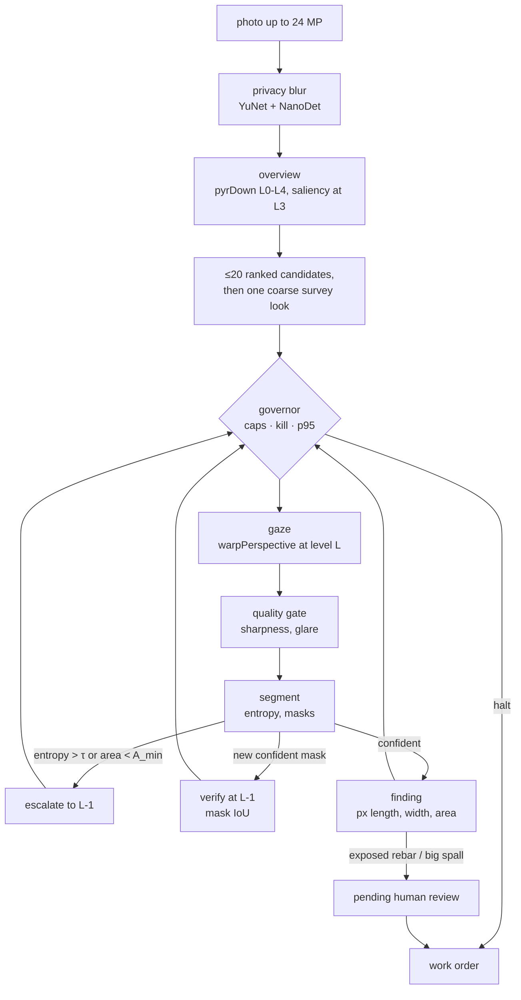

# Drishyam

**A virtual-PTZ inspector for bridge photos.** Drishyam (Sanskrit: *that which is
seen*) decides where to look in a huge photo, zooms until it is sure, drafts
findings with pixel measurements, asks a human to sign anything critical, and
spends compute in proportion to risk. Every camera move is an OpenCV 5
`pyrDown` / `warpPerspective` / `resize` call, so the agent's own actions are
the workload COOL accelerates on Graviton.

**What COOL can buy end to end, measured.** An 8-image macro run on the local x86 laptop ([results/local-macos-x86/macro.json](results/local-macos-x86/macro.json)) puts 9 % of a job in KleidiCV-covered imgproc, 69 % in the classical segmenter (imgproc plus NumPy), 3 % in crack thinning, 8 % in decode and 12 % in Python. So if COOL makes the covered ops 1.8× faster, a whole job gets about 1.04× faster. The gaze path itself is cheap; most of the time is in segmentation, which is where a COOL or DNN speed-up would have to land.

- **Live demo:** https://drishyam-seven.vercel.app (stock OpenCV 5 on Vercel, x86, *not COOL*)
- **Demo video (49 s):** [drishyam-demo.mp4](https://github.com/vj-io/drishyam/releases/latest/download/drishyam-demo.mp4) — a real job on the live site: survey, zoom, a human-signed critical finding, a planner failure drill and KILL
- **PRD:** [docs/PRD.md](docs/PRD.md) · **Requirement traceability:** [docs/requirements.md](docs/requirements.md) · **Security model:** [docs/security.md](docs/security.md) · **API:** [docs/api-contract.md](docs/api-contract.md) · **MCP:** [docs/mcp.md](docs/mcp.md)

## What it does



1. **Look where it matters.** A saliency prior from imgproc ops (Sobel, black-hat, adaptive threshold, CLAHE, rust-hue `inRange`) ranks up to 20 candidate windows on the 1/8-scale overview.
2. **Zoom until sure.** The next look is `argmax p·s·(1+u)·a / t̂` (prior × severity × uncertainty × unseen area ÷ predicted ms). An uncertain look (entropy > τ) or a tiny mask zooms one pyramid level finer on what it saw; a new confident mask is verified one level finer by mask IoU.
3. **Spend in proportion to risk.** Pixel, $ and seconds caps, a p95-latency governor (switches model, then coarsens), and a stop rule when the next look is worth less than a quarter of the average value per ms so far. Every step records the cause that chose it.
4. **A human signs anything critical.** Exposed rebar and large spalling wait in `pending_review`; only a human (web review, or `drishyam review`) can approve or reject. The agent, the MCP tools and the optional LLM planner have no path to that transition.

## Run it

```bash
uv sync --all-extras
```

```bash
make serve          # web app + UI on http://127.0.0.1:8000 (same CSP as production)
```

```bash
uv run drishyam run public/samples/bridge_03.jpg --pixel-cap 0.3
```

```bash
uv run drishyam review runs/<job>/work_order.json f1 approve --by "Your Name"
```

```bash
uv run drishyam mcp  # MCP server over stdio: 12 allow-listed tools, no approve tool, no shell
```

Tests: `make test` (unit, API, MCP, CLI, evals; same as CI) · browser e2e under the production CSP: `uv pip install playwright && .venv/bin/playwright install chromium && make e2e` · CI runs on x86 and arm64.

## Results

Measured on **200 held-out labelled synthetic images** (seed 7; policy changes were tuned only on a separate 60-image dev split), one segmenter and one matching rule for every policy (a ground-truth box is found by a same-class component with IoU ≥ 0.3 or containing its centre).

| Policy | pixels processed (× image) | recall | $ / image (modelled) |
| --- | --- | --- | --- |
| downscale once (1024 px) | 0.25 | 0.50 | 0.000074 |
| tiling, L2 grid | 0.06 | 0.44 | 0.000019 |
| tiling, L1 grid | 0.50 | 0.55 | 0.000139 |
| tiling, L0 (exhaustive, 20 % overlap) | 1.67 | 0.55 | 0.000443 |
| **Drishyam**, cap 5 % | 0.02 | **0.00** (no 512² look fits after the overview on a 3 MP image) | 0.000005 |
| **Drishyam**, cap 10 % | 0.10 | **0.30** | 0.000029 |
| **Drishyam**, cap 20 % | 0.18 | **0.43** | 0.000053 |
| **Drishyam**, cap 30 % | 0.25 | **0.48** | 0.000072 |
| **Drishyam**, cap 50 % | 0.37 | **0.53** | 0.000102 |
| **Drishyam**, cap 100 % | 0.47 | **0.54** | 0.000129 |

- At a **30 % cap** Drishyam finds **0.48** of the defects using **0.25** of the image's pixels: **0.88×** exhaustive tiling's recall at **0.15×** its pixels, 0.97× a same-pixel downscale.
- At a **50 % cap**: **0.53** at 0.37 of the pixels = **0.97×** tiling's recall at **0.22×** its pixels. **Verdict on the PRD hypothesis (≥ 0.9× tiling recall at ≤ 0.3 of the full-resolution pixels): not met** — at 0.25 of the pixels Drishyam reaches 0.88×. Measured against tiling's real pixel spend (1.67× the image, because tiles overlap), it reaches 0.97× at 0.22× from the 50 % cap.
- Honest caveats: the best tiling grid (L1, 0.55 at 0.50) still beats Drishyam at equal pixels, and the hysteresis segmenter shipped with this policy lifted every baseline too, so it is not a Drishyam-only gain.
- Critical false-accept rate (critical prediction with no critical ground truth): Drishyam @30 % 0.52 vs exhaustive tiling 0.79 (the PRD asks for ≤ tiling); a single downscale (0.49) and L2 tiling (0.42) are lower still.
- Agent: 100 % of steps carry a cause; 38 of 38 planner drills that fired were recovered by the rule planner (2 of the 40 injected never fired because those jobs finished first); governor drills 10/10; escalation rate 17 %; at the 30 % cap, 3 looks and 0.27 of the pixels per image (p50 = p95). Human-approval latency is not measured (the web demo is stateless) and the FR-21 ablations were not run.

The images are procedural (`evals/synth.py`): 2048×1536 weathered concrete with drawn cracks, spalls, efflorescence, exposed rebar and rust run-off, plus graffiti, formwork lines, water stains, blur and glare as distractors. The eight bundled samples in `public/samples/` come from the same generator. Measured on the real CODEBRIM set this would differ; that run is `make data && make eval DATA=data/codebrim`.


| per-class recall | crack | spalling | efflorescence | exposed_rebar | corrosion |
|---|---|---|---|---|---|
| Drishyam @30 % | 0.45 | 0.62 | 0.16 | 0.54 | 0.58 |
| tiling L0 | 0.47 | 0.70 | 0.25 | 0.52 | 0.75 |
| downscale | 0.48 | 0.57 | 0.22 | 0.44 | 0.66 |

Full numbers: [public/results/summary.json](public/results/summary.json); failure gallery (12 real cases, 6 categories): [public/results/failures.json](public/results/failures.json), also on the live site.

Drishyam's looking policy reads measured latency, so `make eval` on another machine moves recall by about ±0.01–0.02 and the drill counts by one or two; the committed numbers came from a 12-worker run on an 8-core Intel laptop.

Everything above is measured, on a **labelled synthetic** dataset, with the
**classical** segmenter (no learned weights). They show the looking policy, not
segmentation quality. The CODEBRIM evaluation the PRD calls for runs with
`make data && make eval`; the dataset (8.3 GB, non-commercial) is never
committed.

## Honest scope

| Built and tested here | Needs the owner's AWS account |
| --- | --- |
| Agent loop, governor, planner fallback, findings and human approval, privacy blur, MCP server, CLI, web API + UI, evaluation harness, benchmark scripts, Kaggle training and ONNX export, CI on x86 and Arm | COOL 3.1 AMI on c8g (Graviton4) and the three-arm benchmark, DynamoDB/SNS approval store, CloudWatch, CDK stack, EC2 auto-stop |

- The demo segmenter is a classical evidence-map engine so the agent runs with zero downloads; a dacl10k ONNX model drops in with `DRISHYAM_ONNX=/path/model.onnx` (see [training/](training/README.md)).
- Measurements are image pixels. There are no millimetres and no safety ratings.
- The web demo is stateless: the signed `work_order.json` is the audit trail.

## Licence

MIT. Bundled models: YuNet (MIT) and NanoDet-Plus (Apache 2.0) from OpenCV Zoo, see [models/README.md](models/README.md). Fonts: SIL OFL 1.1.
