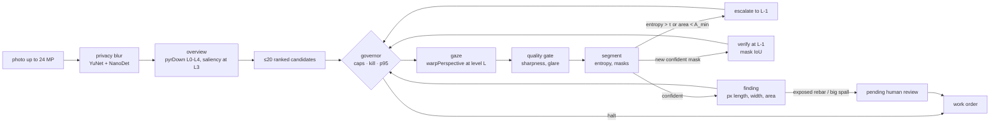

# Drishyam

**A virtual-PTZ inspector for bridge photos.** Drishyam (Sanskrit: *that which is
seen*) decides where to look in a huge photo, zooms until it is sure, drafts
findings with pixel measurements, asks a human to sign anything critical, and
spends compute in proportion to risk. Every camera move is an OpenCV 5
`pyrDown` / `warpPerspective` / `resize` call, so the agent's own actions are
the workload COOL accelerates on Graviton.

- **Live demo:** LIVE_URL (stock OpenCV 5 on Vercel, x86, *not COOL*)
- **PRD:** [docs/PRD.md](docs/PRD.md) · **Requirement traceability:** [docs/requirements.md](docs/requirements.md) · **Security model:** [docs/security.md](docs/security.md) · **API:** [docs/api-contract.md](docs/api-contract.md) · **MCP:** [docs/mcp.md](docs/mcp.md)

## What it does



1. **Look where it matters.** A saliency prior from imgproc ops (Sobel, black-hat, adaptive threshold, CLAHE, rust-hue `inRange`) ranks up to 20 candidate windows on the 1/8-scale overview.
2. **Zoom until sure.** The next look is `argmax p·s·(1+u)·a / t̂` (prior × severity × uncertainty × unseen area ÷ predicted ms). An uncertain look (entropy > τ) or a tiny mask zooms one pyramid level finer on what it saw; a new confident mask is verified one level finer by mask IoU.
3. **Spend in proportion to risk.** Pixel, $ and seconds caps, a p95-latency governor (switches model, then coarsens), and a stop rule when the next look is worth less than a quarter of the average value per ms so far. Every step records the cause that chose it.
4. **A human signs anything critical.** Exposed rebar and large spalling wait in `pending_review`; only a human (web review, or `drishyam review`) can approve or reject. The agent, the MCP tools and the optional LLM planner have no path to that transition.

## Run it

```bash
uv sync --all-extras
```

```bash
make serve          # web app + UI on http://127.0.0.1:8000 (same CSP as production)
```

```bash
uv run drishyam run public/samples/bridge_03.jpg --pixel-cap 0.3
```

```bash
uv run drishyam review runs/<job>/work_order.json f1 approve --by "Your Name"
```

```bash
uv run drishyam mcp  # MCP server over stdio: 12 allow-listed tools, no approve tool, no shell
```

Tests: `make test` (unit, API, MCP, CLI) · `tests/e2e/test_ui_live.py` (real browser against the real stack) · CI runs on x86 and arm64.

## Results

RESULTS_TABLE

Everything above is measured, on a **labelled synthetic** dataset, with the
**classical** segmenter (no learned weights). They show the looking policy, not
segmentation quality. The CODEBRIM evaluation the PRD calls for runs with
`make data && make eval`; the dataset (8.3 GB, non-commercial) is never
committed.

## Honest scope

| Built and tested here | Needs the owner's AWS account |
| --- | --- |
| Agent loop, governor, planner fallback, findings and human approval, privacy blur, MCP server, CLI, web API + UI, evaluation harness, benchmark scripts, Kaggle training and ONNX export, CI on x86 and Arm | COOL 3.1 AMI on c8g (Graviton4) and the three-arm benchmark, DynamoDB/SNS approval store, CloudWatch, CDK stack, EC2 auto-stop |

- The demo segmenter is a classical evidence-map engine so the agent runs with zero downloads; a dacl10k ONNX model drops in with `DRISHYAM_ONNX=/path/model.onnx` (see [training/](training/README.md)).
- Measurements are image pixels. There are no millimetres and no safety ratings.
- The web demo is stateless: the signed `work_order.json` is the audit trail.

## Licence

MIT. Bundled models: YuNet (MIT) and NanoDet-Plus (Apache 2.0) from OpenCV Zoo, see [models/README.md](models/README.md). Fonts: SIL OFL 1.1.
