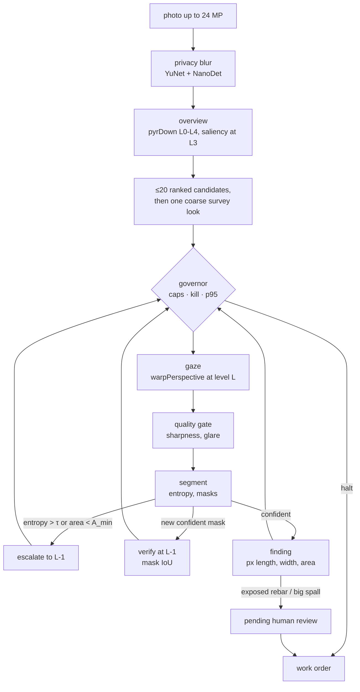

# Drishyam

**A virtual-PTZ inspector for bridge photos**, entered in the OpenCV AI Competition 2026, powered by AWS. It is for
bridge inspectors working through photo backlogs (624,939 US bridges, 41,148 in poor condition, each routinely
inspected at intervals of up to 24 months; [docs/impact-sources.md](docs/impact-sources.md)). Drishyam (Sanskrit:
*that which is seen*) decides where to look in a huge photo, zooms in where it is unsure (with the live v1 engine,
no finer than half size on a 2048-px photo), drafts findings with pixel measurements, asks a human to sign anything
critical, and stops looking when the next look is worth less than it costs. Every camera move is an OpenCV
`pyrDown` / `warpPerspective` / `resize` call. The live demo runs the stock opencv-python-headless 5.0.0 wheel on Lambda arm64.
That pinned wheel's aarch64 build already includes KleidiCV 26.03 and carotene: on GitHub's arm64 runner its
`cv2.getBuildInformation()` reads "Custom HAL: YES (carotene (ver 0.0.1) KleidiCV (ver 26.03))"
([results/linux-aarch64/micro.json](results/linux-aarch64/micro.json); the Lambda's own build information is not
recorded).

- **Live demo:** https://d1xg58guluup8c.cloudfront.net (stock OpenCV 5 on AWS Lambda arm64 behind CloudFront, *not COOL*; [docs/aws.md](docs/aws.md))
- **Report:** [docs/report.md](docs/report.md) · **Architecture:** [docs/architecture.png](docs/architecture.png) · **Agent loop:** [docs/agent-loop.svg](docs/agent-loop.svg) · **Claude driving it over MCP (recorded):** [docs/mcp-session/transcript.md](docs/mcp-session/transcript.md) · **Why it matters, with sources:** [docs/impact-sources.md](docs/impact-sources.md)
- **PRD:** [docs/PRD.md](docs/PRD.md) · **Requirement traceability:** [docs/requirements.md](docs/requirements.md) · **Security model:** [docs/security.md](docs/security.md) · **API:** [docs/api-contract.md](docs/api-contract.md) · **MCP:** [docs/mcp.md](docs/mcp.md)

## Results at a glance

Recall is the share of labelled defects found at the 30 % pixel cap, with paired 95 % bootstrap intervals over
photos; chance is the same model's boxes moved to random places, and IoU-only drops the contains-the-centre match
([report, section 8](docs/report.md#8-evaluation)). Each segmenter was scored once on the held-out sets
([results/heldout_models.json](results/heldout_models.json)); `tests/test_report_doc.py` fails if a number here
drifts from that file or, for the Lambda timings, from [docs/aws.md](docs/aws.md).

| Segmenter | CODEBRIM recall (95 % CI) | chance | IoU-only (chance) | synth200 recall (95 % CI) | clean photos with a box | critical boxes per CODEBRIM photo |
| --- | --- | --- | --- | --- | --- | --- |
| **v1 (live)** | 0.49 (0.44–0.54) | 0.30 | 0.25 (0.08) | 0.64 (0.61–0.67) | 0 of 51 | 9.60 |
| v2a | 0.48 (0.43–0.52) | 0.30 | 0.24 (0.08) | 0.61 (0.57–0.64) | 9 of 51 | 4.38 |
| v2b | 0.49 (0.44–0.53) | 0.28 | 0.25 (0.08) | 0.57 (0.53–0.61) | 9 of 51 | 4.65 |
| v2c | 0.48 (0.44–0.53) | 0.28 | 0.23 (0.07) | 0.57 (0.54–0.61) | 22 of 51 | 3.71 |
| classical engine | 0.19 (0.16–0.23) | 0.12 | 0.08 (0.03) | 0.48 (0.44–0.52) | 34 of 51 | 1.73 |

- **v1 runs live since 2026-10-21** (deployed commit 4fe8e30, smoke-tested: [docs/aws.md](docs/aws.md)). It was
  chosen on the dev splits only ([results/dev/model_choice_dev.json](results/dev/model_choice_dev.json)); held out
  it is again the only model with no measurable loss against any other. These are its second scorings (one earlier,
  unpublished). Its CC BY-NC 4.0 weights are release assets of v1.1.0, not in git.
- **What the held-out runs measured:** the governor off and the 512-px FP32 net on every look. Live, the v1
  profile's SLA is 1500 ms, so looks stay on the 512-px FP32 net unless steps exceed 1.5 s. v1's finest look is L1
  (half size) on a 2048-px photo and L2 on a 4608-px one, so on these photos it never looks at full resolution.
- **Against the classical engine,** v1 finds 2.54× (2.16–3.01) its recall on CODEBRIM and 1.34× (1.24–1.45) on
  synth200, and puts no box on a clean photo where the classical engine puts 7.08 per photo. But chance is high on
  CODEBRIM because its boxes are large; it sends 5.5 times the critical boxes to the human gate (at that rate, about 24,000
  for a 2,536-photo bridge inspection, an extrapolation from CODEBRIM photos); its modelled ms per CODEBRIM job are 1.99× (CI 1.92–2.06); and on the
  Lambda its step p95 was 0.52 to 1.14 s, against 67.7 to 88.0 ms.
- **Where v1 fails:** on synthetic photos it finds no efflorescence (0.00) and almost no exposed rebar (0.02), where
  the classical engine finds 0.16 and 0.57; on one of our own wall photos it flagged nothing although a hairline
  crack is visible by eye ([report, section 9](docs/report.md#9-failures)).
- **The classical engine** (the deployed demo until 2026-10-21, and every policy comparison) does not let the agent
  beat the simple baselines: on synth200 it is 0.87× exhaustive tiling (0.81–0.93) at 0.16× its pixels, so the PRD
  hypothesis (at least 0.9× tiling's recall at no more than 0.3× its pixels) is not met, and 0.96× one 1024-px
  downscale (0.91–1.02); it finds 0.19 of CODEBRIM's defects, 0.98× one downscale (0.90–1.06).

## What it does



1. **Look where it matters.** A saliency prior from imgproc ops (Sobel, black-hat, adaptive threshold, CLAHE, rust-hue `inRange`) ranks up to 20 candidate windows on the 1/8-scale overview.
2. **Zoom until sure.** The next look is `argmax p·s·(1+u)·a / t̂` (prior × severity × uncertainty × unseen area ÷ predicted ms). An uncertain look (entropy > τ) or a tiny mask zooms one pyramid level finer on what it saw; a new confident mask is verified one level finer by mask IoU. With v1, the live engine, a look spans at least 0.3 of the photo's long side (its profile's `min_view`), so its finest level is L1 (half size) on a 2048-px photo and L2 on a 4608-px one; a look there is not escalated or verified further.
3. **Stop when a look is not worth its cost.** The job ends when the best next look is worth less than a quarter of the value per ms realised so far, or than the value of a look that finds nothing once every candidate left has been seen as finely as its first look would see it, inside pixel, $ and seconds caps and a p95-latency governor (switches model, then coarsens). Every step records the cause that chose it.
4. **A human signs anything critical.** Exposed rebar and large spalling wait in `pending_review`; only a human (web review, or `drishyam review`) can approve or reject. The agent, the MCP tools and the optional LLM planner have no path to that transition.

No LLM runs in the live demo: the deployed agent is the rule policy above, and its planner failure drills use planners scripted to time out or answer junk. The LLM path is the MCP server; in a [recorded session](docs/mcp-session/transcript.md) Claude chose each call from the measured IoU and entropy (its prompt states the decision rules). The full system, AWS included, is in [docs/architecture.png](docs/architecture.png), and the loop in [docs/agent-loop.svg](docs/agent-loop.svg).

## Run it

```bash
uv sync --all-extras
```

Web app and UI on http://127.0.0.1:8000 (same CSP as production):

```bash
make serve
```

```bash
uv run drishyam run public/samples/bridge_03.jpg --pixel-cap 0.3
```

`run` ends by printing its work order path and a review command template; use that job id in place of `j_XXXXXX`:

```bash
uv run drishyam review runs/j_XXXXXX/work_order.json f1 approve --by "Your Name"
```

MCP server over stdio (12 allow-listed tools, no approve tool, no shell):

```bash
uv run drishyam mcp
```

Tests: `make test` (unit, API, MCP, CLI, evals; same as CI) · browser e2e under the production CSP: `uv pip install playwright && .venv/bin/playwright install chromium && make e2e` · CI runs on x86 and arm64.

## Results

Every policy uses one segmenter and one matching rule (a ground-truth box is found by a same-class component with IoU ≥ 0.3 or containing its centre; "IoU-only" drops the centre clause); the 95 % intervals are a paired bootstrap over images, and "chance" is each policy's own boxes moved to random places. Methods, the per-cap tables and the caveats are in the [report, section 8](docs/report.md#8-evaluation).

With the classical engine (published runs of 2026-10-18, agent of commit 832299b):

- **200 held-out synthetic images (2048×1536):** at a 30 % pixel cap Drishyam finds 0.48 of the defects using 0.26 of the image's pixels: 0.87× exhaustive tiling's recall (95 % CI 0.81–0.93) at 0.16× its pixels (512-px full-resolution tiles overlapping 20 %, so tiling reads 1.67× the image), so the PRD hypothesis (≥ 0.9× tiling recall at ≤ 0.3× its pixels) is **not met**. A single 1024-px downscale (0.50 at 0.25 of the pixels) does at least as well: Drishyam is 0.96× of it (95 % CI 0.91–1.02). Chance scores 0.03.
- **100 synthetic images at CODEBRIM's 4608×3456:** zooming beats one downscale, narrowly (0.52 against 0.45, 1.14×, 95 % CI 1.04–1.25), but a coarse L2 tiling grid (the same 512-px tiles on pyramid level 2, the image at a quarter of its width and height) finds 0.53 with about a third of Drishyam's pixels (0.10 against 0.29).
- **200 real CODEBRIM photos:** every policy, Drishyam included, finds about one labelled defect in five (Drishyam at 30 %: 0.19, chance 0.12; IoU-only 0.08, chance 0.03). Drishyam is 0.94× exhaustive tiling (95 % CI 0.85–1.04) and 0.98× one downscale (0.90–1.06), so it does not beat the simple baseline here. The classical segmenter, tuned on synthetic images, is the limit: it misses spalling (0.00) and exposed rebar (0.01). CODEBRIM's licence bars sharing the photos, so only numbers and text descriptions of the failures are published.
- **The trained segmenters, held out** ([results/heldout_models.json](results/heldout_models.json), [report, section 8](docs/report.md#the-trained-segmenters-held-out)): four dacl10k-trained models, each scored once per held-out set at the profile and on the cost table chosen on dev. At the 30 % cap v1, the dev choice, finds 0.49 of the 200 CODEBRIM photos' defects (95 % CI 0.44–0.54) against the classical engine's 0.19, 2.54× (2.16–3.01; chance is high here, 0.30, as its boxes are large; with IoU only, 0.25 against a chance of 0.08), and 0.64 on synth200 (0.61–0.67) against 0.48, and it puts no box on any of the 51 clean photos (the classical engine 7.08 per photo). Held-out confirms the dev choice: v1 is the only model with no measurable loss against any other. v2a and v2b find the same share of CODEBRIM's defects, less on synth200 (v1 is 1.05× and 1.12× them) and put a box on 9 of the clean photos each. v1's costs: twice their critical boxes per CODEBRIM photo for the human gate (9.60 against 4.38 and 4.65) and 1.99× the classical engine's modelled ms per CODEBRIM job (x86 tables). v2c, v2a's net retrained with the rare classes weighted harder, scored last: the same share of CODEBRIM's defects, less than v1 and v2a on synth200 (v1 is 1.12× it), a box on 22 of the 51 clean photos (3.16 per photo), and the fewest critical boxes for the gate (3.71 per CODEBRIM photo); it changes neither the dev choice nor this verdict. No eval photo is a near-duplicate of a dacl10k image (0 candidates of 200 against 8,922). v1 had been scored on CODEBRIM eval200 and synth200 once before, unpublished. v1 is the live segmenter since 2026-10-21. These runs had the governor off and used the 512-px FP32 net on every look; live, the v1 profile's SLA is 1500 ms, so looks stay on the 512-px FP32 net unless steps exceed 1.5 s.
- **Agent control:** 100 % of steps carry a cause; 40 of 40 planner drills and 10 of 10 governor drills recovered. At the 30 % pixel cap the cap, not the stop rule, ends 189 of 200 synthetic and 194 of 200 CODEBRIM jobs; uncapped, the stop rule ends 185 of 200 synthetic jobs.
- **Ablations (FR-21):** each variant flips one switch of the agent, same caps and fixed costs ([public/results/ablations.json](public/results/ablations.json)). At the 30 % cap, dropping the survey look lowers recall on every set (0.91× the full agent on the 2048×1536 set, 95 % CI 0.85–0.97; 0.86× at 4608×3456; 0.66× on CODEBRIM). Random gaze order is below the full agent at 4608×3456 (pooled 95 % CI 0.82–0.92) and on CODEBRIM (0.92–1.00) but matches it on the 2048×1536 set (0.97–1.00). At the 30 % cap the uncertainty term, the seeding of unvisited candidates by every look, the stop floor and the governor change nothing measurable; uncapped on the 2048×1536 set the uncertainty term and the seeding earn a little recall (without them 0.98×, 0.96–0.99, and 0.92×, 0.89–0.95). For the governor: the policy comparison runs with the governor's model, level and gaze-size overrides off, and turned on they never act, because under fixed costs its latency rules never fire, so its response is shown by the 10 governor drills instead. Without the verify step recall is slightly higher at the 30 % cap on the 2048×1536 set (1.03×, 1.00–1.06) and lower uncapped there (0.96×, 0.94–0.98). None of these intervals is corrected for multiple comparisons.
- **Measured and not adopted** (dev splits only, each read by a rule written down before its run): the classical
  agent's tuning knobs, where `tau_scout` 0.7 was adopted and then reverted because its synth_dev gain was not
  measurable (1.03×, 0.98–1.09) ([results/dev/tune_sweep.json](results/dev/tune_sweep.json)); a two-model cascade
  (v2a scouting, v2b confirming), with lower recall than v2a alone on CODEBRIM dev100 (0.83×, 0.73–0.93) and on
  synth_dev (0.91×, 0.85–0.98)
  ([results/dev/cascade_dacl10k_v2a+v2b.json](results/dev/cascade_dacl10k_v2a+v2b.json)); INT8, which OpenCV 5.0.0
  runs only statically quantized and only on `ENGINE_NEW`, slower than FP32 on the x86 Mac (one 512-px forward on
  one thread: 1066.6 and 1391.1 ms against FP32's 686.7), and whose QDQ crack masks overlap FP32's at IoU 0.37
  ([docs/bench.md](docs/bench.md#int8-can-opencv-5s-dnn-run-a-quantized-dacl10k)); and prefetching the next look,
  which slowed steps on x86 at 2 and 4 threads and never ran on the function.
- **Arm against x86** (GitHub's runners, one run each, shared VMs, not the Lambda): the Arm runner did 5.13 images/s
  against x86's 4.06 in the 200-image macro run on one thread, and ran the agent loop at 1.21 times x86's jobs/s on
  one thread and 1.27 times on four ([report, section 6](docs/report.md#6-opencv-5-implementation)).


(The live site's FIG. 4.1, rendered from the committed `public/results/summary.json` and, dashed red, v1's run on the same images, `public/results/synth_dacl10k/summary.json`: bars are the 95 % intervals, dotted ticks the chance level. `scripts/render_figures.py` re-renders this image and `docs/architecture.png`; like the e2e tests, it needs Playwright.)

Full numbers: [public/results/summary.json](public/results/summary.json), [public/results/large/summary.json](public/results/large/summary.json), [public/results/codebrim/summary.json](public/results/codebrim/summary.json), [public/results/ablations.json](public/results/ablations.json), false alarms on images with no damage: [public/results/clean/summary.json](public/results/clean/summary.json); every prediction and trace: [public/results/per_image.json.gz](public/results/per_image.json.gz); failure gallery: [public/results/failures.json](public/results/failures.json), also on the live site.

## COOL on Graviton (not run)

COOL on Graviton was not run: the Marketplace AMI could not be subscribed from our AWS account. It is an AWS India (AISPL) account, whose card restriction terminated the Marketplace agreement seconds after subscribing (a support case is open). The three-arm scripts are in [bench/](bench/README.md).

**What COOL could buy end to end, from GitHub's arm64 runner.** A 200-image macro run with the stock aarch64 wheel on GitHub's `ubuntu-24.04-arm` runner (Neoverse-N2, one thread; a GitHub Actions VM, not the Lambda; [results/linux-aarch64/macro.json](results/linux-aarch64/macro.json)) puts 8 % of a job in KleidiCV-covered imgproc, 74 % in the classical segmenter (imgproc plus NumPy), 4 % in crack thinning, 7 % in decode and 7 % in Python. So if COOL made the covered ops 1.8× faster, a whole job would get about 1.04× faster (the x86 laptop's 8-image run, [results/local-macos-x86/macro.json](results/local-macos-x86/macro.json), gives the same 1.04×). The gaze path itself is cheap; most of the time is in segmentation, which is where a COOL or DNN speed-up would have to land. The stock aarch64 wheel the live demo runs already links KleidiCV 26.03, so any COOL gain would come on top of that.

**Arm against x86 on GitHub's runners** (one run each, same wheel version, 4 logical CPUs each, shared VMs, not the Lambda; [docs/bench.md](docs/bench.md#arm-against-x86-on-github)). Against `ubuntu-24.04` (AMD EPYC 7763, IPP HAL), the Arm runner ran the agent loop at 1.17 to 1.27 times the jobs per second and the macro job at 1.26 times the images per second (per-image p50 195.8 against 248.2 ms), most of the gap in the classical segmenter. On one thread x86 won 12 of the 24 kernel and size pairs (but 6 of the 24 differ by less than 6 %, close enough to flip in another run), black-hat and top-hat by about 2 times, and ran the NanoDet forward in 0.61 of Arm's time; on 4 threads Arm won 23 of 24. Every ratio mixes core, OpenCV build and VM.

## Honest scope

| Built and tested here | Deployed on AWS (us-east-1) and smoke-tested | Not done |
| --- | --- | --- |
| Agent loop, governor, planner fallback, findings and human approval, privacy blur, MCP server, CLI, web API + UI, evaluation harness, benchmark scripts, dacl10k training notebook and ONNX export, CI on x86 and Arm | CDK stack: CloudFront + OAC + WAF, Lambda arm64 (Function URL, AWS_IAM), DynamoDB kill flags, Secrets Manager HMAC key, CloudWatch (EMF, 4 alarms, dashboard), X-Ray, Budget. The live segmenter is v1 (`onnx:drishyam_dacl10k.onnx`, since 2026-10-21). The alarms and the budget publish to an SNS topic whose email subscription is confirmed: a test alarm reached the owner's email on 2026-10-21 ([docs/aws.md](docs/aws.md)) | COOL three-arm benchmark (AMI subscription blocked); approval store (not built: the web demo is stateless and the signed `work_order.json` is the audit trail) |

- The live demo runs v1, a dacl10k-trained ONNX model ([models/README.md](models/README.md)), on OpenCV 5 DNN `ENGINE_NEW` with `DRISHYAM_ONNX=/path/model.onnx` (see [training/](training/README.md); `ENGINE_CLASSIC` cannot import it, and a DeepLabV3+ export that failed parity on OpenCV 5.0.0 was dropped: [report, section 6](docs/report.md#6-opencv-5-implementation)). Its held-out results are under Results; its CC BY-NC 4.0 weights ship in the Lambda package and as release assets of v1.1.0, and are not committed. Without `DRISHYAM_ONNX` the classical evidence-map engine (`classical-v1`, no weights) runs and needs no downloads.
- Two samples are our own photos of a painted plaster wall (`public/samples/real_01.jpg`, `real_02.jpg`: labelled "REAL PHOTO (ours), painted plaster wall, no ground truth", no EXIF or GPS), and the site's **Watch it on a real wall** replays the v1 segmenter's recorded run on each (`real_0N.ndjson`, fixed costs from `results/local-macos-x86-dacl10k-retime/`). With no ground truth nothing is scored: on `real_02` it took one look and flagged one crack (a draft, not critical); on `real_01` it saw no region worth a look and flagged nothing, so it missed the hairline crack we see by eye: the overview proposed no candidate, so the segmenter never ran ([report, section 9](docs/report.md#9-failures)).
- Measurements are image pixels. There are no millimetres and no safety ratings.
- The web demo is stateless: the signed `work_order.json` is the audit trail. There is no approval database: the PRD's DynamoDB/SNS approval store was not built ([docs/security.md](docs/security.md), "Known limits").

## Team

- Vaibhav Jangid, lead engineer (agent policy, OpenCV pipeline, evaluation, AWS deployment)
- Bhavya Dhoot, design, demo and presentation (site design, video)

## Licence

MIT. Bundled models: YuNet (MIT) and NanoDet-Plus (Apache 2.0) from OpenCV Zoo, see [models/README.md](models/README.md). Fonts: SIL OFL 1.1.

The trained `drishyam_dacl10k` segmenter is not covered by the MIT licence: its weights are [CC BY-NC 4.0](https://creativecommons.org/licenses/by-nc/4.0/) (non-commercial; trained on [dacl10k](https://github.com/phiyodr/dacl10k-toolkit)), are not committed to this repository (the v1 files, `drishyam_dacl10k.onnx` and `.fp16.onnx`, are release assets of v1.1.0, with their sha256), and carry their own licence file, [models/LICENSE.drishyam_dacl10k](models/LICENSE.drishyam_dacl10k).
