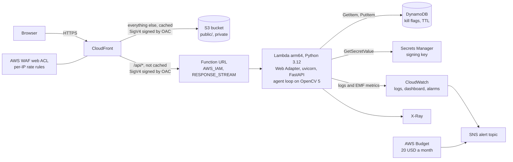

# AWS deployment

The web demo (the FastAPI app and the static site) runs on AWS only, as one CDK (Python) stack in
`us-east-1`: the API on Lambda arm64 (Graviton) and the static site in a private S3 bucket, both reached
only through CloudFront and AWS WAF.

**Status: deployed** on 2026-10-18 (India time) to `us-east-1` from commit ca69037 and smoke-tested. The latest
smoke run (`scripts/aws.sh smoke` with `WAF_LOOP=1`: checks 1 to 5 and 7 under [Smoke](#smoke)) passed:
`/api/health` answered from `aws-lambda` on `aarch64` with OpenCV 5.0.0 (`stock (not COOL)`) and commit ca69037, a
job on `bridge_03.jpg` streamed to `done` (`awaiting_review`, 6 steps), KILL halted a second job after 3 steps, an
unsigned `POST` through CloudFront got 403, the raw Function URL got 403, the WAF answered 429 at the 14th
empty-bodied job start, and the step p95 was 67.7 ms over the first job's 6 steps. An earlier run against the same
build, three minutes before and without the WAF check, also passed but measured more weakly: step p95 83.7 ms over
6 steps, and KILL halted the second job only after 6 steps. Both summary lines, copied here because
`runs/aws-smoke.log` is git-ignored (the timestamps are UTC):

```
smoke 2026-10-18T07:09:20Z https://d1xg58guluup8c.cloudfront.net commit=ca690371bf3c21eb5efc61f58f9048322a41ec52 package=vSxCotfLF5Ja/atXtqO5ddXcvT9YHElpHTOQZ8woQvA= ttfb_first=1.307764s ttfb_warm=1.241300s step_p95_ms=83.7 result=pass
smoke 2026-10-18T07:12:25Z https://d1xg58guluup8c.cloudfront.net commit=ca690371bf3c21eb5efc61f58f9048322a41ec52 package=vSxCotfLF5Ja/atXtqO5ddXcvT9YHElpHTOQZ8woQvA= ttfb_first=1.267549s ttfb_warm=1.335864s step_p95_ms=67.7 result=pass
```

On the live site the WAF's 429 carries the JSON body `{"error": "rate limited: 10 job starts per 2 min per IP; wait
and retry"}`, and a review reply carries `prev_token_sha256` (both checked on 2026-10-18).
**Until the next deploy:** the deployed build (commit ca69037, `/api/health` version 1.0.2) predates the numbers in
the README and the report, so its FIG. 4 and FIG. 5 show the evaluation from before the arm64 re-run (commit 46f01b5)
and its guided-run button still says "about 45 s". The costs below are list-price estimates until the first bill; the
dashboard screenshot is not added yet.

Three parts depend on app changes made outside `infra/` (all three are in):
`drishyam/web.py` must read the signing key from the secret named by `DRISHYAM_SIGNING_KEY_SECRET_ARN`
and keep KILL flags in the table named by `DRISHYAM_KILL_TABLE` (otherwise each Lambda environment signs
with its own key and KILL never reaches the job), and must print one EMF line per job for the dashboard;
`public/js/api.js` must send `x-amz-content-sha256` on every POST (otherwise CloudFront answers 403).
`scripts/aws.sh deploy` checks for the first and the last (it greps `web.py` for `DRISHYAM_KILL_TABLE`
and `api.js` for `x-amz-content-sha256`) and refuses to deploy without them.

## Deploy in your own account

Prerequisites: a clone of this repository; [uv](https://docs.astral.sh/uv/) (the package build and the
CDK environment use it); Node.js 22 or 24 for `npx aws-cdk@2.1145.0` (the CDK's jsii runtime lists
those as supported and warns on others); AWS CLI v2; `curl`, `jq` and `shasum` for the smoke test; and an
AWS CLI profile with administrator rights that is not the account root user (`cdk bootstrap` and
`cdk deploy` create IAM roles). Everything goes to `us-east-1`. Then, from the repository root, with
your 12-digit account id and profile name in the first line:

```
export ACCOUNT=123456789012 AWS_PROFILE=my-admin
scripts/aws.sh deploy
scripts/aws.sh smoke
scripts/aws.sh destroy
```

`deploy` refuses a profile whose account is not `ACCOUNT` (without `ACCOUNT` it expects the owner's
account, 242441136319), asks before applying IAM changes, and prints the site URL. If your account's
Lambda concurrency quota is below 105 (the owner's account has 10), it stops and prints two ways forward;
the shorter is to run it as `RESERVED=none scripts/aws.sh deploy` (see [Operate](#operate)). Left
running, the stack costs about what the [Cost estimate](#cost-estimate) says, mostly the WAF; `destroy`
removes it, except the `CDKToolkit` bootstrap stack and one small log group (see [Operate](#operate)).

## Architecture



| Part | What it does | Why |
| --- | --- | --- |
| Lambda `drishyam-web` | Python 3.12 zip on arm64, 3008 MB, 60 s timeout, X-Ray active tracing. The live deployment has no reserved concurrency (`RESERVED=none`): the account quota of 10 is the cap. The stack reserves 5 by default, where the quota allows (see [Operate](#operate)) | Graviton is the target the CI's `ubuntu-24.04-arm` job already tests; the cap bounds the worst-case bill |
| Lambda Web Adapter | Public layer `arn:aws:lambda:us-east-1:753240598075:layer:LambdaAdapterLayerArm64:30` (adapter 1.1.0, the version the [awslabs/aws-lambda-web-adapter README](https://github.com/awslabs/aws-lambda-web-adapter) lists; the layer's own description says `arm64: 1.1.0`). Handler `run.sh` starts `uvicorn drishyam.web:app` on port 8080; `AWS_LAMBDA_EXEC_WRAPPER=/opt/bootstrap`, `AWS_LWA_INVOKE_MODE=response_stream` | The app runs unchanged; NDJSON events stream to the browser as they are produced |
| Function URL | `AuthType AWS_IAM`, `InvokeMode RESPONSE_STREAM` | Nobody can call it without a SigV4 signature, so the WAF cannot be bypassed |
| CloudFront | Two origins, each with Origin Access Control. `/api/*` goes to the Function URL: not cached, all methods, all viewer headers and the query string forwarded, no compression, 60 s read timeout. Everything else goes to the S3 bucket, cached (`CachingOptimized`), `/` serves `index.html`, with a response headers policy built from `infra/headers.json` (CSP, HSTS, `X-Frame-Options`, `Referrer-Policy`, `nosniff`, `Permissions-Policy`, COOP, CORP; `web.py` serves the same file's headers in local runs, and `tests/test_infra.py` fails if the policy differs from it) | Lambda runs one request per environment, so a cold page load (about 30 files) through the function would hit the concurrency cap and get 429s; static invocations would also crowd out jobs and water down the Duration p95 alarm |
| S3 bucket | Private (all public access blocked, TLS only, SSE-S3); only this distribution may read objects. CDK's `BucketDeployment` uploads `public/` on every deploy that changes it, deletes files no longer there and invalidates `/*`. `destroy` empties and deletes it | The static site off the function, with the same headers as in local runs |
| AWS WAF | Web ACL (scope `CLOUDFRONT`, which must live in `us-east-1`). Rule `job-starts`: `POST /api/jobs`, 10 per IP per 120 s. Rule `kill-and-review`: `/api/kill` plus `/api/review`, 30 per IP per 60 s. Rule `all-requests`: every request, 300 per IP per 60 s (a page load is about 30). Paths are matched after URL decoding. Blocked requests get 429 with a JSON body that names the rule's limit, such as `{"error": "rate limited: 10 job starts per 2 min per IP; wait and retry"}` | A cap on job starts, the expensive call; one on the two other `POST` endpoints; and a ceiling on everything else, such as cache-busting `GET /api/health` floods. Trade-offs under Limits |
| DynamoDB kill table | On demand, partition key `k` (string), TTL attribute `exp` | `/api/kill` lands in a different Lambda environment from the job it stops; an in-process flag cannot reach it |
| Secrets Manager | A 64-character key generated by CloudFormation, never in the repo or the template | Every Lambda environment signs and verifies work orders with the same key |
| CloudWatch | Log group (14-day retention); dashboard `Drishyam` (jobs by status, job seconds, pixels used, steps and findings, reviews by decision, and the function's invocations, errors, throttles, duration and concurrency); alarms on Errors (at least 1 in 5 min), Throttles (at least 1 in 5 min), Duration p95 (over 45 s) and AppErrors (at least 1 in 5 min). AppErrors is a metric filter on the log group for `ERROR drishyam` (an unhandled 500 or a failed job, which `web.py` logs from the `drishyam` logger) or uvicorn's `Exception in ASGI application` | Behind the Web Adapter a FastAPI 500, or a job that ends in an `{"type": "error"}` event inside a 200 stream, is a successful invocation, so the Errors alarm only sees timeouts, crashes and init failures |
| SNS + Budget | Alarms and a 20 USD monthly cost budget (alerts at 50 % and 100 % of actual cost, credits not counted) publish to one topic. Its one subscription, the owner's email, awaits confirmation (`ListSubscriptionsByTopic`, 2026-10-18), so until it is confirmed the alerts reach nobody | Credits would otherwise hide real spend |

No VPC, no NAT, no container image (CDK's bootstrap bucket holds the zips).

## IAM

| Principal | Actions | Resource and conditions |
| --- | --- | --- |
| Function role (no managed policies) | `logs:CreateLogStream`, `logs:PutLogEvents` | The function's own log group |
| | `dynamodb:GetItem`, `dynamodb:PutItem` | The kill table |
| | `secretsmanager:GetSecretValue` | The signing-key secret |
| | `xray:PutTraceSegments`, `xray:PutTelemetryRecords` | `*` (X-Ray has no resource-level permissions) |
| `cloudfront.amazonaws.com` (function resource policy) | `lambda:InvokeFunctionUrl` and `lambda:InvokeFunction` (the second only via the URL) | `SourceArn` is this distribution. Lambda requires both actions for Function URL calls ([CloudFront docs](https://docs.aws.amazon.com/AmazonCloudFront/latest/DeveloperGuide/private-content-restricting-access-to-lambda.html)) |
| `cloudfront.amazonaws.com` (bucket policy) | `s3:GetObject` | Objects in the site bucket; `SourceArn` is this distribution. The policy also denies any request without TLS |
| `cloudwatch.amazonaws.com` (topic policy) | `sns:Publish` | The alert topic; this account's alarms only |
| `budgets.amazonaws.com` (topic policy) | `sns:Publish` | The alert topic; this account's budgets only |

Two more roles exist only for deploy and destroy; CDK generates them and nothing at request time can
use them. Both have the managed policy `AWSLambdaBasicExecutionRole` (write their own logs).

| Deploy-time role | Actions | Resource |
| --- | --- | --- |
| `BucketDeployment` function (runs on deploys that change `public/`) | `s3:GetObject*`, `s3:GetBucket*`, `s3:List*` | CDK's bootstrap asset bucket |
| | the same plus `s3:PutObject*`, `s3:DeleteObject*`, `s3:Abort*` and the object tagging, retention and legal-hold puts | The site bucket |
| | `cloudfront:CreateInvalidation`, `cloudfront:GetInvalidation` | `*` (CDK's construct does not scope it) |
| Auto-delete function (runs on `destroy`, granted in the bucket policy) | `s3:GetBucket*`, `s3:List*`, `s3:DeleteObject*`, `s3:PutBucketPolicy` | The site bucket |

`tests/test_infra.py` synthesises the stack and fails if the web function's role gains any other action,
any other `*` resource or a managed policy, or if a public invoke permission appears.

## What clients must send

CloudFront signs each request to the Function URL, but Lambda does not accept an unsigned body, so every
`POST` (`/api/jobs`, `/api/kill`, `/api/review`) must carry `x-amz-content-sha256`: the lowercase hex
SHA-256 of the exact body bytes ([CloudFront docs](https://docs.aws.amazon.com/AmazonCloudFront/latest/DeveloperGuide/private-content-restricting-access-to-lambda.html),
"Important"). Without it the request gets 403. The page computes it with `crypto.subtle.digest`; with
curl (works in zsh and bash):

```
h=$(shasum -a 256 < public/samples/bridge_03.jpg | cut -d' ' -f1)
curl -N -H 'Content-Type: image/jpeg' -H "x-amz-content-sha256: ${h}" --data-binary @public/samples/bridge_03.jpg "https://d1xg58guluup8c.cloudfront.net/api/jobs?pixel_cap=0.3"
```

The alternative, a Function URL with `AuthType NONE`, needs no hash but lets anyone skip CloudFront and
the WAF by calling the URL directly; this stack does not use it.

## Operate

Run these from the repository root. They use the CLI profile `drishyam` (account 242441136319) and
`us-east-1`; `AWS_PROFILE` overrides the profile and `ACCOUNT` the account `deploy` expects.

```
scripts/aws.sh deploy
scripts/aws.sh smoke
scripts/aws.sh stop
scripts/aws.sh start
scripts/aws.sh destroy
```

- `deploy` checks that the app-side changes are in (see the top of this page), checks that the profile's
  account is `ACCOUNT`,
  builds `build/lambda/` (`scripts/build_lambda.sh`), creates `.venv-infra/` with `infra/requirements.txt`
  if it is missing, runs `cdk bootstrap` (a no-op once done) and `cdk deploy` with the CDK CLI
  `aws-cdk@2.1145.0` through `npx`, and prints the site URL. `cdk deploy` runs with its default approval
  level, so it lists every IAM or security-policy change and waits for a yes before applying it (it
  fails without a terminal). The CloudFront invalidation is part of the stack's `BucketDeployment`.
- `smoke` runs `scripts/smoke.sh` on the deployed URL (below).
- `stop` sets reserved concurrency to 0: every request is refused with a throttle, nothing runs and
  Lambda bills nothing. `start` undoes it; on a deployment without a reservation, such as the live one,
  run it as `RESERVED=none scripts/aws.sh start`. A redeploy does not undo `stop`, because the template
  value did not change.
- `destroy` deletes the stack, including the site bucket and its files. What stays: the CDK bootstrap
  stack (`CDKToolkit`, with the uploaded zips) and the log group that the bucket's auto-delete function
  creates when it runs.

**Who deploys:** today the `drishyam` profile is the account root user: `aws sts get-caller-identity`
returned `arn:aws:iam::242441136319:root` on 2026-10-18, through an `aws login` session
(`login_session` in `~/.aws/config`, so no long-lived keys). AWS advises against using root for
everyday tasks. The better setup is an IAM Identity Center user, or an IAM role with admin rights, for
deploys, with the profile pointed at it and root kept for account tasks; that is not done yet. Until it
is, `deploy` runs as root, and the approval prompt above is the check on IAM changes.

**Reserved concurrency:** this account's Lambda concurrency quota is 10 (read with
`aws lambda get-account-settings` on 2026-10-18), and Lambda keeps 100 unreserved, so a reservation of 5
cannot be created until the quota is at least 105. The live stack was therefore deployed with
`RESERVED=none`: it has no reserved concurrency, and the account quota of 10 is the only cap (which
doubles the worst-case cost below). Without `RESERVED`, `deploy` stops in such an account and prints both
ways forward: request the default quota of 1000 and deploy once it is granted (the stack then reserves
5), or run `RESERVED=none scripts/aws.sh deploy`.

**Alerts:** the topic has one email subscription, which awaits confirmation: no alarm or budget email arrives
until the owner clicks the link in the confirmation email. To subscribe an address, run this once and click that
link (`deploy` prints the same command with the topic ARN filled in):

```
aws sns subscribe --topic-arn "$(aws cloudformation describe-stacks --stack-name Drishyam --query "Stacks[0].Outputs[?OutputKey=='AlertTopicArn'].OutputValue" --output text --profile drishyam --region us-east-1)" --protocol email --notification-endpoint you@example.com --profile drishyam --region us-east-1
```

Run the synth tests with `uv run --with-requirements infra/requirements.txt python -m pytest -q tests/test_infra.py`
(the project environment has no CDK, so plain `pytest` skips them, and `python -m` makes pytest run on
the interpreter that sees the CDK). CI runs the same command on its x86 job and fails if CDK is missing.

## Packaging

There is no Docker: `scripts/build_lambda.sh` exports the runtime dependencies from `uv.lock` (plus
uvicorn at its locked version) and installs their `aarch64` wheels with `uv pip install --python-platform
aarch64-manylinux_2_28 --python-version 3.12 --only-binary :all: --target build/lambda`. Optional extras
are not exported, so anything an extra adds (for example `boto3`) comes from the Lambda runtime, which
ships its own copy. The python3.12
runtime runs on Amazon Linux 2023 ([Lambda runtimes](https://docs.aws.amazon.com/lambda/latest/dg/lambda-runtimes.html));
`manylinux_2_28` rather than `manylinux2014` because numpy 2.5.4 publishes no `manylinux2014` aarch64
wheel. The package then gets `drishyam/`, every `models/*.onnx` (the two privacy models, YuNet and
NanoDet, and the dacl10k segmenter once `scripts/install_model.sh` has put it there) with the licences and
`models/README.md`, and `run.sh`; `public/` goes to the S3 bucket instead. Measured on 2026-10-18: 1,504
files, 158,912,690 bytes unzipped (Lambda's limit is 262,144,000, layers included), 62,539,742 bytes as a
`zip -r` of the folder; with the dacl10k FP32 and FP16 files, 199,186,975 bytes unzipped and 99,697,441
zipped. CDK uploads the zip to S3, so the 50 MB direct-upload limit does not apply.

A packaged model is used only when the deploy names it: `ONNX=models/drishyam_dacl10k.onnx scripts/aws.sh
deploy` (add `ONNX_FP16=models/drishyam_dacl10k.fp16.onnx` for the fast path) passes CDK context `onnx`
(`onnx_fp16`), which sets the function's `DRISHYAM_ONNX` (`DRISHYAM_ONNX_FP16`) to that file under
`/var/task`; `infra/app.py` refuses a path that is not in `build/lambda`. A deploy without `ONNX` runs the
classical engine. Making the CC BY-NC 4.0 dacl10k model the live segmenter is an owner decision.

## Smoke

`scripts/smoke.sh <url>` (curl, jq and shasum) prints one line per check:

1. `GET /api/health`, twice, answers `ok`, with the version, OpenCV build, host, `arch` and commit, and
   the time to first byte of both requests: the first is cold if the function was idle or just
   deployed (the script cannot tell), the second is warm.
2. A job on `public/samples/bridge_03.jpg` streams to its `done` event. An `INFO latency` line follows:
   the nearest-rank p95 of the steps' `latency_ms` (warp plus segmentation, no pacing), with the host's
   `arch` and the build from `/api/health` (on Lambda, `aarch64` and `stock (not COOL)`: the stock
   OpenCV wheel, not the COOL build). It is the p95 over one job's steps, a handful of numbers.
3. KILL: a second job is started, `/api/kill` is sent once step 2 has streamed, and the job must end
   `halted` with cause `kill-switch`.
4. Behind CloudFront only: a `POST` without `x-amz-content-sha256` gets 403.
5. With `FUNCTION_URL` set (`scripts/aws.sh smoke` sets it): the raw Function URL gets 403.
6. With `E2E=1`: `tests/e2e/test_ui_live.py <url>`, the browser flows (needs Playwright in `.venv`, see
   the README). It starts about 3 jobs.
7. With `WAF_LOOP=1`: empty-bodied job starts (the app answers 400 without running a job) until the WAF
   answers 429 with its `rate limited` JSON body (a Lambda throttle 429 does not count),
   expected after about 10 in 120 s; WAF evaluates rates about every 10 s, so the block can come a few requests
   later (the 14th, after the two jobs above, in the 2026-10-18T07:12:25Z run). Job starts from
   that IP stay blocked until its rate falls back under the limit, up to two minutes after the loop.

The last line sums up the run: UTC timestamp, URL, the commit from `/api/health`, the package digest
(`CODE_SHA256`; `scripts/aws.sh smoke` passes the function's `CodeSha256`), both times to first byte, the
step p95 and pass or FAIL. With `SMOKE_LOG=<file>` (relative to the repository root) every line of the run
is appended to that file; `scripts/aws.sh smoke` appends to `runs/aws-smoke.log` (gitignored).

`.github/workflows/smoke.yml` runs checks 1 to 5 by hand (`workflow_dispatch`) with the URL as input; it
has read-only repository permissions and no AWS credentials, so its package digest reads `unreported`.

## Cost estimate

Not measured yet: list prices for `us-east-1` from the AWS Price List API (`aws pricing get-products`) and
the pricing pages linked, at an assumed judging load of 1,000 jobs a month (10 s each at 3008 MB) and a
few thousand page views.

| Item | Price | Estimate per month |
| --- | --- | --- |
| Lambda compute, arm64 | 0.0000133334 USD per GB-second | 1,000 x 10 s x 2.94 GB = 29,375 GB-s, 0.39 USD (0 within the always-free 400,000 GB-s) |
| Lambda requests | 0.20 USD per million | under 0.01 USD |
| CloudFront | [pay-as-you-go](https://aws.amazon.com/cloudfront/pricing/), 1 TB out and 10 million requests a month free | 0 USD within that allowance |
| AWS WAF | [5 USD per web ACL, 1 USD per rule, 0.60 USD per million requests](https://aws.amazon.com/waf/pricing/) | 5 + 3 x 1 + under 0.10 = about 8 USD |
| S3 | 0.023 USD per GB-month, 0.0004 USD per 1,000 GETs, 0.005 USD per 1,000 PUTs | 12 MB stored; GETs only on CloudFront cache misses; one PUT per changed file per deploy: under 0.01 USD |
| DynamoDB on demand | 0.125 USD per million reads, 0.625 USD per million writes | under 0.01 USD |
| Secrets Manager | 0.40 USD per secret, 0.05 USD per 10,000 calls | 0.40 USD |
| CloudWatch | [10 custom metrics, 10 alarms, 3 dashboards and 5 GB of logs free](https://aws.amazon.com/cloudwatch/pricing/); then 0.30 USD per metric | 4 job metrics x 3 values of `Status` (`completed`, `halted`, `awaiting_review`) = 12 metrics, plus `Reviews` x 2 values of `Decision` (`approve`, `reject`) = 14, plus `AppErrors` = 15, 5 over the free 10: 1.50 USD. 4 alarms, within the free 10 |
| X-Ray, SNS, Budgets | 100,000 traces a month free; one email subscription (unconfirmed); budgets without actions cost nothing | 0 USD |
| **Total** | | **about 10.30 USD**, 8 of it the WAF |

CloudFront's [flat-rate plans](https://docs.aws.amazon.com/AmazonCloudFront/latest/DeveloperGuide/flat-rate-pricing-plan.html)
bundle AWS WAF with the distribution, including a 0 USD Free plan. Whether its rate limiting can express
these 60-second rules has not been checked, and moving to it is a console step, not part of this stack.

Worst case on the live deployment (no reservation, account quota 10): 10 environments busy around the
clock is 10 x 86,400 s x 2.94 GB = 2.54 million GB-s, about 34 USD a day (17 USD with a reservation of
5). AWS Budgets updates "up to three times a
day" ([docs](https://docs.aws.amazon.com/cost-management/latest/userguide/budgets-managing-costs.html)),
so the budget email arrives hours late. The Throttles alarm fires within about 5 minutes once requests
exceed the cap (10 environments live, 5 with a reservation), and `scripts/aws.sh stop` takes effect at once.

## Limits

- Lambda runs one request per environment, so at most 10 API requests (in practice, jobs) run at once on
  the live deployment (the account quota; 5 with a reservation of 5); the next one is refused with 429
  until one finishes. Static files come from S3 and do not count.
- WAF rate rules cannot stop one IP from filling every environment. WAF's smallest limit is 10 requests
  per window, so `job-starts` uses 10 per 120 s: 5 a minute on average, and a job holds its environment
  for at most about 55 s (a 30 s cap plus up to 25 s of pacing), so one IP can keep about 4.6
  environments busy at most, on average. A burst of 10 starts can still fill every environment (all 10
  live) for up to a minute,
  and WAF checks rates about every 10 s, so it blocks late. The cost of the tighter rule falls on heavy
  users: someone who starts more than 10 jobs in two minutes is blocked until their rate drops. Viewers
  behind one shared IP (an office NAT) share all three limits.
- A job, including any pacing between steps, must finish within the 60 s function timeout.
- WAF sampled requests (kept by AWS for 3 hours) hold viewer IPs; CloudFront and WAF access logs are off.
- Rotating the signing key invalidates every work order signed before the rotation; no rotation is set up.
