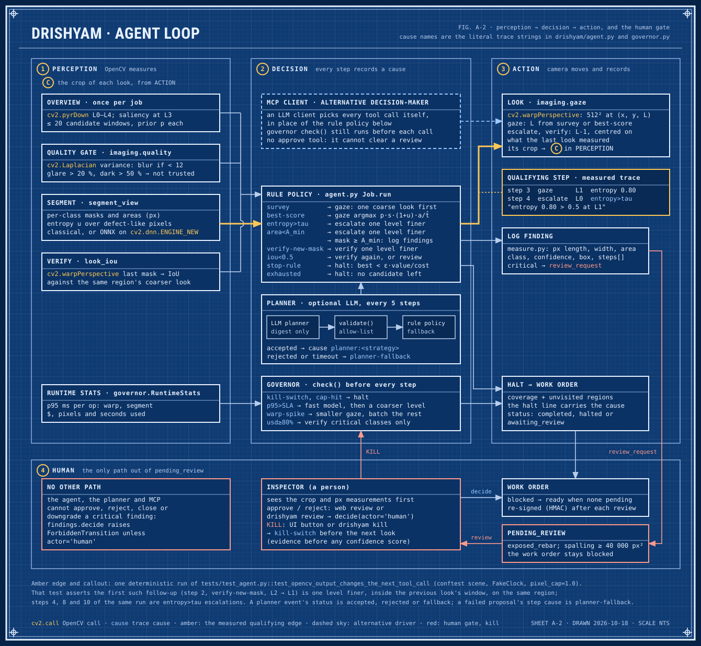
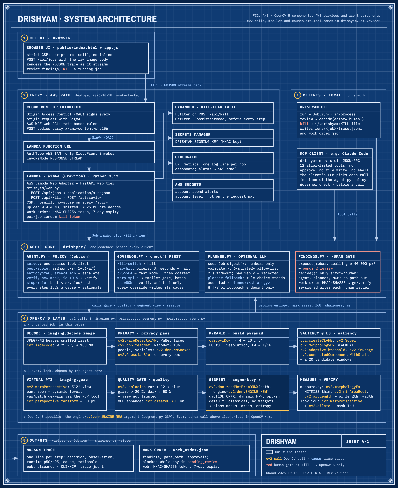
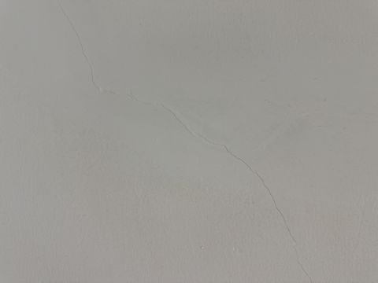

# Drishyam: submission report

*Virtual-PTZ inspection of bridge photos with an agent that stops looking when the next look is worth less than it
costs.* An entry in the OpenCV AI Competition 2026, powered by AWS. Live demo: https://d1xg58guluup8c.cloudfront.net · Code: https://github.com/vj-io/drishyam

Sections: Results at a glance · 1 Problem · 2 Users · 3 How it works · 4 Architecture · 5 AWS deployment · 6 OpenCV 5
implementation · 7 Related work · 8 Evaluation · 9 Failures · 10 Agentic evidence · 11 Responsible use and limits ·
12 Team and reproduce · Appendix: per-cap tables.

## Results at a glance

Recall is the share of labelled defects found at the 30 % pixel cap, with paired 95 % bootstrap intervals over
photos; chance is the same model's boxes moved to random places, and IoU-only drops the contains-the-centre match
(section 8). Each segmenter was scored once on the held-out sets (`results/heldout_models.json`);
`tests/test_report_doc.py` fails if a number here drifts from that file or, for the Lambda timings, from
[aws.md](aws.md).

| Segmenter | CODEBRIM recall (95 % CI) | chance | IoU-only (chance) | synth200 recall (95 % CI) | clean photos with a box | critical boxes per CODEBRIM photo (parts of findings) |
| --- | --- | --- | --- | --- | --- | --- |
| v1 (first look policy) | 0.49 (0.44–0.54) | 0.30 | 0.25 (0.08) | 0.64 (0.61–0.67) | 0 of 51 | 9.60 |
| **v1-policy2 (live)** | 0.49 (0.44–0.53) | 0.31 | 0.26 (0.09) | 0.62 (0.59–0.66) | 0 of 51 | 8.75 |
| v2a | 0.48 (0.43–0.52) | 0.30 | 0.24 (0.08) | 0.61 (0.57–0.64) | 9 of 51 | 4.38 |
| v2b | 0.49 (0.44–0.53) | 0.28 | 0.25 (0.08) | 0.57 (0.53–0.61) | 9 of 51 | 4.65 |
| v2c | 0.48 (0.44–0.53) | 0.28 | 0.23 (0.07) | 0.57 (0.54–0.61) | 22 of 51 | 3.71 |
| classical engine | 0.19 (0.16–0.23) | 0.12 | 0.08 (0.03) | 0.48 (0.44–0.52) | 34 of 51 | 1.73 |

A person signs critical findings, not boxes: about 2.17 per CODEBRIM photo under v1's first policy and 1.15 under
v1-policy2, the live one (section 8). The last column counts boxes: each connected part of a finding's mask, in every
look that drew it, that is critical by class and area. That is the unit the scorer matches, and one finding has
several.

- **v1 runs live since 2026-10-21**, with the v1-policy2 look policy since 2026-10-22 (deployed commit a2b8688, smoke-tested: [aws.md](aws.md)). It was chosen on the
  dev splits only (`results/dev/model_choice_dev.json`); held out it is again the only model with no measurable
  loss against any other. These are its second scorings (one earlier, unpublished). Its CC BY-NC 4.0 weights are
  release assets of v1.1.0, not in git.
- **v1-policy2, live since 2026-10-22 (first deployed from commit adf9474):** one configuration chosen on the dev splits by a rule committed before its run and scored once held out (v1's third read; section 8). On CODEBRIM a person signs about 1.15 critical findings per photo instead of 2.17, and the critical boxes fall to 8.75 per photo from 9.60 (0.91×, CI 0.84–0.98); it lists 0.20 masks per photo as needs-a-look for a person to check by eye; recall is unchanged (0.99×, CI 0.97–1.01), on synth200 0.98× (0.95–1.00); critical-class recall is not higher (0.99×, 0.96–1.02; exposed rebar 0.14 against 0.16). On CODEBRIM verify now fires on 14.1 % of looks (5.0 % confirm looks) instead of 9.4 %, escalation on 5.8 %. It still does not beat L2 tiling: 0.98× its recall at 1.40× its pixels, and 0.83× (0.76–0.89) at the 10 % cap.
- **What the held-out runs measured:** the governor off and the 512-px FP32 net on every look. Live, the v1
  profile's SLA is 1500 ms, so looks stay on the 512-px FP32 net unless steps exceed 1.5 s. v1's finest look is L1
  (half size) on a 2048-px photo and L2 on a 4608-px one, so on these photos it never looks at full resolution.
- **How much v1 zooms, and a tiling grid it does not beat:** on CODEBRIM at the 30 % cap an escalation fired on
  5.9 % of v1's looks and a verify on 9.4 %, and an L2 tiling grid finds 0.50 with 0.10 of the pixels, against the
  agent's 0.49 with 0.14; on synth200 an L1 grid finds 0.70 with 0.50 of the pixels, against 0.64 with 0.26
  ([codebrim_dacl10k](../public/results/codebrim_dacl10k/summary.json),
  [synth_dacl10k](../public/results/synth_dacl10k/summary.json) summaries).
- **Against the classical engine,** v1 finds 2.54× (2.16–3.01) its recall on CODEBRIM and 1.34× (1.24–1.45) on
  synth200, and puts no box on a clean photo where the classical engine puts 7.08 per photo. But chance is high on
  CODEBRIM because its boxes are large; it sends 5.5 times the critical boxes to the human gate (boxes, not the
  findings a person signs; the one measured backlog of 2,536 photos, 2,436 of them synthetic, queued 684 critical
  findings from the 587 photos it ran and left 1,949 not assessed); its modelled ms per CODEBRIM job are 1.99× (CI 1.92–2.06); and on the
  Lambda its step p95 was 0.52 to 1.14 s, against 67.7 to 88.0 ms.
- **Where v1 fails:** on synthetic photos it finds no efflorescence (0.00) and almost no exposed rebar (0.02), where
  the classical engine finds 0.16 and 0.57; on one of our own wall photos it flagged nothing although a hairline
  crack is visible by eye (section 9).
- **The classical engine** (the deployed demo until 2026-10-21, and every policy comparison below) does not let the
  agent beat the simple baselines: on synth200 it is 0.87× exhaustive tiling (0.81–0.93) at 0.16× its pixels, so
  the PRD hypothesis (at least 0.9× tiling's recall at no more than 0.3× its pixels) is not met, and 0.96× one
  1024-px downscale (0.91–1.02); it finds 0.19 of CODEBRIM's defects, 0.98× one downscale (0.90–1.06).

## 1. Problem

The US National Bridge Inventory lists 624,939 bridges, 41,148 of them in poor condition (FHWA, 2026 data). Each
must have a routine inspection at intervals of up to 24 months (23 CFR 650.311). One detailed drone inspection of
the St. Johns Bridge in Portland, Oregon produced 2,536 still photos (Oregon DOT and FHWA, report SPR 787), and the
dacl10k authors note that authorities often fail to keep the required inspection intervals because of staff
shortages. Every figure, with its source and the date it was checked: [impact-sources.md](impact-sources.md).

The defects that matter most (hairline cracks, early exposed rebar) are small at thumbnail scale, so a tool must
either tile every photo at full resolution or guess where to look. Drishyam's bet is that *looking is cheap when it
is a geometric warp*, and that where to look next can be read from what OpenCV just measured. This report makes no
time-saving claim: on real photos Drishyam finds about 0.2 of the labelled defects with the classical engine, and
about half with the trained v1 segmenter, which the demo runs since 2026-10-21 (section 8).

## 2. Users

The PRD names three. An **inspection engineer** reviewing a photo backlog uploads a photo and gets findings with
the crop, the class, pixel length, width (with v1, its mask's width, not the crack's: section 11) and area, and the
numbered gaze step that found each one, so the evidence
comes before any score. Critical findings (exposed rebar, spalling above 40,000 px²) wait for that engineer's
approval, which the agent cannot give or downgrade, and a per-job budget in pixels, dollars and seconds sets what
the triage of a backlog may cost. **Judges** need a trace in which an OpenCV output changes the next tool call,
failure drills they can trigger, a live endpoint and honest failure cases. The **operator** who pays for the AWS
account needs caps, a budget alert and one command that stops all spending.

The narrated submission film (4 minutes, captions on) is an asset of the v1.1.1 release
([drishyam.mp4](https://github.com/vj-io/drishyam/releases/download/v1.1.1/drishyam.mp4), not in git) and also plays
on the site's Docs and links sheet; `video/plan.md` says how it is built and where each number in it comes from.

Not built yet: approval from an SNS email link (approval is the web review or `drishyam review`); the COOL
benchmark (section 6); a budget stop action or auto-stop schedule (the stop is `scripts/aws.sh stop`); a live LLM planner (the
drills use scripted planners, section 3). Dropped: the Hugging Face Space mirror; the demo runs only on AWS.

## 3. How it works



Each job is a loop of camera moves over an image pyramid (L0 = full resolution, L4 = 1/16):

1. **Overview.** `pyrDown` to L4; a saliency prior at L3 from `cvtColor`, `GaussianBlur`, `Sobel`, black-hat
   `morphologyEx`, `adaptiveThreshold`, CLAHE and a rust-hue `inRange`; up to 20 ranked candidate windows. When it
   proposes none, the job takes one look at L2 whose window spans the whole photo (cause `fallback-l2`, on by default
   since 2026-10-21, live since 2026-10-22), and the work order still lists the photo as not assessed.
2. **Gaze.** `warpPerspective` renders a 512² virtual-PTZ view whose pixels map back to L0 exactly: pan and zoom.
   The agent always passes yaw = pitch = 0; only the MCP tool exposes yaw and pitch, as a synthetic rotation with
   f = view size, not a calibrated rectification.
3. **Quality gate.** Laplacian sharpness and exposure; glare and blur are logged and not trusted.
4. **Segment.** Per-class probabilities, masks and an entropy score. The live engine since 2026-10-21 is v1, a
   dacl10k-trained ONNX model on OpenCV 5 DNN `ENGINE_NEW`; without `DRISHYAM_ONNX` the classical engine (evidence
   maps, no weights) runs behind the same interface, and every policy comparison in section 8 uses it.
5. **Decide.** The next look is `argmax p·s·(1+u)·a / t̂` (prior × severity × uncertainty × unseen area ÷ predicted
   ms). Escalate one level finer, centred on what it saw, when entropy > τ or the mask is below A_min; verify a new
   confident mask one level finer by mask IoU; log findings with length, width, area and orientation in pixels (with
   v1, a crack's width is its mask's, not the crack's: section 11).
   With v1 a look spans at least 0.3 of the photo's long side (its profile's `min_view`), so its finest level is L1
   (half size) on a 2048-px photo and L2 on a 4608-px one; a look there is not escalated, and a mask first drafted
   there is not verified one level finer. v1's live look policy is v1-policy2 (section 8): first looks on the tiling
   grid's tiles that hold a candidate, exposed rebar and spalling weighted 2× in s, a mask that would make a new
   critical finding under confidence 0.6 held for one confirm look at its level (cause `confirm-critical`; if that
   look does not confirm it, a person checks it by eye as a needs-a-look entry), and overlapping critical findings of
   one class merged.
6. **Govern.** Before every step: kill switch, pixel / $ / seconds caps, p95 latency against the SLA (500 ms; 1500
   ms for the v1 profile; switch to the fast model, then a coarser level), warp spikes, and a $ ≥ 80 % mode that verifies only critical classes.
7. **Stop** when the best remaining expected value per ms falls below a quarter of the realised value per ms so far,
   or below a floor, the value of a look that finds nothing (ε·v0/t̂, v0 = 2), once every candidate left has been
   shown by a look as fine as its own first look (a coarse survey alone never ends a job). Under a pixel cap the cap
   usually binds first: at the 30 % cap the cap ends 189 of 200 synthetic and 194 of 200 CODEBRIM jobs; uncapped,
   the stop rule ends 185 of 200 synthetic jobs and 194 of 200 CODEBRIM jobs (the published classical runs, made on
   2026-10-18 with the agent of commit 832299b, which has the floor and the seeding; they were not repeated on later
   commits).

Critical findings (exposed rebar; spalling above 40 000 px²) wait in `pending_review`. Only a human, in the web review
or with `drishyam review`, can approve or reject them; nothing the agent, the MCP tools or the planner can call reaches
that transition. The same holds for an area the agent could not assess: only a person resolves it, checked by eye
(nothing found or defect found, with an optional note), and a work order is `ready` only when every critical finding
is decided and every such area is resolved ([api-contract.md, Checked by eye](api-contract.md#checked-by-eye)).

No LLM runs in the live demo (the batch CLI's optional Nova Lite router is in section 10). The deployed agent is the rule policy above (the stack sets no
`DRISHYAM_PLANNER_URL`), and the planner failure drills use planners scripted to time out or answer junk. The LLM
path is the MCP server: section 10 links a recorded session in which Claude chose each call from the measured
values.

## 4. Architecture



Three clients reach one agent core: the browser through CloudFront and an arm64 Lambda (section 5), and the CLI and
the MCP server locally. The core (policy, governor, optional planner behind an allow-list validator, human gate)
drives the OpenCV layer and emits an NDJSON trace and a signed work order. Every cv2 call in the figure also exists
in OpenCV 4.x except the two starred uses: the `ENGINE_NEW` argument, and a NumPy bool mask read as `CV_Bool` by
`copyTo` (`CV_BOOL_MASKS`, on since 2026-10-22; section 6). `drishyam batch` (section 10) runs on the CLI only; its
optional Nova Lite router on Amazon Bedrock is off by default and not on the web path. Sources: [architecture.svg](architecture.svg)
and [architecture.mmd](architecture.mmd); the agent loop above is [agent-loop.svg](agent-loop.svg).

## 5. AWS deployment

One CDK (Python) stack in `us-east-1` (`infra/`), deployed with `scripts/aws.sh deploy`; the full page, with IAM,
limits and the cost table, is [aws.md](aws.md).

- **Entry.** CloudFront with two origins, each behind Origin Access Control: the static site from a private S3
  bucket, and `/api/*` to a Lambda Function URL with `AuthType AWS_IAM` and response streaming, so the URL cannot be
  called around CloudFront. Every `POST` carries `x-amz-content-sha256`, which the page computes.
- **AWS WAF.** Three per-IP rate rules: 10 job starts per 120 s, 30 kill or review calls per 60 s, 300 requests per
  60 s.
- **Compute.** Lambda arm64 (Graviton), Python 3.12, 3008 MB, 60 s timeout, with the Lambda Web Adapter running the
  FastAPI app unchanged. It runs the stock `opencv-python-headless` 5.0.0 wheel (section 6), not COOL. The deployed
  stack sets no reserved concurrency: the account's Lambda quota of 10 is the cap.
- **State and secrets.** A DynamoDB table holds kill flags (read before every step, so `/api/kill` reaches a job in
  another Lambda environment); Secrets Manager holds the HMAC key that signs work orders. The function's role can do
  only that plus writing its own logs and X-Ray traces, and `tests/test_infra.py` fails if it gains anything else.
- **Observability.** One EMF log line per job, a CloudWatch dashboard, 4 alarms (Errors, Throttles, Duration p95,
  AppErrors) and X-Ray tracing. The alarms and a 20 USD monthly budget publish to one SNS topic, whose email
  subscription is confirmed: a test alarm (AppErrors set to ALARM by hand) reached the owner's email on 2026-10-21.
  The alarms have no OK action, so a recovery sends no email.
- **Smoke test** (`scripts/aws.sh smoke` with `WAF_LOOP=1`, `scripts/smoke.sh`): `smoke 2026-10-22T17:17:47Z
  result=pass`, against the live build, commit a2b8688, the commit `/api/health` reports: a job on `bridge_03.jpg`
  ended `awaiting_review` after 6 steps; KILL, sent after step 2 streamed, halted the second job after 3 steps; a
  `POST` without the body hash and a direct Function URL call both got 403; the WAF answered 429 at the 15th
  empty-bodied job start (WAF evaluates rates about every 10 s, so it blocks late); and the step p95 was 994.9 ms over
  6 steps, under v1's 1500 ms limit. The live browser suite (`tests/e2e/test_ui_live.py`) passed three of the four
  times it ran against this deploy: once its guided run took 40.8 s, over the suite's 40 s limit ([aws.md](aws.md)). With v1 a step's p95 was 0.52 to 1.14 s over the eleven v1 smoke runs to f12f50f, and every later run
  [aws.md](aws.md) quotes falls in that range, against 67.7 to 88.0 ms for the classical engine before it.
- **Cost.** Spent so far: 0.62 USD before credits, month to date on 2026-10-21 (Cost Explorer; 0.59 of it the WAF),
  0.00 USD after them. The list-price estimate is about 10 USD a month at 1,000 jobs a month, 8 of it the WAF ([aws.md](aws.md)). The $ shown
  in the UI and the evals is *modelled*: timed op milliseconds × 0.339 USD/h, the c8g.2xlarge rate plus the COOL
  Marketplace fee the PRD planned for. It is not the Lambda bill, and decode and the privacy blur, which run before
  the job starts, are not in it.
- **Operate.** `scripts/aws.sh stop` sets the function's reserved concurrency to 0 (nothing runs, nothing bills);
  `start` undoes it (on the live deployment, which has no reservation, run `RESERVED=none scripts/aws.sh start`);
  `destroy` deletes the stack and the site bucket.

## 6. OpenCV 5 implementation

| Stage | cv2 calls | Module |
| --- | --- | --- |
| Decode | `imdecode`, after a header sniff | `imaging.py` |
| Privacy blur | `FaceDetectorYN` (YuNet); `dnn.readNet`, `dnn.blobFromImage`, `dnn.NMSBoxes` (NanoDet-Plus); `GaussianBlur` | `privacy.py` |
| Pyramid and saliency | `pyrDown` × 4; at L3 `cvtColor`, `createCLAHE`, `GaussianBlur`, `Sobel`, `magnitude`, `morphologyEx` (black-hat), `adaptiveThreshold`, `inRange`, `connectedComponentsWithStats` | `imaging.py` |
| Gaze | `warpPerspective` (`INTER_LINEAR`, `BORDER_REFLECT_101`), `perspectiveTransform` | `imaging.py` |
| Quality gate | `Laplacian` variance; glare and dark pixel fractions | `imaging.py` |
| Segment | classical engine: `cvtColor`, `createCLAHE`, `GaussianBlur`, `medianBlur`, `morphologyEx`, `inRange`, `dilate`, `connectedComponentsWithStats`; ONNX engine: `dnn.readNetFromONNX(path, engine=cv2.dnn.ENGINE_NEW)` | `segment.py` |
| Measure and verify | `morphologyEx` (hit-or-miss thinning), `findContours`, `minAreaRect`, `arcLength`, `approxPolyDP`; cross-level mask IoU through `warpPerspective` and `dilate` | `measure.py`, `agent.py` |

**What OpenCV 5 adds, and what the pipeline does with it.** "New in 5.0" means absent from the latest 4.x wheel,
opencv-python-headless 4.14.0.94 (`results/local-macos-x86/opencv_builds.json`). [bench.md](bench.md), "OpenCV 5
features in the pipeline", has every figure, the rule a change had to pass (the agent's traces identical to the byte
on the ten demo samples and four synth_dev images, with both segmenters, and a measured speed-up) and what was not
adopted. The timings are this Mac's (a heavily shared machine) unless a runner is named; both new benchmarks also
ran once on GitHub's Arm and x86 runners (run 39665440222, quiet VMs, not the Lambda).

- `ENGINE_NEW` (new in 5.0): `engine=cv2.dnn.ENGINE_NEW` in `OnnxSegmenter._load` (`segment.py`, exercised by
  `tests/test_segment.py` with a tiny ONNX model) is the only engine that reads v1, which the live demo runs since
  2026-10-21 on the stock 5.0.0 wheel. On 5.0 `readNet` gives it to the NanoDet privacy detector too: 4.14 took
  x1.95 (1.79-2.13) of 5.0's time on that forward here, and x1.59 (1.59-1.60) on the Arm runner.
- 5.0's bilinear warp without lookup tables (new in 5.0): 4.14 took x1.60 (1.38-1.85) of 5.0's time on the gaze's
  `warpPerspective` and x2.43 (2.07-2.86) on an oblique one, with a different output; on the Arm runner x1.53
  (1.53-1.54) and x1.80 (1.79-1.81), but on the EPYC runner 4.14's warp was the faster. The warp is cheap next to a
  segmenter look, so a job barely moves.
- The engine selector with `ENGINE_CLASSIC` on a static-shape copy of v1 (the selector is new in 5.0; the classic
  engine is 4.x's): `OnnxSegmenter(engine="classic")`, off. On this Mac the agent's traces with it were identical on
  14 of 14 photos, every argmax equal, but its looks took x1.30 (1.29-1.32) of `ENGINE_NEW`'s time on 16 threads. On
  GitHub's Neoverse-N2 runner it ran v1's forward in x0.38 of `ENGINE_NEW`'s time, and at the agent level it passes
  both tests there: the same 14 traces identical, and its looks took x0.39 (0.39-0.40) of
  `ENGINE_NEW`'s time on one thread and x0.44 (0.44-0.45) on two, the Lambda function's thread count. It is the
  largest gain found for the live v1. It stays off: the owner kept `ENGINE_NEW` live (2026-10-22), so this is
  reported as a finding, not a change (bench/repro/README.md, 3). Shipping it would need a copy written at build time
  into `models/` (the Lambda package lacks the `onnx` package that makes it), one code change (read that file by path,
  keep hashing the original) and a check on the deployed Graviton.
- The new engine's profiling mode (`Net.setProfilingMode(DNN_PROFILE_DETAILED)`, new in 5.0), in
  `bench/opencv5_features.py`: v1's time per layer on both engines. Here its twelve 3x3 convolutions are 81 % of
  `ENGINE_NEW`'s time on one thread. On the Arm runner they took 800.6 against 248.5 ms on the two engines, more than
  the whole gap: the new engine's 2.6 times longer forward there is its 3x3 convolution.
- `CV_Bool` (new in 5.0): the NumPy bool footprint as a `copyTo` mask in `segment.restrict`. Identical, faster in
  three of its four timings here, where it failed the rule (one interval reaches 1.02). On both GitHub runners it
  passes (x0.91 to x0.95 of the NumPy time). It is on since 2026-10-22 (`CV_BOOL_MASKS`): the owner chose the result
  on Arm, where the function runs, after seeing both. Its output is identical on all three machines, so no published
  number moves.
- `reduceArgMax` (OpenCV 4.6, not new) in `segment.finish`: identical, x0.52 to x0.74 of NumPy's time, adopted
  (`CV_ARGMAX`); on a whole look the gain is within this machine's noise.

**What OpenCV 5's DNN module loaded, and what it did not.** The v1 model loads only on `ENGINE_NEW`:
`ENGINE_CLASSIC` stops at the decoder's `Shape` node (`Assertion failed: !isDynamicShape in function 'parseShape'`)
on the FP32 file and on both statically quantized copies (`results/local-macos-x86/int8.json`; the other three models
were not tried on it). The cause is the export's symbolic input H and W (`[1, 3, 'h', 'w']`, so one file runs at both
the 512 and the 256 size): a copy with them fixed loads on `ENGINE_CLASSIC` and matches the deployed net to max |dprob| 2.1e-5,
while the FP16 copy loads there but fails its first forward; the engine timings (this Mac, and GitHub's Arm and x86
runners) and a minimal repro are in [bench.md](bench.md), "OpenCV 5 DNN engines for v1". `training/parity.py` checks every export against its PyTorch
checkpoint through `OnnxSegmenter` on `ENGINE_NEW` (20 crops, FP32 tolerance max |dprob| 1e-3) and refuses an FP32
file over it. A DeepLabV3+ (the dacl10k paper's baseline architecture, `--arch deeplabv3plus` in
`training/train_dacl10k.py`) was tried first for v2c and dropped: its FP32 export, with the 19-to-6 class merge in the
graph, did not match PyTorch on OpenCV 5.0.0 `ENGINE_NEW` (max |dprob| 0.85), while its FP16 export and its 19-logit
export passed. The cause was not isolated, and the numbers are recorded only in the message of commit 95741ba, not
in a results file. v2c was trained as v2a's UNet instead, with the rare classes weighted harder. INT8 is the third
limit found: the dynamically quantized model loads on neither engine, and the statically quantized ones run only on
`ENGINE_NEW` and slower than FP32 on the x86 Mac ([bench.md](bench.md), "INT8").

That wheel's aarch64 build already includes Arm's KleidiCV and carotene: the Lambda package pins the same
`opencv-python-headless` 5.0.0.93 wheel (`pyproject.toml`), whose `cv2.getBuildInformation()` on GitHub's arm64
runner reads "Custom HAL: YES (carotene (ver 0.0.1) KleidiCV (ver 26.03))" and "Baseline: NEON FP16"
(`results/linux-aarch64/micro.json`). The deployed Lambda reports the same build in its `GET /api/health`
(`cv2_build`, fetched 2026-10-21 into `results/lambda-cv2-build.json`): hal "YES (carotene (ver 0.0.1) KleidiCV (ver
26.03))", cpu_baseline "NEON FP16", cpu_dispatch "NEON_DOTPROD NEON_FP16 NEON_BF16", parallel "pthreads", on
`aarch64`. The camera moves use ops KleidiCV covers in some formats (`pyrDown`,
`resize`, `warpPerspective`), so a COOL gain would have to come on top of the KleidiCV the wheel already has.
Whether the 3-channel `BORDER_REFLECT_101` `warpPerspective` used here takes the HAL path has not been measured. There is no `filter2D` and no NumPy pixel loop on the gaze path; the classical
segmenter adds `connectedComponentsWithStats` and a NumPy softmax, and measurement adds `findContours`.

### COOL on Graviton (not run)

COOL on Graviton was not run: the Marketplace AMI could not be subscribed from our AWS account. It is an AWS India
(AISPL) account, whose card restriction terminated the Marketplace agreement seconds after subscribing (a support case
is open). The three-arm scripts are in [bench/](../bench/README.md). `bench/run_all.sh <arm>` runs the micro and
macro benchmarks and a parity save with a provenance block (OpenCV version, build-info hash, whether `cv2` loads
from `/opt/cool`), `bench/parity.py` checks that two arms produce identical masks, and the same code passes CI on
GitHub's arm64 runners. [bench/aws_runbook.md](../bench/aws_runbook.md) is the copy-paste sequence for the three
arms (COOL on c8g, stock on c8g, stock on c7i), each set to terminate itself after 3 hours, and `python -m
bench.compare_arms results/A results/B results/C` would write `docs/cool_benchmark.md` against the PRD's expected
1.2–1.8× op-level and 1.2–1.3× end-to-end range. None of it has run on AWS.

**What COOL could buy end to end, from GitHub's arm64 runner.** A 200-image macro run with the stock aarch64 wheel
on GitHub's `ubuntu-24.04-arm` runner (Neoverse-N2, one thread; a GitHub Actions VM, not the Lambda;
[results/linux-aarch64/macro.json](../results/linux-aarch64/macro.json)) puts 8 % of a job in the stages it labels
KleidiCV-covered imgproc (pyramid, saliency, warp, quality gate), 74 % in the classical segmenter (imgproc plus
NumPy), 4 % in crack thinning, 7 % in decode and 7 % in Python. So if COOL made the covered ops 1.8× faster, a whole
job would get about 1.04× faster; the x86 laptop's 8-image run
([results/local-macos-x86/macro.json](../results/local-macos-x86/macro.json)) gives the same 1.04×. The gaze path itself is cheap; most of the time is in segmentation, which is
where a COOL or DNN speed-up would have to land.

**Arm against x86 on GitHub's runners.** The same workflow run timed the same wheel version on GitHub's x86
`ubuntu-24.04` runner (AMD EPYC 7763, IPP HAL), 4 logical CPUs and Python 3.13 on both (the Lambda runs 3.12): one run
each, on shared VMs, not the function and not a Graviton core. On one thread each runner won 12 of the 24 kernel and
size pairs (x86 about twice as fast at black-hat and top-hat, Arm about twice as fast at contours and fitting), but 6
of the 24 differ by less than 6 %, close enough to flip in another run; on 4 threads Arm won 23 of 24. The agent loop
ran 1.17 to 1.27 times as many jobs per second on Arm, and the macro job 1.26 times as many images per second
(per-image p50 195.8 against 248.2 ms), most of the gap in the classical segmenter; x86 ran the NanoDet forward in
0.61 of Arm's time on one thread. Every ratio mixes core, OpenCV build (KleidiCV and carotene against IPP) and VM, and
the run was not repeated. Tables and provenance: [bench.md](bench.md), "Arm against x86 on GitHub". In brief
(prefetching off; the macro run is the default agent on a real clock, one OpenCV thread):

| GitHub run 39220769299 (not the Lambda) | Arm, `ubuntu-24.04-arm` | x86, `ubuntu-24.04` | Arm ÷ x86 |
| --- | --- | --- | --- |
| OpenCV kernels won, 1 thread (of 24 kernel and size pairs) | 12 | 12 | |
| OpenCV kernels won, 4 threads (of 24 kernel and size pairs) | 23 | 1 | |
| agent loop, jobs/s, 1 thread | 3.97 | 3.28 | 1.21 |
| agent loop, jobs/s, 4 threads | 4.88 | 3.84 | 1.27 |
| macro, 200 synthetic images, 1 thread: images/s | 5.13 | 4.06 | 1.26 |
| macro, per-image p50 ms | 195.8 | 248.2 | |

From 1 to 4 threads the Arm runner's agent loop went from 3.97 to 4.88 jobs/s and x86's from 3.28 to 3.84. The
function itself has 1.7 vCPU of time at 3008 MB; the stack sets OpenCV to 2 threads (`DRISHYAM_CV_THREADS`), and
the deployed function's startup log confirms 2 ([aws.md](aws.md); [bench.md](bench.md), "Lambda").

## 7. Related work

Drishyam combines old ideas; this section says which, and what it adds.

- **Image pyramids.** Burt and Adelson's Laplacian pyramid [1] made coarse-to-fine processing over a stack of
  low-pass copies of an image standard. Drishyam's L0 to L4 are a Gaussian pyramid built with `cv2.pyrDown`, and
  every look is a crop of one level.
- **Saliency.** Itti, Koch and Niebur [2] combine colour, intensity and orientation contrast across scales into one
  saliency map that orders where attention goes. Drishyam's prior is the same kind of hand-built map, with features
  chosen for concrete damage (black-hat for dark thin lines, Sobel edges, adaptive threshold, CLAHE, a rust-hue
  range), and it ranks up to 20 candidate windows.
- **A low-resolution view steering a high-resolution one.** Gould, Arfvidsson, Kaehler, Sapp, Messner, Bradski,
  Baumstarck, Chung and Ng [3] use a learned attentive interest map on a low-resolution video stream to point a
  high-resolution fovea, and follow recognised objects in the periphery, which keeps recognition real-time.
  Drishyam's overview-then-zoom is the same idea applied to one large still photo: the periphery is a coarse level
  of the same pyramid and the fovea is a `warpPerspective` crop. Its attention map is hand-built, not learned, and
  nothing is tracked.
- **Learned glimpse policies.** Mnih, Heess, Graves and Kavukcuoglu [4] train a recurrent network with reinforcement
  learning to choose a sequence of glimpses, so the computation is set by the number of glimpses rather than the
  image size. Drishyam's policy is not learned: a fixed score and a handful of rules, which keeps every choice
  explainable from logged numbers but means nothing is optimised end to end.
- **Tiling.** SAHI [5] slices a large image into overlapping tiles, runs the detector on each and merges the
  results, the standard answer to small objects in large images. Drishyam's tiling baseline re-implements SAHI's
  slicing (512 px tiles, 20 % overlap, the last row and column pulled back to the edge) and its greedy NMM merge in
  `evals/harness.py`, rather than importing the library, and runs the same grid on pyramid levels 1 and 2 for
  smaller budgets.

**What Drishyam adds** is engineering around those ideas:

1. A value-per-ms score: the next look maximises expected value per predicted millisecond, where the prediction is
   the job's own measured p95 of warp and segment time (in the published evals, a fixed table of p50s, so a re-run
   reproduces them).
2. A stop rule: the job ends when the best remaining look is worth less than a quarter of the value per ms realised
   so far, or than a floor (ε·v0/t̂, the value of a look that finds nothing) once every candidate left has been
   seen by a look as fine as its own first look.
3. Cross-scale verification: a new confident mask is looked at again one pyramid level finer and compared, class by
   class, by mask IoU through the two views' homographies. Below 0.5 for the same class with the same place seen
   as another class (IoU ≥ 0.5 between the two looks' best masks) it is a class change, otherwise a disagreement;
   the finding of that class is then `verified: false`, and a human is asked when it is critical, when no finer
   look can settle it, or when a class change involves a critical class (the finding named then waits in
   `pending_review`), with the measured IoU as the reason.
4. A governor that checks kill, caps and p95 latency before every step and writes a cause for each override, so
   every step in the trace says why it happened.
5. A human gate: critical findings wait in `pending_review`, and no agent, MCP or planner call can approve them.

**What is not new:** coarse-to-fine pyramids, saliency priors, steering a high-resolution window from a
low-resolution map, and tiling. On every set at least one simple baseline matches or beats Drishyam's recall at
similar or lower pixel cost (section 8): one downscale on the 2048×1536 set and on CODEBRIM, the L2 tiling grid at
4608×3456 and on CODEBRIM. Only at 4608×3456 does zooming beat one downscale, narrowly. So with the classical engine
the combination has not paid off in recall. With the trained v1 segmenter behind every policy, held out, the agent at
the 30 % cap is 1.18× one downscale on CODEBRIM (1.11–1.28) and 1.20× at 4608×3456 (1.13–1.27), but 0.94×
exhaustive tiling on the 2048×1536 set (0.90–0.97), and on CODEBRIM an L2 tiling grid with v1 finds 0.50 with 0.10
of the pixels against the agent's 0.49 with 0.14 (point estimates; `public/results/codebrim_dacl10k/summary.json`).
So on CODEBRIM a simple baseline matches the agent at a lower pixel cost with either segmenter.

1. P. J. Burt and E. H. Adelson, "The Laplacian Pyramid as a Compact Image Code", *IEEE Transactions on
   Communications*, vol. COM-31, no. 4, pp. 532–540, April 1983.
2. L. Itti, C. Koch and E. Niebur, "A Model of Saliency-Based Visual Attention for Rapid Scene Analysis", *IEEE
   Transactions on Pattern Analysis and Machine Intelligence*, vol. 20, no. 11, pp. 1254–1259, November 1998.
3. S. Gould, J. Arfvidsson, A. Kaehler, B. Sapp, M. Messner, G. Bradski, P. Baumstarck, S. Chung and A. Y. Ng,
   "Peripheral-Foveal Vision for Real-time Object Recognition and Tracking in Video", *International Joint
   Conference on Artificial Intelligence (IJCAI)*, 2007, pp. 2115–2121.
4. V. Mnih, N. Heess, A. Graves and K. Kavukcuoglu, "Recurrent Models of Visual Attention", *Advances in Neural
   Information Processing Systems 27 (NIPS 2014)*, pp. 2204–2212.
5. F. C. Akyon, S. O. Altinuc and A. Temizel, "Slicing Aided Hyper Inference and Fine-tuning for Small Object
   Detection", *IEEE International Conference on Image Processing (ICIP)*, 2022, pp. 966–970,
   doi:10.1109/ICIP46576.2022.9897990.

## 8. Evaluation

Measured on **200 held-out labelled synthetic images** (seed 7; policy changes were tuned only on dev splits, unpublished: 60 synthetic images, seed 4242, `make eval-dev`; 30 synthetic images with no damage, seed 4243, `make eval-dev-clean`; and 100 CODEBRIM photos, seed 4244, none of them in the 200 below, `make eval-dev-real`), one segmenter and one matching rule for every policy (a ground-truth box is found by a same-class component with IoU ≥ 0.3 or containing its centre; "IoU-only" drops the centre clause). The 95 % intervals are a bootstrap over images, paired across policies. "Chance" moves each policy's own boxes (same class and size) to random places in the photo and scores them again. Precision is one-to-one: in confidence order each prediction claims at most one ground-truth box, so a defect reported again from a second look is a false box; "hits per matched box" counts the predictions that land on each box found (1 = no duplicates). All of it runs on the **fixed cost model** (`--cost-model fixed`): every op the agent times costs its p50 from the `job_ops` table in `results/linux-aarch64/micro.json` (the stock aarch64 wheel on GitHub's `ubuntu-24.04-arm` runner, Neoverse-N2, one thread) on every call, so t̂, the stop rule and the governor see the same costs on a busy machine as on an idle one, and a re-run (`make eval`, whose `MICRO_ARM` defaults to `linux-aarch64`) reproduces the numbers exactly on an x86 machine, however busy it is (on arm64 the synthetic images themselves come out slightly different: the aarch64 HAL rounds some pixel ops differently). The jobs themselves ran on the x86 laptop; only their costs are the arm64 ones. $ is that modelled time × $0.339/h (untimed Python is not charged). In this comparison the governor's model, level and gaze-size overrides are off (caps and the kill switch stay), so Drishyam segments every look with the same accurate model as the baselines; turning them on changes nothing under fixed costs at the 30 % and 100 % caps, the only caps the governor-on ablation ran (30 % only on CODEBRIM; [Ablations](#ablations-fr-21) below). The classical-engine runs in this section (every table up to the trained segmenters) were made on 2026-10-18 with the agent of commit 832299b and published in commit c36e375; they were not repeated on later commits.

The FR-21 ablations (random gaze order, no uncertainty term, no survey look, no verify step, governor on) are under
[Ablations](#ablations-fr-21) below. The per-cap tables and per-class recall are in the
[appendix](#appendix-per-cap-tables).

### Synthetic, 2048×1536 (200 images)

| Policy | pixels (× image) | recall (95 % CI) | IoU-only recall | chance recall (IoU-only) | false boxes / image |
| --- | --- | --- | --- | --- | --- |
| downscale once (1024 px) | 0.25 | 0.50 (0.46–0.54) | 0.43 | 0.02 (0.01) | 12.2 |
| tiling, L2 grid | 0.06 | 0.44 (0.41–0.48) | 0.40 | 0.02 (0.01) | 8.5 |
| tiling, L1 grid | 0.50 | 0.55 (0.52–0.59) | 0.48 | 0.02 (0.01) | 17.3 |
| tiling, L0 (exhaustive, 20 % overlap) | 1.67 | 0.55 (0.51–0.59) | 0.47 | 0.03 (0.01) | 83.4 |
| **Drishyam**, cap 30 % | 0.26 | **0.48** (0.44–0.52) | 0.42 | 0.03 (0.01) | 17.5 |
| **Drishyam**, uncapped | 0.45 | **0.56** (0.52–0.60) | 0.49 | 0.04 (0.01) | 31.1 |

- At a **30 % cap** Drishyam finds **0.48** of the defects using **0.26** of the image's pixels, against 0.55 for
  exhaustive 512-px tiling with 20 % overlap, which reads 1.67× the image. That is **0.87×** tiling's recall (95 % CI
  0.81–0.93) at **0.16×** its pixels. **Verdict on the PRD hypothesis (≥ 0.9× tiling recall at ≤ 0.3× its pixels):
  not met**, though the interval reaches 0.93, so 0.9 is not ruled out either.
- **One downscale does at least as well**: against a single 1024-px downscale at about the same pixels (0.50 at
  0.25), Drishyam is 0.96× (95 % CI 0.91–1.02).
- Against the other grids it is 0.86× L1 tiling (0.55 at 0.50 of the pixels, the best grid) and 1.08× L2 tiling
  (0.44 at 0.06). When a match needs IoU ≥ 0.3 (no contains-the-centre clause), it is 0.91× L0 tiling (95 % CI
  0.84–0.99).
- How predictions are boxed changes the ratio. Every number here gives each policy one box per connected component.
  With one box per class per view for every policy, the 30 % ratio to L0 tiling is 0.76×; with Drishyam's finding
  boxes against the baselines' components (the as-specified mix, which favours Drishyam) it is 1.26×
  (`agent_metrics.box_convention` in the summary).
- At a **50 % cap**: 0.55 at 0.39 of the pixels, 1.00× tiling's recall at 0.23× its pixels (point estimates; the
  summary gives intervals at the 30 % cap only). Uncapped, the stop rule ends 185 of 200 jobs by itself (the other 15
  when every candidate has been looked at), at 0.45 of the pixels with 1.02× tiling's recall.
- **Above chance**: the same boxes at random places score 0.00 to 0.04 for every policy.
- **False boxes**: precision 0.084 for Drishyam at 30 % (17.5 false boxes per image) against 0.119 for one
  downscale (12.2) and 0.021 for exhaustive tiling (83.4). Drishyam reports a defect again from each look in its
  evidence trail (1.67 predictions per matched box, against 1.03 for one downscale).
- **Hairline cracks** (87 crack boxes are 1–2 px wide; the flag is in the ground truth): exhaustive tiling finds 0.25
  of them, one downscale 0.10, Drishyam 0.08 at the 30 % cap and 0.14 uncapped. Only 16 boxes are under 96² px, too
  few to read anything into.
- The segmenter's crack hysteresis, added with this policy (a faint crack pixel counts when it is connected to a
  confident one, as in Canny), lifted every baseline too, so it is not a Drishyam-only gain.
- Critical false-accept rate (critical prediction with no critical ground truth): Drishyam at 30 % 0.59 against
  exhaustive tiling 0.79 (the PRD asks for ≤ tiling); a single downscale (0.49) and L2 tiling (0.42) are lower still.
- Agent: 100 % of steps carry a cause; escalation rate 17 %; at the 30 % cap, 3 looks per image (p50 = p95) and
  0.26 of the pixels on average: 189 of 200 jobs hit the cap (each at 0.27 of the pixels, so p50 = p95 = 0.27), and
  the other 11 stop earlier (7 on the stop rule, 4 with every candidate looked at).

The images are procedural (`evals/synth.py`): 2048×1536 weathered concrete with drawn cracks, spalls, efflorescence, exposed rebar and rust run-off, plus graffiti, formwork lines, water stains, blur and glare as distractors. The eight bundled samples in `public/samples/` come from the same generator. The two others there, `real_01` and `real_02`, are our own photos of a painted plaster wall with no ground truth, so no number in this report uses them; the site replays the v1 segmenter's recorded run on each (`real_0N.ndjson`; the same runs as `video/live/real.ndjson` and `video/live/variants/IMG_2330/real.ndjson`).


(The live site's FIG. 4.1, rendered from the committed `public/results/summary.json`: bars are the 95 % intervals, dotted ticks the chance level; `scripts/render_figures.py` re-renders this image.)

Full numbers: [public/results/summary.json](../public/results/summary.json); every prediction and trace: [public/results/per_image.json.gz](../public/results/per_image.json.gz).

**Fixed costs against measured wall time.** `make eval-live` reruns the synthetic set the way the app runs, on measured wall time ([public/results/live/summary.json](../public/results/live/summary.json)), here with the machine's load average near 39 from other jobs. It was not re-run: it dates from 2026-10-17 21:37 UTC, before segmenter, agent and imaging changes that the fixed-cost runs above include (among them: straight crack components dropped, cracks drafted only if elongated, blown-out or black areas given no looks), so it differs from them in code as well as in costs. On that older code Drishyam at 30 % found 0.48 (0.45–0.52) at 0.25 of the pixels, 0.88× tiling (0.82–0.94), and the governor never switched the model but shrank the gaze and batched on 6 warp spikes. The stop rule ended 29 of 200 jobs at the 30 % cap, against 7 in the fixed-cost run; with both the code and the cost model changed, the files do not say how much of that gap each change causes. Live numbers move with the machine; the fixed ones are the comparison.

### Synthetic at CODEBRIM's size, 4608×3456 (100 images)

`make eval-large` builds 100 images with the same generator (seed 7) at 4608×3456, the size of most CODEBRIM photos, and runs the same harness, to test the claim that zooming should beat one downscale as photos grow. Published as it came out: [public/results/large/summary.json](../public/results/large/summary.json).

| Policy | pixels (× image) | recall (95 % CI) | IoU-only recall | chance recall (IoU-only) | false boxes / image |
| --- | --- | --- | --- | --- | --- |
| downscale once (1024 px) | 0.05 | 0.45 (0.39–0.51) | 0.40 | 0.02 (0.01) | 16.0 |
| tiling, L2 grid | 0.10 | 0.53 (0.47–0.59) | 0.48 | 0.02 (0.01) | 70.4 |
| tiling, L1 grid | 0.40 | 0.53 (0.47–0.59) | 0.45 | 0.02 (0.01) | 529.5 |
| tiling, L0 (exhaustive, 20 % overlap) | 1.63 | 0.32 (0.26–0.38) | 0.20 | 0.01 (0.00) | 215.5 |
| **Drishyam**, cap 30 % | 0.29 | **0.52** (0.46–0.58) | 0.44 | 0.04 (0.02) | 116.5 |
| **Drishyam**, uncapped | 0.51 | **0.53** (0.47–0.58) | 0.45 | 0.04 (0.02) | 141.7 |

- Against one downscale, zooming now wins, narrowly: Drishyam at 30 % finds 0.52 against 0.45, 1.14× (95 % CI 1.04–1.25), where on the 2048×1536 set it was 0.96× (0.91–1.02). The downscale shrinks these images 4.5× instead of 2×.
- A coarse tiling grid does as well: L2 tiling finds 0.53 at 0.10 of the pixels, about a third of Drishyam's 0.29. Exhaustive L0 tiling falls to 0.32 (spalling 0.16, exposed rebar 0.00): the generator scales spalls with the image, so here they are about 225 to 860 px across and a 512-px full-resolution tile often holds only part of one. The headline ratio against L0 tiling (1.64×, which formally "meets" the 0.9× target) says more about L0 tiling than about Drishyam.
- Hairline cracks (39 boxes) stay nearly invisible to every policy: 0.15 for L0 tiling, 0.10 for L1, 0.03 to 0.08 for Drishyam from the 10 % cap up (0.00 at 5 %), 0.03 for one downscale. Uncapped, the stop rule ends 82 of 100 jobs by itself (the other 18 end when every candidate has been looked at).

### Real bridge photos: CODEBRIM (200 images)

The same harness, segmenter and matching rule on **200 real inspection photos** from CODEBRIM: a seeded subset (seed 7) of the 1,052 annotated originals, mostly 4608×3456 px (2 to 24 MP), holding 1,008 defect boxes with 1,685 class labels (a box showing several defects is scored once per class) and at least 175 labels in every class. `make data` downloads and checks the 8.3 GB archive and `make eval-real` runs it; the 200 file names are committed in `evals/codebrim_eval200.txt`. The dataset's licence is non-commercial and bars sharing the photos, so only the numbers and a text description of each failure are published (the failure crops stay in the git-ignored `results/codebrim/`). Two matching rules are reported side by side, because on these photos they disagree: the lenient one (IoU ≥ 0.3 or containing the centre) and IoU-only. Same fixed cost model as above.

| Policy | pixels (× image) | recall (95 % CI) | IoU-only recall (95 % CI) | chance recall (IoU-only) | boxes per image |
| --- | --- | --- | --- | --- | --- |
| downscale once (1024 px) | 0.07 | 0.20 (0.17–0.23) | 0.08 (0.06–0.10) | 0.10 (0.02) | 184 |
| tiling, L2 grid | 0.10 | 0.21 (0.19–0.24) | 0.08 (0.06–0.10) | 0.09 (0.02) | 254 |
| tiling, L1 grid | 0.42 | 0.22 (0.19–0.25) | 0.08 (0.06–0.10) | 0.09 (0.02) | 930 |
| tiling, L0 (exhaustive, 20 % overlap) | 1.62 | 0.21 (0.17–0.24) | 0.06 (0.04–0.07) | 0.08 (0.01) | 3,144 |
| **Drishyam**, cap 30 % | 0.29 | **0.19** (0.16–0.23) | 0.08 (0.06–0.10) | 0.12 (0.03) | 921 |
| **Drishyam**, uncapped | 0.52 | **0.22** (0.19–0.25) | 0.10 (0.08–0.13) | 0.14 (0.03) | 1,625 |

- **The PRD's hypothesis test (G1, defined on these photos) passes on paper and means little.** At a 30 % cap Drishyam reaches **0.94×** exhaustive tiling's recall (95 % CI 0.85–1.04, so not clearly above 0.9) at **0.18×** its pixels (1.40×, 1.10–1.79, when a match needs IoU ≥ 0.3), and **0.98×** a single 1024-px downscale (0.90–1.06) that uses a quarter of its pixels: the downscale does as well for far fewer pixels. Every baseline, and Drishyam from the 20 % cap up, finds only about one labelled defect in five (0.18 to 0.22).
- **Much of that lenient score is chance.** Each policy's own boxes, moved to random places, already score 0.07 to 0.14 under the lenient rule, because hundreds to thousands of boxes per image (921 for Drishyam at 30 %, 3,144 for L0 tiling) contain many ground-truth centres by luck. Under IoU-only, recall is 0.04 to 0.10 and chance 0.01 to 0.03: above chance, but low for every policy.
- **On real photos the segmenter, not where the agent looks, limits recall.** The classical engine was tuned on synthetic images. Precision (one-to-one) is 0.0005 to 0.0074, and 98 to 100 % of every policy's critical predictions match no critical ground truth. It finds cracks (0.30) and corrosion (0.52) and effectively misses spalling (0.00) and exposed rebar (0.01).
- **The agent's control carries over.** 100 % of steps carry a cause; 40 of 40 planner drills and 10 of 10 governor drills recovered. At the 30 % cap a job takes 17 looks (p50; 26 at p95), against 3 on the smaller synthetic images; uncapped, the stop rule ends 194 of 200 jobs, at 0.52 of the pixels.

Full numbers: [public/results/codebrim/summary.json](../public/results/codebrim/summary.json), also on the live site (FIG. 4.2). CODEBRIM: Mundt, Majumder, Murali, Panetsos and Ramesh, "Meta-learning Convolutional Neural Architectures for Multi-target Concrete Defect Classification with the COncrete DEfect BRidge IMage Dataset", CVPR 2019.

### Ablations (FR-21)

`make eval-ablations` and `make eval-ablations-real` rerun the agent with one `JobConfig` switch flipped at a time,
on the same images, segmenter, matching rule and fixed costs, and compare each variant's recall with the full
agent's by a paired bootstrap over images ([public/results/ablations.json](../public/results/ablations.json)). Ratio
to the full agent at the **30 % cap** (95 % CI):

| Variant | synthetic 2048×1536 (200) | synthetic 4608×3456 (100) | CODEBRIM (200) |
| --- | --- | --- | --- |
| full agent (recall) | 0.48 | 0.52 | 0.19 |
| random gaze order, seeds 0–2 (pooled CI only) | 0.97–1.00 | 0.82–0.92 | 0.92–1.00 |
| no uncertainty term | 1.01 (1.00–1.02) | 1.01 (0.99–1.03) | 0.99 (0.97–1.02) |
| no seeding from looks | 0.98 (0.95–1.00) | 0.97 (0.94–1.00) | 1.02 (0.98–1.05) |
| no stop floor | 1.00 (1.00–1.00) | 1.00 (1.00–1.00) | 1.00 (1.00–1.00) |
| no survey look | 0.91 (0.85–0.97) | 0.86 (0.79–0.92) | 0.66 (0.60–0.73) |
| no verify step | 1.03 (1.00–1.06) | 1.01 (0.98–1.03) | 1.03 (0.99–1.06) |
| governor on | 1.00 (1.00–1.00) | 1.00 (1.00–1.00) | 1.00 (1.00–1.00) |

"No seeding from looks" turns off what every look tells the unvisited candidates it shows (their class, severity and
entropy); "no stop floor" removes the floor (v0 = 0). The JSON also holds each of the two terms removed together
with the floor, which separates the term's effect on where the agent looks from the earlier stop it causes.

- **The survey look earns its pixels everywhere**: without it recall drops on every set, most on the real photos
  (0.66×). Uncapped it still costs recall (0.83×, 0.79–0.87, at 2048×1536; 0.87×, 0.80–0.93, at 4608×3456).
- **The image-driven gaze order beats random order only on the larger photos.** At 4608×3456 and on CODEBRIM the
  pooled interval is below 1 (on CODEBRIM its upper end rounds to 1.00); on the 2048×1536 set it sits inside the
  0.95–1.05 margin set in advance, so there random order matches the full agent. Uncapped, random order matches it
  on both synthetic sets.
- **At the 30 % cap the score's extra terms change nothing measurable.** Without the uncertainty term `(1+u)` or
  the seeding every interval touches 1, and without the stop floor recall is the same. Uncapped on the
  2048×1536 set both earn some recall: 0.98× without the uncertainty term (0.96–0.99) and 0.92× without the seeding
  (0.89–0.95), at 0.41 and 0.32 of the pixels against the full agent's 0.45.
- **The governor changes nothing here**: under fixed costs its latency rules never fire, so turning it on gives
  the full agent's results (its response is shown by the drills instead, section 10).
- **The verify step costs recall under a cap and buys some uncapped.** At the 30 % cap on 2048×1536 recall is
  slightly higher without it (1.03×, 1.00–1.06): the verify looks spend capped pixels on places already seen.
  Uncapped there it is 0.96× (0.94–0.98) without it, at 0.36 of the pixels instead of 0.45. Its other value is the
  cross-scale agreement it records for the human reviewer.
- None of the variant-against-full intervals is corrected for multiple comparisons. CODEBRIM was run at the 30 % cap
  only.

### False alarms on images with no damage (51 images)

`make eval-clean` runs the same policies on 50 synthetic images that hold only distractors (one or two of
formwork lines, water stains, graffiti and glare) plus the demo's clean sample `bridge_08`, so every box is a false alarm
([public/results/clean/summary.json](../public/results/clean/summary.json)). Per image, with one box per component,
Drishyam at the 30 % cap reports 7.08 boxes (0.02 critical), one downscale 3.00 (0.00) and exhaustive tiling 36.80
(0.04); with one box per class per view (what a Drishyam finding is), 1.08, 1.16 and 12.69. Drishyam reports some
damage on 67 % of these images and a critical finding on 1 of the 51; one downscale reports damage on 88 % and
exhaustive tiling on all of them. On `bridge_08` itself Drishyam reports nothing at any cap, one downscale 2 crack
boxes and exhaustive tiling 53.

### The trained segmenters, held out

These numbers call for a trained segmenter. Four dacl10k-trained UNets exist ([training/](../training/README.md),
[models/README.md](../models/README.md)): v1 (MobileNetV3-Large encoder), v2a (the same encoder, training recipe v2),
v2b (EfficientNet-B2 encoder, recipe v2) and v2c (v2a's encoder and recipe with the rare classes weighted harder in
the loss). Which one the live engine should run was decided on the dev splits only
(`results/dev/model_choice_dev.json`, [API contract](api-contract.md)): v1, the one model with no measurable loss
against any other. Each was then scored **once** on the held-out sets, at its dev-chosen profile
(`drishyam.agent.PROFILES`, unchanged) and charged the cost table the dev comparison charged it (v1
`results/local-macos-x86-dacl10k-retime/`, v2a `results/local-macos-x86-dacl10k_v2a/`, v2b
`results/local-macos-x86-dacl10k_v2b/`, v2c `results/local-macos-x86-dacl10k_v2c/`, the classical engine
`results/local-macos-x86/`; `python -m evals.model_eval
--costs <table>` charges a committed table instead of re-timing over it). The classical engine was run once per set on
its own table. CODEBRIM eval200 and synth200 ran through `evals.model_eval --publish` (the path `make eval-model`
takes), the 51 clean photos and, for v1 and the classical engine only, the 100 photos at 4608×3456 through the
harness. `python -m evals.heldout` re-scores every run's per-image file into
[results/heldout_models.json](../results/heldout_models.json) and reads it by the dev criterion, unchanged. Nothing was
tuned on these numbers, and the live-engine recommendation stays as it was made on dev. One caveat: v1 had been scored
once before on CODEBRIM eval200 and synth200 (2026-10-18, by the agent and cost table of that day, never published),
so for v1 these are second scorings; v2a, v2b and v2c had never been scored on a held-out set. v2c came last: it
was calibrated on dev and joined the dev comparison first (five models; v1 stayed the dev choice), then was scored
once here; the other models' held-out runs were not repeated, and the tables re-score their saved per-image files,
which give the same numbers as before.

**What these numbers describe, and what runs live.** The held-out runs had the governor off, so every look used the
512-px FP32 net. Live, the v1 profile's governor SLA is 1500 ms, set once from the smoke runs' Lambda step p95s (up
to 1.14 s, section 5) plus headroom and not tuned against recall, so live looks stay on the 512-px FP32 net unless
steps exceed 1.5 s; a slower step switches the job to the FP16 256-px net, which no held-out run scored. v1's profile
(`min_view` 0.3) makes L1 (half size) its finest look on a 2048-px photo and L2 on a 4608-px one.

At the 30 % cap (pixels ratio and per-class recall are in the JSON):

| Set | Model | recall (95 % CI) | IoU-only | chance | precision | boxes / photo | critical / photo | × L0 tiling (95 % CI) | × downscale (95 % CI) | modelled ms / job |
| --- | --- | --- | --- | --- | --- | --- | --- | --- | --- | --- |
| CODEBRIM eval200 | v1 | 0.493 (0.44–0.54) | 0.253 | 0.299 | 0.077 | 45.8 | 9.60 | 1.39 (1.25–1.52) | 1.18 (1.11–1.28) | 3434 |
| CODEBRIM eval200 | v1-policy2 | 0.489 (0.44–0.53) | 0.261 | 0.310 | 0.080 | 44.2 | 8.75 | 1.38 (1.25–1.51) | 1.17 (1.09–1.27) | 3516 |
| CODEBRIM eval200 | v2a | 0.480 (0.43–0.52) | 0.244 | 0.301 | 0.081 | 41.3 | 4.38 | 1.06 (0.99–1.14) | 1.11 (1.03–1.18) | 3281 |
| CODEBRIM eval200 | v2b | 0.487 (0.44–0.53) | 0.251 | 0.285 | 0.075 | 44.4 | 4.65 | 1.03 (0.97–1.09) | 1.10 (1.03–1.19) | 8079 |
| CODEBRIM eval200 | v2c | 0.484 (0.44–0.53) | 0.234 | 0.283 | 0.063 | 53.9 | 3.71 | 1.03 (0.96–1.10) | 1.20 (1.13–1.27) | 4422 |
| CODEBRIM eval200 | classical-v1 | 0.194 (0.16–0.23) | 0.080 | 0.122 | 0.002 | 921.0 | 1.73 | 0.94 (0.85–1.04) | 0.98 (0.90–1.06) | 1726 |
| synth200 | v1 | 0.639 (0.61–0.67) | 0.623 | 0.064 | 0.336 | 6.3 | 0.81 | 0.94 (0.90–0.97) | 1.05 (1.00–1.09) | 1718 |
| synth200 | v1-policy2 | 0.624 (0.59–0.66) | 0.611 | 0.053 | 0.317 | 6.6 | 0.85 | 0.92 (0.88–0.95) | 1.02 (0.98–1.07) | 1730 |
| synth200 | v2a | 0.607 (0.57–0.64) | 0.587 | 0.062 | 0.334 | 6.0 | 0.91 | 0.83 (0.79–0.86) | 1.17 (1.11–1.25) | 1772 |
| synth200 | v2b | 0.573 (0.53–0.61) | 0.541 | 0.041 | 0.315 | 6.0 | 0.68 | 0.78 (0.74–0.82) | 1.18 (1.11–1.25) | 4287 |
| synth200 | v2c | 0.573 (0.54–0.61) | 0.531 | 0.081 | 0.202 | 9.4 | 1.13 | 0.77 (0.73–0.81) | 1.24 (1.17–1.31) | 2142 |
| synth200 | classical-v1 | 0.478 (0.44–0.52) | 0.425 | 0.028 | 0.084 | 19.1 | 1.60 | 0.87 (0.81–0.93) | 0.96 (0.91–1.02) | 337 |
| synth_large, 4608×3456 | v1 | 0.669 (0.62–0.72) | 0.642 | 0.086 | 0.257 | 8.7 | 2.68 | 1.31 (1.18–1.48) | 1.20 (1.13–1.27) | 2669 |
| synth_large, 4608×3456 | classical-v1 | 0.518 (0.46–0.58) | 0.444 | 0.044 | 0.015 | 118.3 | 3.41 | 1.64 (1.44–1.90) | 1.14 (1.04–1.25) | 1866 |

On the 51 clean photos (50 synthetic photos with distractors and no damage, plus the demo's `bridge_08`) every box is a false alarm:

| Model | boxes / clean photo (95 % CI) | photos with a box | critical boxes / photo | modelled ms / job |
| --- | --- | --- | --- | --- |
| v1 | 0.000 (0.00–0.00) | 0 of 51 | 0.000 | 1567 |
| v1-policy2 | 0.000 (0.00–0.00) | 0 of 51 | 0.000 | 1556 |
| v2a | 0.529 (0.12–1.04) | 9 of 51 | 0.000 | 1605 |
| v2b | 0.510 (0.14–1.02) | 9 of 51 | 0.020 | 3914 |
| v2c | 3.157 (1.74–4.67) | 22 of 51 | 0.000 | 1963 |
| classical-v1 | 7.078 (4.63–9.59) | 34 of 51 | 0.020 | 332 |

Each pair on the same photos, at the 30 % cap (paired 95 % bootstrap CIs; the criterion's three readings):

| A / B | CODEBRIM recall, A ÷ B (95 % CI) | synth200 recall, A ÷ B | clean boxes / photo, A − B | clean share of photos with a box, A − B |
| --- | --- | --- | --- | --- |
| v1 / v2a | 1.03 (0.98–1.07) | 1.05 (1.01–1.11) | -0.53 (-1.04 to -0.12) | -0.18 (-0.27 to -0.08) |
| v1 / v2b | 1.01 (0.96–1.06) | 1.12 (1.06–1.17) | -0.51 (-1.02 to -0.14) | -0.18 (-0.27 to -0.08) |
| v1 / v2c | 1.02 (0.96–1.07) | 1.12 (1.07–1.17) | -3.16 (-4.67 to -1.74) | -0.43 (-0.57 to -0.29) |
| v1 / classical-v1 | 2.54 (2.16–3.01) | 1.34 (1.24–1.45) | -7.08 (-9.59 to -4.63) | -0.67 (-0.78 to -0.53) |
| v2a / v2b | 0.99 (0.95–1.02) | 1.06 (1.00–1.12) | +0.02 (-0.67 to +0.69) | +0.00 (-0.14 to +0.14) |
| v2a / v2c | 0.99 (0.95–1.03) | 1.06 (1.01–1.12) | -2.63 (-4.25 to -1.10) | -0.25 (-0.43 to -0.08) |
| v2a / classical-v1 | 2.47 (2.13–2.89) | 1.27 (1.16–1.39) | -6.55 (-9.02 to -4.12) | -0.49 (-0.65 to -0.31) |
| v2b / v2c | 1.01 (0.96–1.05) | 1.00 (0.95–1.05) | -2.65 (-4.12 to -1.29) | -0.25 (-0.41 to -0.10) |
| v2b / classical-v1 | 2.51 (2.14–2.96) | 1.20 (1.10–1.31) | -6.57 (-9.12 to -4.18) | -0.49 (-0.63 to -0.33) |
| v2c / classical-v1 | 2.49 (2.13–2.94) | 1.20 (1.10–1.31) | -3.92 (-6.86 to -0.82) | -0.24 (-0.41 to -0.04) |
| v1-policy2 / v1 | 0.99 (0.97–1.01) | 0.98 (0.95–1.00) | +0.00 (+0.00 to +0.00) | +0.00 (+0.00 to +0.00) |

Held-out confirms the dev choice: v1 is again the only model with no measurable loss against any other on CODEBRIM eval200, synth200 or the clean set. By the same criterion it is now also better than each of the others, which
no model was on dev:

- **Against the classical engine**, v1 finds 2.54× its recall on CODEBRIM (0.493 against 0.194, 95 % CI 2.16–3.01;
  on dev100 it was 3.13×) and 1.34× on synth200 (1.24–1.45), and it puts no box on any of the 51 clean photos, where
  the classical engine puts 7.08 per photo on 34 of them. On the 100 photos at 4608×3456 it finds 0.669 against
  0.518 (1.29×, 1.18–1.42) with 0.09 of the pixels against 0.29.
- **Chance is high on CODEBRIM.** v1's own boxes moved to random places would find 0.30 of CODEBRIM's defects (v2a's
  0.30, v2b's and v2c's 0.28), because large boxes contain many ground-truth centres. With IoU only, v1 finds 0.253 against a
  chance of 0.083 (the classical engine 0.080 against 0.026), 3.18× the classical engine (CI 2.50–4.10). On synth200
  chance stays below 0.07 for every model.
- **Against v2a and v2b**, v1 finds the same share of CODEBRIM's defects (1.03×, CI 0.98–1.07; 1.01×, 0.96–1.06) and
  more on synth200 (1.05×, 1.01–1.11; 1.12×, 1.06–1.17), where on dev no pair of the three differed measurably. v2a
  and v2b each put a box on 9 of the 51 clean photos (0.53 and 0.51 boxes per photo), v1 on none. Between the two
  retrained models, v2b finds less than v2a on synth200 (v2a ÷ v2b 1.06×, CI 1.00–1.12, its lower end just above 1)
  and the same on CODEBRIM.
- **v2c**, v2a's net retrained with the rare classes weighted harder, is worse than v1 and v2a on two of the three
  readings (synth200 recall and clean false alarms) and than v2b on one (clean false alarms), and better than none of
  them. It finds the same share of CODEBRIM's defects as the other trained models (0.484; v1 ÷ v2c 1.02×, CI
  0.96–1.07) but less than v1 and v2a on synth200 (0.573; v1 ÷ v2c 1.12×, 1.07–1.17; v2a ÷ v2c 1.06×, 1.01–1.12; the
  same as v2b, 1.00×, 0.95–1.05), and its IoU-only recall on CODEBRIM is below v2b's (v2b ÷ v2c 1.07×, CI 1.00–1.15,
  its lower end just above 1). It puts the most false alarms of the trained models on the clean photos: 3.16 boxes
  per photo, a box on 22 of the 51, measurably more than each of v1, v2a and v2b (v2c − v1 +3.16, CI +1.74 to
  +4.67), though fewer than the classical engine (−3.92, −6.86 to −0.82); on dev it had already put more on them than
  v1 and v2a. Its one measurable advantage is the human gate: 3.71 critical boxes per CODEBRIM photo, the fewest of
  the trained models (v1 sends 2.59× as many, CI 1.96–3.32). The rare-class weighting does not show in the
  per-class recall (point values, no CI): like v2a and v2b it finds no exposed rebar on either set, and it finds
  0.54 of CODEBRIM's efflorescence and 0.03 of synth200's against v2a's 0.51 and 0.14. Its modelled ms per CODEBRIM
  job (4422) are 1.35× v2a's on their own tables, but its table was timed at a higher machine load (timed in one
  window, a v2c look costs 0.99× a v2a look), so that gap is the timing, not the net.
- **What v1 costs.** It sends about twice the critical boxes per CODEBRIM photo to the human gate that v2a and v2b
  send (9.60 against 4.38 and 4.65: 2.19×, CI 1.79–2.61, and 2.06×, 1.65–2.49), as it did on dev (7.24 against 4.22
  and 3.94), and 5.5 times the classical engine's 1.73. Its modelled ms per CODEBRIM job are 1.05 times v2a's (CI
  1.03–1.06; both tables were timed in one window) and 1.99 times the classical engine's (3434 against 1726 ms, CI
  1.92–2.06); the classical table was timed at a 1-minute load of 23.8, which overstates its ms, so at equal load the
  ratio would be higher. On synth200 v1 finds no efflorescence (0.00) and almost no exposed rebar (0.02), where the
  classical engine finds 0.16 and 0.57; its overall recall is higher because it finds more cracks, spalling and
  corrosion. v2b's ms are 2.35 to 2.61 times v1's, but its table was timed at a higher machine load (timed in one
  window, a v2b look costs 0.87 to 1.04 times a v2a look), so that gap is the timing, not the model.
- **Against the baselines.** On CODEBRIM v1 at the 30 % cap is 1.18× one downscale (1.11–1.28) and 1.39× exhaustive
  L0 tiling (1.25–1.52) at 0.09× tiling's pixels; L0 tiling is a weak baseline for this net (0.355, below its L1
  grid's 0.514), which then sees 512-px windows of full-resolution photos. On synth200 v1 is 0.94× L0 tiling (CI
  0.90–0.97) at 0.15× its pixels, which is the PRD hypothesis's ratio (≥ 0.9× tiling recall at ≤ 0.3× its pixels)
  with the interval's lower end at 0.90, and 1.05× one downscale (1.00–1.09); v2a, v2b and v2c are 0.83×, 0.78× and
  0.77× L0 tiling there.
- Every ms here is modelled from this Mac's x86 tables; none was measured on the Lambda's arm64 CPU. The intervals
  are not corrected for the number of pairs. The JSON also holds the 100 % cap, per-class recall, every pair at both
  caps and each run's machine load at its start and end (1-minute load 2.2 to 25.7 then; in between up to 43 for the
  first three models and up to 462 during v2c's synth200 run, when a video render shared the laptop; fixed costs make
  the numbers independent of it).

The leakage check hashes each image with its lighting removed (a 255-bit pHash, in four rotations) to find
candidates, and normalised cross-correlation confirms them. Calibrated on CODEBRIM with `python -m evals.leakage
--codebrim data/codebrim`: resized, rotated, recompressed and re-exposed copies of 50 eval images sit at hash
distance ≤ 10 and correlation ≥ 0.93, and each eval image's nearest other CODEBRIM photo at ≥ 56 and ≤ 0.43, so the
thresholds 32 and 0.8 separate them; crops that drop 5 % of the frame are not found. The 9×8 dHash it replaces put
70 of the 200 eval images within 10 of 64 of an unrelated CODEBRIM photo. Against dacl10k (all 8,922 images of the
kagglehub download, its train, validation and test-dev folders) it finds no candidate at all: none of the 200 eval
photos is within hash distance 64 of any dacl10k image (the `leakage` block of each published CODEBRIM summary, run
before each model's evaluation, the same each time).

### v1-policy2, held out (one read)

v1-policy2 is v1 with one configuration chosen on the dev splits: first looks on the tiling grid's tiles that hold a
candidate, a confirm look at the same level (recentred) for a critical mask under confidence 0.6, which otherwise goes
to a person as a needs-a-look entry instead of a critical finding, exposed rebar and spalling weighted 2× in the look
score, overlapping critical findings of one class merged, and the zero-candidate fallback on
([API contract](api-contract.md)). The rule, a grid of 8 configurations and 5 ablations, the metrics and the commands
were committed before any of them ran ([results/dev/policy2_sweep.json](../results/dev/policy2_sweep.json), commit
54b5601); two passed every clause, and the one that found more critical-class boxes became v1's default in the code
(`drishyam.agent.POLICY2`), and the live site runs it since 2026-10-22 (first deployed from commit adf9474; the live
build is a2b8688, [aws.md](aws.md)). It was then scored **once** on
the held-out sets with v1's recipe and cost table (`runs/heldout/run_policy2.sh`, at commit 44d891d; the leakage
check first, the same counts). This is v1's third read of CODEBRIM eval200 and synth200 and its second of the clean
set; a held-out run of v1 with the fallback alone was started and stopped, and its output was never read or used.
The OpenCV 5 changes merged afterwards (6a36f44) give the same jobs to the byte on all 190 dev photos, for v1, for
v1-policy2 and for the baselines, so the read stands for the merged code; it was not repeated. Every clause of the dev
rule also holds on the held-out counterparts (`dev_rule_on_held_out`). The baselines in its run are v1's run's, box
for box.

What it changes. On CODEBRIM a person signs about 1.15 critical findings per photo instead of 2.17, and the critical boxes fall to 8.75 per photo from 9.60 (0.91×, CI 0.84–0.98). A box is one connected part of a finding's mask in one look, several per finding; findings are counted by each finding's final measure on both sides, since v1's runs did not record
sign-offs (v1-policy2's exact count is 1.17). It lists 0.20 masks per photo as needs-a-look for a person to check by eye. Its recall is unchanged (0.99×, CI 0.97–1.01), on synth200 0.98× (0.95–1.00). Its critical-class recall is not higher (0.99×, 0.96–1.02; exposed rebar 0.14 against 0.16).
On CODEBRIM verify now fires on 14.1 % of looks (5.0 % confirm looks) instead of 9.4 %, escalation on 5.8 %, because the confirm looks fire on CODEBRIM's large photos, where v1's finest level is
L2 and a mask drafted there got no verify before; on synth200 they almost never fire (v1's critical masks there are
confident or absent). Against L2 tiling on CODEBRIM it does not do better: 0.98× its recall at 1.40× its pixels, and 0.83× (0.76–0.89) at the 10 % cap. Every clean photo stays box-free.

What it costs. On synth200 it finds a little less than v1 (the ratio's interval only just reaches 1.00) and puts
more boxes per photo (+0.29, CI +0.04 to +0.56); on the hard photos (a critical-class box under 1 % of the photo) it
finds 0.32 of synth200's small critical boxes against v1's 0.39, and 0.26 against 0.26 on CODEBRIM, where L1 tiling
finds 0.42; modelled ms per CODEBRIM job are 1.02× v1's (CI 0.99–1.05), pixels 1.03×. It does not raise
critical-class recall, which was the rule's objective among the configurations that passed; what it does is lower the
human gate's load at no measurable recall loss, and make a verify fire where v1 could not.

Compute against accuracy at the 30 % and 10 % caps (recall of what a person is shown, drafted critical-class recall;
ratios are recall ratios with paired 95 % CIs):

| Set | Policy | pixels | modelled ms / job | recall shown (95 % CI) | critical-class recall (95 % CI) | critical boxes / photo | × L2 tiling | × L1 tiling | × downscale | × v1, same cap |
| --- | --- | --- | --- | --- | --- | --- | --- | --- | --- | --- |
| CODEBRIM eval200 | downscale | 0.073 | 612 | 0.418 (0.36–0.46) | 0.380 (0.31–0.44) | 1.99 | 0.83 (0.77–0.89) | 0.81 (0.73–0.89) | – | – |
| CODEBRIM eval200 | tiling@L2 | 0.105 | 3343 | 0.503 (0.45–0.55) | 0.429 (0.38–0.48) | 5.22 | – | 0.98 (0.93–1.03) | 1.20 (1.13–1.31) | – |
| CODEBRIM eval200 | tiling@L1 | 0.419 | 12930 | 0.514 (0.47–0.55) | 0.449 (0.41–0.49) | 9.63 | 1.02 (0.97–1.07) | – | 1.23 (1.12–1.37) | – |
| CODEBRIM eval200 | v1@0.3 | 0.142 | 3434 | 0.493 (0.44–0.54) | 0.446 (0.39–0.51) | 9.60 | 0.98 (0.94–1.02) | 0.96 (0.90–1.01) | 1.18 (1.11–1.28) | – |
| CODEBRIM eval200 | v1-policy2@0.3 | 0.146 | 3516 | 0.491 (0.44–0.54) | 0.441 (0.38–0.50) | 8.75 | 0.98 (0.94–1.01) | 0.96 (0.90–1.01) | 1.18 (1.10–1.28) | 1.00 (0.98–1.02) |
| CODEBRIM eval200 | v1@0.1 | 0.091 | 2542 | 0.424 (0.36–0.48) | 0.405 (0.33–0.47) | 7.59 | 0.84 (0.77–0.90) | 0.83 (0.74–0.90) | 1.02 (0.93–1.10) | – |
| CODEBRIM eval200 | v1-policy2@0.1 | 0.090 | 2527 | 0.417 (0.36–0.47) | 0.396 (0.33–0.46) | 6.27 | 0.83 (0.76–0.89) | 0.81 (0.73–0.89) | 1.00 (0.91–1.08) | 0.98 (0.96–1.01) |
| synth200 | downscale | 0.250 | 590 | 0.610 (0.58–0.64) | 0.683 (0.64–0.73) | 0.57 | 1.12 (1.08–1.16) | 0.87 (0.83–0.91) | – | – |
| synth200 | tiling@L2 | 0.062 | 598 | 0.544 (0.51–0.58) | 0.600 (0.54–0.67) | 0.36 | – | 0.78 (0.73–0.81) | 0.89 (0.86–0.92) | – |
| synth200 | tiling@L1 | 0.500 | 3542 | 0.701 (0.67–0.73) | 0.730 (0.69–0.78) | 0.56 | 1.29 (1.23–1.36) | – | 1.15 (1.10–1.20) | – |
| synth200 | v1@0.3 | 0.256 | 1718 | 0.639 (0.61–0.67) | 0.726 (0.68–0.77) | 0.81 | 1.17 (1.12–1.23) | 0.91 (0.88–0.94) | 1.05 (1.00–1.09) | – |
| synth200 | v1-policy2@0.3 | 0.257 | 1730 | 0.626 (0.59–0.66) | 0.713 (0.67–0.76) | 0.85 | 1.15 (1.10–1.21) | 0.89 (0.86–0.92) | 1.03 (0.98–1.07) | 0.98 (0.96–1.00) |
| synth200 | v1@0.1 | 0.099 | 605 | 0.392 (0.36–0.42) | 0.409 (0.36–0.46) | 0.23 | 0.72 (0.66–0.78) | 0.56 (0.52–0.60) | 0.64 (0.60–0.70) | – |
| synth200 | v1-policy2@0.1 | 0.099 | 605 | 0.371 (0.34–0.40) | 0.387 (0.33–0.45) | 0.23 | 0.68 (0.63–0.74) | 0.53 (0.49–0.57) | 0.61 (0.56–0.66) | 0.95 (0.89–1.01) |

The human gate and the hard subsets at the 30 % cap (critical findings by each finding's final measure; the hard
subset's last column is the share of its small critical-class boxes found):

| Set | Policy | critical boxes / photo | critical findings / photo | needs-a-look / photo | verify looks | escalations | hard photos | small critical boxes found |
| --- | --- | --- | --- | --- | --- | --- | --- | --- |
| CODEBRIM eval200 | v1@0.3 | 9.60 | 2.17 | 0.00 | 9.4 % | 5.9 % | 57 of 200 | 0.26 |
| CODEBRIM eval200 | v1-policy2@0.3 | 8.75 | 1.15 | 0.20 | 14.1 % | 5.8 % | 57 of 200 | 0.26 |
| synth200 | v1@0.3 | 0.81 | 0.27 | 0.00 | 27.6 % | 3.5 % | 51 of 200 | 0.39 |
| synth200 | v1-policy2@0.3 | 0.85 | 0.28 | 0.01 | 27.8 % | 3.5 % | 51 of 200 | 0.32 |
| clean | v1@0.3 | 0.00 | 0.00 | 0.00 | 0.0 % | 0.0 % | 0 of 51 | – |
| clean | v1-policy2@0.3 | 0.00 | 0.00 | 0.00 | 0.0 % | 0.0 % | 0 of 51 | – |

### Measured and not adopted

On the dev splits only, each read by a rule written down before its run:

- the classical agent's tuning knobs (`tau_scout`, a finer overview, budget fill, the stop floor, the survey's
  share of value): nothing adopted. `tau_scout` 0.7 was adopted, then reverted after review: its synth_dev gain
  was not measurable (1.03×, 0.98–1.09), and its one measurable gain, on CODEBRIM dev100 (1.22×, 1.09–1.43), is on
  the rule's guard split and about a third of it is what the same boxes find at random places
  (`results/dev/tune_sweep.json`);
- a two-model cascade, v2a scouting every look and v2b confirming uncertain ones: lower recall than v2a alone on
  CODEBRIM dev100 (0.83×, 0.73–0.93) and on synth_dev (0.91×, 0.85–0.98), at more modelled ms per job, so it stays
  off (`results/dev/cascade_dacl10k_v2a+v2b.json`);
- INT8: OpenCV 5.0.0 loads the dynamically quantized model on neither DNN engine and runs the statically quantized
  ones only on `ENGINE_NEW`, slower than FP32 on the x86 Mac (one 512-px forward on one thread: 1066.6 and 1391.1
  ms against FP32's 686.7), and the QDQ model's crack masks overlap FP32's at IoU 0.37
  (`results/local-macos-x86/int8.json`, [bench.md](bench.md));
- prefetching the next look: off. On GitHub's runners it shortened one-thread jobs but slowed steps on x86 at 2
  and 4 threads, and it never ran on the function ([bench.md](bench.md)).
- a scale-free blur gate (`JobConfig.blur_gate "both"`): a view is blur only if its Laplacian variance is under 12
  and its re-blur ratio (Crété-Roffet et al., 2007) is above 0.37, set on a pool of photos outside the dev and
  held-out sets. It is Harm under its rule, committed before its one dev run: on the 190 dev photos it took back 43
  of the 49 refusals of views as they were, all on CODEBRIM (share refused −0.0505, CI −0.0836 to −0.0235), but
  passed 8 of the 846 σ-2 blurred copies the Laplacian gate refuses (−0.0094, CI −0.0176 to −0.0023). Recall on
  CODEBRIM dev100 was ×1.04 (1.01–1.09), and nothing changed on synth_dev or the clean split. Before any dev read
  it replaced a rule for the re-blur gate alone, which on the pool refused more sharp views than the Laplacian
  gate (71 against 47) ([results/dev/blur_gate.json](../results/dev/blur_gate.json)).

## 9. Failures

Twelve measured failures from the classical engine's published synthetic run (synth200, agent of commit 832299b; not
the live v1), two in each of six categories (FIG. 5 on the live site; [public/results/failures.json](../public/results/failures.json)). The rule column is the gallery generator's current text (`evals/failures.py`); `make eval` rewrites failures.json, not this table, so after a re-run `python -m tests.test_report_doc` prints the rows to copy here, and `tests/test_report_doc.py` fails until they match:

| Plate | Category | What happened | Rule that would catch it |
| --- | --- | --- | --- |
|  | Graffiti read as damage | s0162, drishyam@0.3: a spalling finding (confidence 0.97, step 2 at L1) lies within the bounding box of a graffiti patch and matches no ground-truth box of any class. | Chroma gate before drafting: spray paint is far more saturated than concrete or rust, so a candidate whose median saturation sits well above the surrounding concrete and outside the rust hue band is dropped as non-structural. Not implemented. |
|  | Graffiti read as damage | s0160, drishyam@0.3: a spalling finding (confidence 0.96, step 2 at L1) lies within the bounding box of a graffiti patch and matches no ground-truth box of any class. | Chroma gate before drafting: spray paint is far more saturated than concrete or rust, so a candidate whose median saturation sits well above the surrounding concrete and outside the rust hue band is dropped as non-structural. Not implemented. |
|  | Formwork line read as crack | s0139, drishyam@1.0: a crack finding (confidence 0.93, step 5 at L1) lies within the bounding box of a formwork line patch and matches no ground-truth box of any class. The straight-line test kept it at the look that drafted it (step 5, L1, where a residual counts 2x in L0 px); a later full-resolution look covered it, but a later look never withdraws a drafted finding. | Implemented (drishyam/segment.py drop_straight_lines): a crack component whose centreline lies within 1.5 L0 px (RMS) of its cv2.fitLine line, over a length of at least 20x its mean width, is logged as a straight line and never drafted. Each case says at which look the test kept the line. It reads the residual in L0 px, so a look at level L must find the line within 1.5 / 2^L view px of its fit (0.375 px at L2), and a later look never withdraws a crack an earlier look drafted. Not implemented: a full-resolution check of a long, thin crack drafted from a coarse look. |
|  | Formwork line read as crack | s0147, drishyam@1.0: a crack finding (confidence 0.89, step 5 at L1) lies within the bounding box of a formwork line patch and matches no ground-truth box of any class. The straight-line test kept it at the look that drafted it (step 5, L1, where a residual counts 2x in L0 px), and no later look covered it. | Implemented (drishyam/segment.py drop_straight_lines): a crack component whose centreline lies within 1.5 L0 px (RMS) of its cv2.fitLine line, over a length of at least 20x its mean width, is logged as a straight line and never drafted. Each case says at which look the test kept the line. It reads the residual in L0 px, so a look at level L must find the line within 1.5 / 2^L view px of its fit (0.375 px at L2), and a later look never withdraws a crack an earlier look drafted. Not implemented: a full-resolution check of a long, thin crack drafted from a coarse look. |
|  | Glare caught by the quality gate | s0040, drishyam@0.3: step 3 (L0) was refused by the quality gate (glare, sharpness 20.9) because the window covers a blown-out highlight. 0 ground-truth box(es) have their centre in that window. The gate did what it should: the work order lists that window as not assessed (action re-shoot), and the region it was looking at got no further look. | Implemented (drishyam/agent.py quality gate): a view with more than 20% blown-out pixels is refused, that region gets no further look, and the work order lists the window under not_assessed with action re-shoot, so the area never reads as clean. What it still costs: nothing under the highlight is assessed from this photo. Not implemented: a retry with the window shifted off the highlight. |
|  | Glare caught by the quality gate | s0082, drishyam@0.3: step 3 (L0) was refused by the quality gate (glare, sharpness 19.2) because the window covers a blown-out highlight. 0 ground-truth box(es) have their centre in that window. The gate did what it should: the work order lists that window as not assessed (action re-shoot), and the region it was looking at got no further look. | Implemented (drishyam/agent.py quality gate): a view with more than 20% blown-out pixels is refused, that region gets no further look, and the work order lists the window under not_assessed with action re-shoot, so the area never reads as clean. What it still costs: nothing under the highlight is assessed from this photo. Not implemented: a retry with the window shifted off the highlight. |
|  | Crack hidden in blur | s0085, drishyam@1.0: a 233x460 px crack inside a blurred patch was not found; it was looked at (step 1, L2, sharpness 56.9), the gate accepted the view, and no crack mask came out of it. | A local sharpness map: where Laplacian variance falls below the gate, report the area as unreadable and ask for a re-shoot; where the gate accepted the view, scale the sharpness threshold to the expected crack width. Not implemented. |
|  | Crack hidden in blur | s0004, drishyam@1.0: a 283x366 px crack inside a blurred patch was not found; it was looked at (step 1, L2, sharpness 43.2), the gate accepted the view, and no crack mask came out of it. | A local sharpness map: where Laplacian variance falls below the gate, report the area as unreadable and ask for a re-shoot; where the gate accepted the view, scale the sharpness threshold to the expected crack width. Not implemented. |
|  | Crack missed under a small budget | s0094, drishyam@0.3: a 44x96 px crack box is missed under the 30% cap but found by drishyam@1.0 and tiling@L0; it was looked at (step 1, L2) but no crack mask survived. | Reserve a small share of the pixel cap for a coarse sweep of low-saliency regions, or lower the stop-rule epsilon so the job does not stop while unvisited candidates remain. Both trade pixels for recall. Not implemented. |
|  | Crack missed under a small budget | s0072, drishyam@0.3: a 131x306 px crack box is missed under the 30% cap but found by drishyam@1.0 and tiling@L0; it was looked at (step 1, L2) but no crack mask survived. | Reserve a small share of the pixel cap for a coarse sweep of low-saliency regions, or lower the stop-rule epsilon so the job does not stop while unvisited candidates remain. Both trade pixels for recall. Not implemented. |
|  | Rebar, spall and stain confusion | s0051, drishyam@1.0: ground truth is spalling, the job reported exposed_rebar there (confidence 0.93, step 4 at L0) and no spalling finding overlaps the box. Review on ambiguity cannot flag it: it fires when a class is absorbed into a dominating finding, and spalling is never absorbed into exposed rebar. | Implemented: rust near a spall is exposed rebar and rust with no spall near it is corrosion (the classical segmenter), and review on ambiguity (drishyam/agent.py): when a second class clears A_min mostly inside a finding that dominates it (corrosion inside exposed rebar; crack or efflorescence inside spalling or exposed rebar), the agent keeps one finding and sends it to a person. It cannot catch a spall reported as exposed rebar, because spalling is never absorbed: each case says whether the rule could apply. Not implemented: the shape test (exposed bars as thin strips, minAreaRect aspect above 3) that would keep a rust-stained spall floor as spalling. |
|  | Rebar, spall and stain confusion | s0100, drishyam@1.0: ground truth is spalling, the job reported exposed_rebar there (confidence 0.93, step 4 at L0) and no spalling finding overlaps the box. Review on ambiguity cannot flag it: it fires when a class is absorbed into a dominating finding, and spalling is never absorbed into exposed rebar. | Implemented: rust near a spall is exposed rebar and rust with no spall near it is corrosion (the classical segmenter), and review on ambiguity (drishyam/agent.py): when a second class clears A_min mostly inside a finding that dominates it (corrosion inside exposed rebar; crack or efflorescence inside spalling or exposed rebar), the agent keeps one finding and sends it to a person. It cannot catch a spall reported as exposed rebar, because spalling is never absorbed: each case says whether the rule could apply. Not implemented: the shape test (exposed bars as thin strips, minAreaRect aspect above 3) that would keep a rust-stained spall floor as spalling. |

On CODEBRIM, 8 failure cases (cracks missed under the 30 % cap that the full budget finds, and exposed rebar
reported as corrosion or spalling) are published as text only, because the licence bars sharing the photos:
[public/results/codebrim/failures_text.json](../public/results/codebrim/failures_text.json), also under FIG. 5 on
the site.

### A real photo: a hairline crack the agent does not flag



`public/samples/real_01.jpg` is our own photo (IMG_2332) of a painted plaster wall, with no ground truth; by eye one
hairline crack runs corner to corner. Run with the v1 segmenter (weights sha256 `c49416c1...`, the fixed cost table
`results/local-macos-x86-dacl10k-retime/`, 30 % cap; `public/samples/real_01.ndjson`), the overview proposed no
candidate window, so the job ended after the overview, at 0.0157 of the pixels, with cause `exhausted` ("every
candidate has been looked at", true of an empty list) and no finding. That recording predates the zero-candidate
fallback: the segmenter never saw the photo, and the miss is the saliency prior's, which at L3 (1/8 scale) found no
region worth a look.

The rule written for it is implemented, on by default since 2026-10-21 and live since 2026-10-22
(`JobConfig.fallback_l2`): when the overview proposes nothing, the job takes one look at L2 whose window spans the
whole photo (cause `fallback-l2`), and the photo stays not assessed whatever that look drafts. It was adopted by a rule
committed before its dev run ([results/dev/zero_candidate_fallback.json](../results/dev/zero_candidate_fallback.json),
v1 at the 30 % cap), and that pass rests on 1 of 190 dev photos: no synth_dev or clean dev photo had zero candidates,
so the false-alarm clause was never exercised. On the one CODEBRIM dev photo it acted on, the fallback look and a
verify drafted 2 crack boxes and found its 1 labelled box, which the run without it missed: recall ×1.0025 (CI
1.00–1.0093) over CODEBRIM dev100, +1183.3 modelled ms on that photo, no critical box. It is not shown to help in
general. Held out it is part of v1-policy2's one read (section 8); a run of v1 with the fallback alone was stopped
unread. On `real_01` it does not catch the crack: at the current code the fallback look's v1 mask shows crack pixels,
but the quality gate refuses the view as blur (Laplacian variance under 12: the smooth paint gives it little
texture), so nothing is drafted, and the work order lists the photo twice, `check-by-eye` and `re-shoot`, a re-shoot
instruction that is wrong for this sharp photo. A gate that judges focus against the view's own contrast
(`blur_gate "both"`) would pass this look: its re-blur ratio is 0.20, and v1 then verifies at L1 and drafts 4
crack boxes, none critical. It is not adopted, because on dev it also passes views blurred too much to trust
(section 8). The site's **Watch it on a real wall** replays the older recording.

On the other wall photo (`real_02.jpg`, IMG_2330, two cracks by
eye) the same engine took one look and drafted one crack, a 678 × 70 px box on part of the lower crack; the upper
crack got no finding. With no ground truth neither photo is scored.

## 10. Agentic evidence

Every step's action is a logged function of an OpenCV output or a runtime
statistic, with a `cause`. A recorded trace (synthetic sample `bridge_03`, the classical engine, which zooms to L0
where v1 stops at L1, 30 % pixel cap, the published fixed arm64
costs on a virtual clock, so machine load does not change it and a re-run on x86 gives the same file:
[trace-bridge_03.ndjson](trace-bridge_03.ndjson), from `python -m evals.trace_sample`), its first four steps abridged
(the seeds without their entropy):

```json
{"step": 1, "decision": {"action": "gaze", "args": {"x": 1500, "y": 1125, "level": 3}}, "observation": {"entropy": 0.6931, "mask_area_px": 894}, "cause": "survey", "rationale": "one L3 look covers all 4 candidates before zooming; 7 looks affordable", "seeded": [{"region": "r1", "cls": "crack", "from_level": 3}, {"region": "r2", "cls": "crack", "from_level": 3}, {"region": "r3", "cls": "crack", "from_level": 3}, {"region": "r4", "cls": "crack", "from_level": 3}]}
{"step": 2, "decision": {"action": "escalate", "args": {"x": 1374, "y": 1226, "level": 2}}, "observation": {"entropy": 0.3441, "mask_area_px": 10740}, "cause": "entropy>tau", "rationale": "entropy 0.69 > 0.5 at L3", "verify": {"iou": 0.189, "class": "crack", "against_level": 3, "class_now": "crack", "iou_any": 0.189}, "seeded": [{"region": "r1", "cls": "exposed_rebar", "from_level": 2}, {"region": "r2", "cls": "spalling", "from_level": 2}, {"region": "r4", "cls": "exposed_rebar", "from_level": 2}]}
{"step": 3, "decision": {"action": "gaze", "args": {"x": 1840, "y": 1456, "level": 1}}, "observation": {"entropy": 0.4331, "mask_area_px": 28209}, "cause": "best-score", "rationale": "argmax score 4.69e-02: prior 0.69, severity 3 (exposed_rebar seen at L2), uncertainty 0.38, unseen 1.00, t_hat 61 ms; lambda 4.88e-03"}
{"step": 4, "decision": {"action": "verify", "args": {"x": 1597, "y": 1542, "level": 0}}, "observation": {"entropy": 0.3343, "mask_area_px": 57395}, "cause": "verify-new-mask", "rationale": "new spalling mask at L1; confirming at L0", "verify": {"iou": 0.0, "class": "spalling", "against_level": 1, "class_now": "corrosion", "iou_any": 0.003}}
```

The entropy OpenCV measured on the coarse survey (0.69 > τ = 0.5) changed the next tool call from "next candidate"
to "zoom one level finer, centred on the uncertain pixels", and the survey seeded all four candidates with what it
saw there (crack). That L2 look drafted an exposed-rebar finding (`f1`) and a spalling finding (`f2`), both critical,
so both wait in `pending_review`; its crack (5232 px) lay inside the spall and was recorded as spalling only, with a
review request saying so. The step's `verify` compared the L3 crack with the L2 crack (IoU 0.189): it is kept in the
step, but it judges no finding, because the only finding there holds another class. The same look re-seeded r1 and
r4 as exposed rebar, and step 3's argmax went to r1 for it: severity 3 and uncertainty 0.38 from that seed (each
term is in the rationale). Its lambda (4.88e-03) is eps × the value found per ms: the stop floor does not apply
yet, because only looks coarser than the candidates' own first look (L1) had shown them; the L1 and L0 looks that
follow see too little of the other candidates' L1 windows to seed them, and the floor never applies in this job. The L1 look extended `f1` (`steps:
[2, 3]`) and drew a new spalling mask (`f4`), so step 4 verified it one level finer. L0 saw no spalling there (IoU
0) and its best class, corrosion, overlaps the L1 spall by 0.003, so this is a disagreement about where, not a class
change; with no finer level to settle it, `f4` is `verified: false` and goes to a human as "unconfirmed: iou 0 < 0.5
between L1 and L0". At step 6 a second verify confirmed a third spalling finding (`f5`, critical) at IoU 0.691, step
7 drafted a crack, and at step 8 the pixel cap ended the job at 0.2875 of the pixels with r4 not looked at.

Failure drills, each runnable from the UI (`chaos` toggles) and covered by tests. A drill fires on a fixed step (planner timeout on step 3, p95 spike on 4, malformed planner on 6); a job that ends before that step names the drill in its `done` event's `drills_not_reached`, so a drill that tested nothing does not read as passed:

| Drill | Result |
| --- | --- |
| 20 planner timeouts + 20 malformed planner replies | 40 / 40 recovered by the rule planner (`test_20_timeouts_and_20_malformed_all_recover`) |
| Forced p95 spike on the segmenter | the next step's cause is `p95>SLA` and its model is `fast` (`test_forced_p95_spike_changes_next_steps_model`) |
| KILL during a live job | kill sent during step 3 → step 4 halted with cause `kill-switch` (`test_kill_endpoint_halts_a_running_job`, the live e2e run; on the deployed site, check 3 of `scripts/smoke.sh`, sent once step 2 has streamed: halted after 3 steps in the a2b8688 smoke run, section 5) |
| $ and pixel caps | the job halts inside one step with coverage and unvisited regions reported (`test_pixel_cap_is_never_exceeded`, `test_seconds_and_usd_caps_halt`) |
| Agent tries to approve its own critical finding | `ForbiddenTransition` (`test_agent_cannot_decide_or_downgrade`) |

The planners in the first drill are scripted to fail; no LLM runs in the live demo (section 3).

**An LLM driving the tools.** [mcp-session/transcript.md](mcp-session/transcript.md) records Claude, inside Claude
Code, driving the MCP server on `bridge_03.jpg` through a small file bridge that chooses nothing. The measurements
changed its calls: at step 6 a verify measured mask IoU 0.00 between L1 and L0, so it looked at what L0 saw and then
handed the exposed-rebar finding to a human with the disagreement as the reason; at step 18 an IoU of 0.72 confirmed
a spalling finding; at step 20 the remaining pixel budget ended the search. Its prompt states the decision rules
(entropy above 0.5 means zoom, IoU below 0.5 means disagreement; [prompt.txt](mcp-session/prompt.txt)), so the
session shows the tools carrying measured evidence to an LLM more than autonomous planning. The transcript also
notes the large spall it missed. On the live v1 engine, [mcp-session-v1/transcript.md](mcp-session-v1/transcript.md)
records two more sessions with the same bridge and rules, plus L1 as v1's finest level. On `bridge_03.jpg`
a verify measured spalling IoU 0.468 between L2 and L1, and L1 read the bars that L2 called exposed rebar as
corrosion, so Claude handed both critical findings to a human with those reasons. It also spent a look on the crack
the rule agent's stop rule left unvisited: 4 of the 4 ground-truth boxes against the rule agent's 3, at the same
17.1 % of the pixels, in one session whose client had read the ground truth beforehand. On the team's `real_01.jpg`,
where the overview proposes no candidate (the rule agent then took no look; since the zero-candidate fallback it
takes one whole-photo look, which the blur gate refuses), Claude gazed at a faint line it saw in the
heatmap, and v1 flagged one crack and nothing else; the measured width (34-69 px) is the mask's, not the hairline's.

### Across a backlog

One drone inspection produced 2,536 photos (section 1), so `drishyam batch` orchestrates a backlog
([batch.md](batch.md)): it triages every photo by the overview's candidate priors, runs the unchanged per-photo agent
in that order under one total budget (the remainder handed to the last job as its seconds cap), honours a kill
switch between and inside photos, writes a decision trace (`batch_trace.jsonl`) and an HMAC-sealed report that
`drishyam batch --report` recomputes from the reviewed work orders, with one queue of critical findings for a person
and every photo it did not reach listed as not assessed. Its ordering is not shown to help on dev
(`results/dev/batch_triage.json`: triage against random order ×1.23, CI 0.64–1.64; against file order ×1.45,
CI 0.53–4.00, under a rule stated before the run), and its up-front pass makes it slower to the first critical than
that file order; the per-photo agent sets the ceiling.

`drishyam batch --router nova` maps every photo through Amazon Nova Lite on Bedrock: the blurred overview and the OpenCV measurements go in, a strict JSON label (Clear, Requires zoom, Critical) comes back, any failure falls back to
the rule triage, and accepted replies are cached by sha256. It then reduces: Clear photos are listed as not assessed,
Critical ones run first, and the router's $ is charged to the budget. Under the rule committed before any paid call
the result is harm (`results/dev/router_eval.json`): critical recall 0.181 against the triage's 0.497 (×0.36,
CI 0.13–0.67) and random order's 0.331 (×0.55, CI 0.21–0.88). Free of its $, its order is no measurable gain (×1.14,
CI 0.98–1.44), and its clears missed 9 of 81 photos holding a critical defect (0.111, CI 0.060–0.198), so the rule
triage stays the default. On a 2,536-photo backlog (`results/backlog_2536/summary.md`; 2,436 synthetic photos and the
100 CODEBRIM dev photos) it cleared 867 photos (40 of them holding a critical defect), ran 587 and queued 684 critical
findings for a person, for $0.316 of Bedrock within a $0.50 budget, and listed 1,949 photos as not assessed (cleared
or not reached). The batch's report stays blocked until a person reviews them.

`drishyam batch --batch-yield` (off by default) changes the plan from what the jobs measure: under budget pressure,
a job leaves its photo once its best next look is worth less than the next photo's first look (Charnov's marginal
value theorem, 1976; no LLM). Forced looks are never cut, and what a yield skips is listed as not assessed. Under the
rule committed before its run (`results/dev/batch_yield.json`, 190 dev photos, v1-policy2), it shows no measurable
difference: critical recall 0.551 against the triage's 0.481 at half the budget (×1.15, CI 0.995–1.47), 93 photos
reached instead of 64, and 413 not-assessed entries instead of 173. It stays off. A real batch on 24 photos matched
the replay exactly.

## 11. Responsible use and limits

- Evidence-first UI: crop, measurements and gaze step before any confidence
  number; an "AI-assisted, not an inspection" banner on every finding.
- Pixels only. No millimetres without a scale reference; no safety ratings. With v1 a crack's width is its mask's
  width, not the crack's: the mask is 15 to 17 crop pixels wide at every level, so the width scales with the look's
  level (in the MCP v1 session, 34 and 69 px for one hairline on `real_01`; section 10). Criticality is a pixel-area threshold
  (spalling ≥ 40,000 px²), so it changes with camera resolution and distance.
- Faces, people and vehicles are blurred (YuNet, NanoDet) before analysis or
  display; a photo mostly filled by a person is refused.
- The planner sees a numeric digest only. Threat model and tests:
  [security.md](security.md).
- The classical engine's probabilities are a softmax over hand-built evidence scores; its confidence and entropy
  are not calibrated.
- The policy comparison holds on synthetic images, but on 200 real CODEBRIM photos the **classical** segmenter caps
  every policy at about 0.2 recall. Of the dacl10k models, v1 (the dev choice) is deployed since 2026-10-21. Held out,
  with the governor off and the 512-px FP32 net on every look, it finds 0.49 of CODEBRIM's defects at the 30 % cap
  against the classical engine's 0.19 (chance 0.30; IoU-only 0.25 against a chance of 0.08), with twice the critical
  boxes of the retrained models (boxes, not the findings a person signs: section 8); its held-out ms are modelled from x86 tables, and on the Lambda
  its step p95 was 0.52 to 1.14 s (sections 5 and 8).
- The ablations show that at the 30 % cap the uncertainty term, the seeding and the governor change nothing
  measurable, that the uncertainty term and the seeding earn a little recall only uncapped on the 2048×1536 set, and
  that image-driven gaze order beats random order only on the larger photos (section 8).
- On one of our own wall photos the overview proposed no region and a hairline crack visible by eye was missed
  (section 9): the recorded run took no look, and with the zero-candidate fallback the one whole-photo look is refused
  by the blur gate (a scale-free gate that passes it was measured on dev and not adopted, section 8). Its work order has no finding, but it lists the whole photo as `not_assessed`
  (action `check-by-eye`) and reads `incomplete`, not `ready`, until a person checks the photo by eye and records it
  (the web review's Checked by eye, or `drishyam review <work order> na0 nothing-found|defect-found`), so it does not
  pass for a clean wall.
- COOL on Graviton was not run (section 6).
- The arm64 timings come from GitHub's `ubuntu-24.04-arm` runner (`results/linux-aarch64/`, Neoverse-N2, one
  thread for the cost table), a GitHub Actions VM, not the deployed Lambda; on the Lambda the only numbers are the
  smoke runs' step p95s, each over one job: 67.7 to 88.0 ms with the classical engine and 0.52 to 1.14 s with v1
  (section 5). The evals ran on the x86 laptop with those arm64 costs (v1's held-out runs with x86 tables).
  The Arm-against-x86 comparison (section 6, [bench.md](bench.md)) is one run per runner on shared GitHub VMs.
- The web demo is stateless; the signed `work_order.json` is its audit trail. There is no approval store, and
  human-approval latency is not measured.

## 12. Team and reproduce

- Vaibhav Jangid, lead engineer (agent policy, OpenCV pipeline, evaluation, AWS deployment)
- Bhavya Dhoot, design, demo and presentation (site design, video)

```bash
uv sync --all-extras && make test && make eval && make bench
```

`make eval-large`, `make eval-ablations`, `make eval-clean` and `make eval-live` rerun the other synthetic results;
`make data` then `make eval-real` and `make eval-ablations-real` the CODEBRIM ones (an 8.3 GB download). The published
fixed-cost runs use the arm64 table, the Makefile's default (`MICRO_ARM=linux-aarch64`); `MICRO_ARM=local-macos-x86`
charges the x86 laptop's table instead, and `eval-live` uses no table. `scripts/aws.sh deploy` and `scripts/aws.sh smoke` deploy and check the AWS
stack ([aws.md](aws.md)).

## Appendix: per-cap tables

Synthetic, 2048×1536, 200 images ([summary.json](../public/results/summary.json)):

| Policy | pixels (× image) | recall (95 % CI) | IoU-only recall | chance recall (IoU-only) | precision | false boxes / image | hits per matched box | $ / image (modelled) |
| --- | --- | --- | --- | --- | --- | --- | --- | --- |
| downscale once (1024 px) | 0.25 | 0.50 (0.46–0.54) | 0.43 | 0.02 (0.01) | 0.119 | 12.2 | 1.03 | 0.000017 |
| tiling, L2 grid | 0.06 | 0.44 (0.41–0.48) | 0.40 | 0.02 (0.01) | 0.148 | 8.5 | 1.04 | 0.000005 |
| tiling, L1 grid | 0.50 | 0.55 (0.52–0.59) | 0.48 | 0.02 (0.01) | 0.096 | 17.3 | 1.05 | 0.000034 |
| tiling, L0 (exhaustive, 20 % overlap) | 1.67 | 0.55 (0.51–0.59) | 0.47 | 0.03 (0.01) | 0.021 | 83.4 | 1.08 | 0.000111 |
| **Drishyam**, cap 5 % | 0.02 | **0.00** (no 512² look fits after the overview on a 3 MP image) | 0.00 | 0.00 (0.00) | – | 0.0 | – | 0.000001 |
| **Drishyam**, cap 10 % | 0.10 | **0.30** (0.27–0.34) | 0.27 | 0.02 (0.01) | 0.134 | 6.5 | 1.05 | 0.000006 |
| **Drishyam**, cap 20 % | 0.18 | **0.42** (0.39–0.47) | 0.39 | 0.03 (0.01) | 0.117 | 10.8 | 1.46 | 0.000012 |
| **Drishyam**, cap 30 % | 0.26 | **0.48** (0.44–0.52) | 0.42 | 0.03 (0.01) | 0.084 | 17.5 | 1.67 | 0.000018 |
| **Drishyam**, cap 50 % | 0.39 | **0.55** (0.51–0.58) | 0.48 | 0.04 (0.02) | 0.066 | 26.2 | 1.98 | 0.000026 |
| **Drishyam**, cap 100 % | 0.45 | **0.56** (0.52–0.60) | 0.49 | 0.04 (0.01) | 0.057 | 31.1 | 2.15 | 0.000031 |

| per-class recall | crack | spalling | efflorescence | exposed_rebar | corrosion |
|---|---|---|---|---|---|
| Drishyam @30 % | 0.45 | 0.62 | 0.16 | 0.57 | 0.54 |
| tiling L0 | 0.47 | 0.70 | 0.25 | 0.52 | 0.75 |
| downscale | 0.48 | 0.57 | 0.22 | 0.44 | 0.66 |

Synthetic, 4608×3456, 100 images ([large/summary.json](../public/results/large/summary.json)):

| Policy | pixels (× image) | recall (95 % CI) | IoU-only recall | chance recall (IoU-only) | false boxes / image |
| --- | --- | --- | --- | --- | --- |
| downscale once (1024 px) | 0.05 | 0.45 (0.39–0.51) | 0.40 | 0.02 (0.01) | 16.0 |
| tiling, L2 grid | 0.10 | 0.53 (0.47–0.59) | 0.48 | 0.02 (0.01) | 70.4 |
| tiling, L1 grid | 0.40 | 0.53 (0.47–0.59) | 0.45 | 0.02 (0.01) | 529.5 |
| tiling, L0 (exhaustive, 20 % overlap) | 1.63 | 0.32 (0.26–0.38) | 0.20 | 0.01 (0.00) | 215.5 |
| **Drishyam**, cap 5 % | 0.05 | **0.29** (0.23–0.36) | 0.25 | 0.01 (0.00) | 15.4 |
| **Drishyam**, cap 10 % | 0.10 | **0.40** (0.34–0.45) | 0.34 | 0.05 (0.02) | 54.2 |
| **Drishyam**, cap 20 % | 0.20 | **0.49** (0.43–0.55) | 0.42 | 0.04 (0.01) | 92.3 |
| **Drishyam**, cap 30 % | 0.29 | **0.52** (0.46–0.58) | 0.44 | 0.04 (0.02) | 116.5 |
| **Drishyam**, cap 50 % | 0.45 | **0.52** (0.47–0.58) | 0.45 | 0.05 (0.02) | 134.6 |
| **Drishyam**, cap 100 % | 0.51 | **0.53** (0.47–0.58) | 0.45 | 0.04 (0.02) | 141.7 |

CODEBRIM, 200 real photos ([codebrim/summary.json](../public/results/codebrim/summary.json)):

| Policy | pixels (× image) | recall (95 % CI) | IoU-only recall (95 % CI) | chance recall (IoU-only) | boxes per image |
| --- | --- | --- | --- | --- | --- |
| downscale once (1024 px) | 0.07 | 0.20 (0.17–0.23) | 0.08 (0.06–0.10) | 0.10 (0.02) | 184 |
| tiling, L2 grid | 0.10 | 0.21 (0.19–0.24) | 0.08 (0.06–0.10) | 0.09 (0.02) | 254 |
| tiling, L1 grid | 0.42 | 0.22 (0.19–0.25) | 0.08 (0.06–0.10) | 0.09 (0.02) | 930 |
| tiling, L0 (exhaustive, 20 % overlap) | 1.62 | 0.21 (0.17–0.24) | 0.06 (0.04–0.07) | 0.08 (0.01) | 3,144 |
| **Drishyam**, cap 5 % | 0.04 | **0.10** (0.07–0.14) | 0.04 (0.03–0.06) | 0.07 (0.01) | 96 |
| **Drishyam**, cap 10 % | 0.09 | **0.14** (0.11–0.17) | 0.05 (0.04–0.07) | 0.08 (0.01) | 281 |
| **Drishyam**, cap 20 % | 0.19 | **0.18** (0.15–0.21) | 0.07 (0.06–0.09) | 0.10 (0.02) | 611 |
| **Drishyam**, cap 30 % | 0.29 | **0.19** (0.16–0.23) | 0.08 (0.06–0.10) | 0.12 (0.03) | 921 |
| **Drishyam**, cap 50 % | 0.46 | **0.22** (0.19–0.25) | 0.10 (0.08–0.12) | 0.14 (0.03) | 1,448 |
| **Drishyam**, cap 100 % | 0.52 | **0.22** (0.19–0.25) | 0.10 (0.08–0.13) | 0.14 (0.03) | 1,625 |

| per-class recall | crack | spalling | efflorescence | exposed_rebar | corrosion |
|---|---|---|---|---|---|
| Drishyam @30 % | 0.30 | 0.00 | 0.05 | 0.01 | 0.52 |
| tiling L0 | 0.31 | 0.01 | 0.02 | 0.00 | 0.58 |
| downscale | 0.29 | 0.01 | 0.06 | 0.00 | 0.55 |
