# Drishyam — submission report

*Virtual-PTZ inspection of bridge photos with an agent that spends compute in
proportion to risk.* Live demo: https://drishyam-seven.vercel.app · Code: https://github.com/vj-io/drishyam · Demo video (49 s): https://github.com/vj-io/drishyam/releases/latest/download/drishyam-demo.mp4

## 1. Problem

Bridge owners have photo backlogs they cannot inspect: the defects that matter
most (hairline cracks, early exposed rebar) are invisible at thumbnail scale, so
a tool must either tile every photo at full resolution or guess where to look.
Drishyam's bet is that *looking is cheap when it is a geometric warp*, and that
where to look next can be read from what OpenCV just measured.

## 2. What the agent does

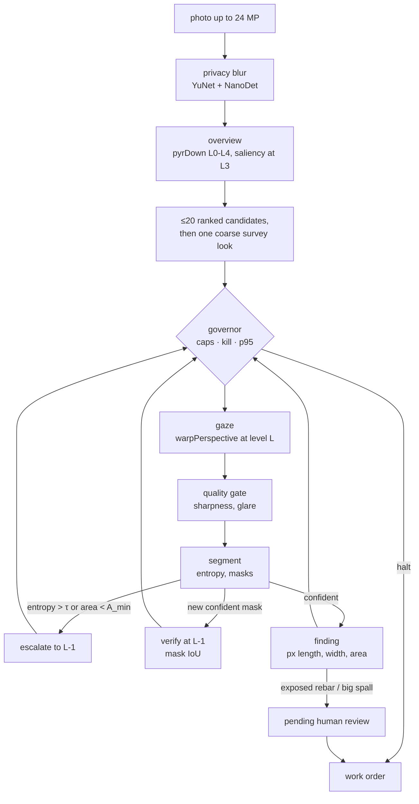

Each job is a loop of camera moves over an image pyramid (L0 = full resolution,
L4 = 1/16):

1. **Overview.** `pyrDown` to L4; a saliency prior at L3 from `cvtColor`,
   `GaussianBlur`, `Sobel`, black-hat `morphologyEx`, `adaptiveThreshold`, CLAHE
   and a rust-hue `inRange`; up to 20 ranked candidate windows.
2. **Gaze.** `warpPerspective` renders a 512² virtual-PTZ view (pan, zoom, and
   yaw/pitch for oblique de-warp) whose pixels map back to L0 exactly.
3. **Quality gate.** Laplacian sharpness and exposure; glare and blur are logged
   and not trusted.
4. **Segment.** Per-class probabilities, masks and an entropy score. The demo
   engine is classical (evidence maps, no weights); a dacl10k ONNX model runs on
   OpenCV 5 DNN `ENGINE_NEW` with the same interface.
5. **Decide.** Escalate one level finer, centred on what it saw, when entropy
   > τ or the mask is below A_min; verify a new confident mask one level finer by
   mask IoU; log findings with length, width, area and orientation in pixels.
6. **Govern.** Before every step: kill switch, pixel / $ / seconds caps, p95
   latency against the SLA (switch to the fast model, then a coarser level),
   warp spikes, and a $ ≥ 80 % mode that verifies only critical classes.
7. **Stop** when the best remaining expected value per ms falls below a quarter
   of the realised value per ms so far.

Critical findings (exposed rebar; spalling above 40 000 px²) wait in
`pending_review`. Only a human — the web review or `drishyam review` — can
approve or reject them; nothing the agent, the MCP tools or the planner can call
reaches that transition.

## 3. Evidence that it is agentic

Every step's action is a logged function of an OpenCV output or a runtime
statistic, with a `cause`. A recorded trace (synthetic sample `bridge_03`, 30 % pixel cap, fixed clock):

```json
{"step": 1, "decision": {"action": "gaze", "args": {"x": 1500, "y": 1125, "level": 3}}, "observation": {"entropy": 0.69, "mask_area_px": 894}, "cause": "survey", "rationale": "one L3 look covers all 3 candidates before zooming; 7 looks affordable"}
{"step": 2, "decision": {"action": "escalate", "args": {"x": 1374, "y": 1226, "level": 2}}, "observation": {"entropy": 0.34, "mask_area_px": 10740}, "cause": "entropy>tau", "rationale": "entropy 0.69 > 0.5 at L3"}
{"step": 4, "decision": {"action": "verify", "args": {"x": 1597, "y": 1542, "level": 0}}, "observation": {"entropy": 0.33, "mask_area_px": 57395}, "cause": "verify-new-mask", "rationale": "new spalling mask at L1; confirming at L0"}
```

The entropy OpenCV measured on the coarse survey (0.69 > τ = 0.5) changed the next
tool call from "next candidate" to "zoom one level finer, centred on the uncertain
pixels"; a new confident spalling mask then triggered a verification one level finer.
The resulting exposed-rebar finding carries its evidence trail (`steps: [2, 3]`) and
waits in `pending_review` for a human.

Failure drills, each runnable from the UI (`chaos` toggles) and covered by tests:

| Drill | Result |
| --- | --- |
| 20 planner timeouts + 20 malformed planner replies | 40 / 40 recovered by the rule planner (`test_20_timeouts_and_20_malformed_all_recover`) |
| Forced p95 spike on the segmenter | the next step's cause is `p95>SLA` and its model is `fast` (`test_forced_p95_spike_changes_next_steps_model`) |
| KILL during a live job on Vercel | kill sent during step 3 → step 4 halted with cause `kill-switch` (verified on the production deployment) |
| $ and pixel caps | the job halts inside one step with coverage and unvisited regions reported (`test_pixel_cap_is_never_exceeded`, `test_seconds_and_usd_caps_halt`) |
| Agent tries to approve its own critical finding | `ForbiddenTransition` (`test_agent_cannot_decide_or_downgrade`) |

## 4. Evaluation

Measured on **200 held-out labelled synthetic images** (seed 7; policy changes were tuned only on a separate 60-image dev split), one segmenter and one matching rule for every policy (a ground-truth box is found by a same-class component with IoU ≥ 0.3 or containing its centre).

| Policy | pixels processed (× image) | recall | $ / image (modelled) |
| --- | --- | --- | --- |
| downscale once (1024 px) | 0.25 | 0.50 | 0.000074 |
| tiling, L2 grid | 0.06 | 0.44 | 0.000019 |
| tiling, L1 grid | 0.50 | 0.55 | 0.000139 |
| tiling, L0 (exhaustive, 20 % overlap) | 1.67 | 0.55 | 0.000443 |
| **Drishyam**, cap 5 % | 0.02 | **0.00** (no 512² look fits after the overview on a 3 MP image) | 0.000005 |
| **Drishyam**, cap 10 % | 0.10 | **0.30** | 0.000029 |
| **Drishyam**, cap 20 % | 0.18 | **0.43** | 0.000053 |
| **Drishyam**, cap 30 % | 0.25 | **0.48** | 0.000072 |
| **Drishyam**, cap 50 % | 0.37 | **0.53** | 0.000102 |
| **Drishyam**, cap 100 % | 0.47 | **0.54** | 0.000129 |

- At a **30 % cap** Drishyam finds **0.48** of the defects using **0.25** of the image's pixels: **0.88×** exhaustive tiling's recall at **0.15×** its pixels, 0.97× a same-pixel downscale.
- At a **50 % cap**: **0.53** at 0.37 of the pixels = **0.97×** tiling's recall at **0.22×** its pixels. **Verdict on the PRD hypothesis (≥ 0.9× tiling recall at ≤ 0.3 of the full-resolution pixels): not met** — at 0.25 of the pixels Drishyam reaches 0.88×. Measured against tiling's real pixel spend (1.67× the image, because tiles overlap), it reaches 0.97× at 0.22× from the 50 % cap.
- Honest caveats: the best tiling grid (L1, 0.55 at 0.50) still beats Drishyam at equal pixels, and the hysteresis segmenter shipped with this policy lifted every baseline too, so it is not a Drishyam-only gain.
- Critical false-accept rate (critical prediction with no critical ground truth): Drishyam @30 % 0.52 vs exhaustive tiling 0.79 (the PRD asks for ≤ tiling); a single downscale (0.49) and L2 tiling (0.42) are lower still.
- Agent: 100 % of steps carry a cause; 38 of 38 planner drills that fired were recovered by the rule planner (2 of the 40 injected never fired because those jobs finished first); governor drills 10/10; escalation rate 17 %; at the 30 % cap, 3 looks and 0.27 of the pixels per image (p50 = p95). Human-approval latency is not measured (the web demo is stateless) and the FR-21 ablations were not run.

The images are procedural (`evals/synth.py`): 2048×1536 weathered concrete with drawn cracks, spalls, efflorescence, exposed rebar and rust run-off, plus graffiti, formwork lines, water stains, blur and glare as distractors. The eight bundled samples in `public/samples/` come from the same generator. The same harness on real photos follows the synthetic results below.

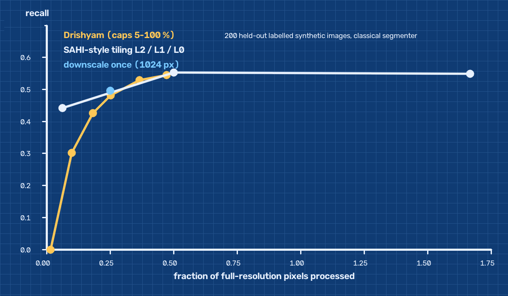

(A static drawing of the committed `public/results/summary.json`; the live site's FIG. 4.1 draws the same file.)

| per-class recall | crack | spalling | efflorescence | exposed_rebar | corrosion |
|---|---|---|---|---|---|
| Drishyam @30 % | 0.45 | 0.62 | 0.16 | 0.54 | 0.58 |
| tiling L0 | 0.47 | 0.70 | 0.25 | 0.52 | 0.75 |
| downscale | 0.48 | 0.57 | 0.22 | 0.44 | 0.66 |

Full numbers: [public/results/summary.json](../public/results/summary.json); failure gallery (12 measured cases from the synthetic run, 6 categories): [public/results/failures.json](../public/results/failures.json), also on the live site.

On 200 labelled synthetic images, Drishyam at a 30% pixel cap found 0.48 of ground-truth boxes using 0.25 of the image's pixels, versus 0.55 for 20%-overlap 512-px tiling using 1.67: 0.88x its recall (0.75x with one-box-per-class boxes, 1.25x with as-specified mixed boxes) at 0.15x its pixels, which does not meet the 0.9x-at-0.3x hypothesis. It is 0.97x a single 1024-px downscale (0.50 at 0.25 of the pixels), 0.87x L1 tiling (0.55 at 0.50, the best grid) and 1.09x L2 tiling (0.44 at 0.06), and 0.93x L0 tiling when a match needs IoU >= 0.3 (no contains-the-centre clause).

### Real bridge photos (CODEBRIM)

The same harness, segmenter and matching rule on **200 real inspection photos** from CODEBRIM: a seeded subset (seed 7) of the 1,052 annotated originals, mostly 4608×3456 px (2 to 24 MP), holding 1,008 defect boxes with 1,685 class labels (a box showing several defects is scored once per class) and at least 175 labels in every class. `make data` downloads and checks the 8.3 GB archive and `make eval-real` runs it; the 200 file names are committed in `evals/codebrim_eval200.txt`. The dataset's licence is non-commercial and bars sharing the photos, so only the numbers are published (the failure crops stay in the git-ignored `results/codebrim/`).

| Policy | pixels processed (× image) | recall | recall, IoU ≥ 0.3 only | boxes per image |
| --- | --- | --- | --- | --- |
| downscale once (1024 px) | 0.07 | 0.20 | 0.08 | 184 |
| tiling, L2 grid | 0.10 | 0.21 | 0.08 | 254 |
| tiling, L1 grid | 0.42 | 0.22 | 0.08 | 930 |
| tiling, L0 (exhaustive, 20 % overlap) | 1.62 | 0.21 | 0.06 | 3,144 |
| **Drishyam**, cap 5 % | 0.04 | **0.11** | 0.04 | 94 |
| **Drishyam**, cap 10 % | 0.09 | **0.13** | 0.05 | 264 |
| **Drishyam**, cap 20 % | 0.19 | **0.19** | 0.07 | 606 |
| **Drishyam**, cap 30 % | 0.29 | **0.20** | 0.09 | 929 |
| **Drishyam**, cap 50 % | 0.42 | **0.22** | 0.09 | 1,355 |
| **Drishyam**, cap 100 % | 0.44 | **0.22** | 0.09 | 1,347 |

| per-class recall | crack | spalling | efflorescence | exposed_rebar | corrosion |
|---|---|---|---|---|---|
| Drishyam @30 % | 0.30 | 0.00 | 0.05 | 0.01 | 0.53 |
| tiling L0 | 0.31 | 0.01 | 0.02 | 0.00 | 0.58 |
| downscale | 0.29 | 0.01 | 0.06 | 0.00 | 0.55 |

- **The PRD's hypothesis test (G1, defined on these photos) passes on paper and means little.** At a 30 % cap Drishyam reaches **0.97×** exhaustive tiling's recall at **0.18×** its pixels. But every baseline, and Drishyam from the 20 % cap up, finds only about one labelled defect in five (0.19 to 0.22); a single 1024-px downscale matches Drishyam at a quarter of its pixels; and without the contains-the-centre clause recall is 0.04 to 0.09 for every policy.
- **On real photos the segmenter, not where the agent looks, limits recall.** The classical engine was tuned on synthetic images. On real concrete it reports up to thousands of boxes per image (929 for Drishyam at 30 %, 3,144 for L0 tiling), so part of the credit is chance centre hits, and 98 to 100 % of every policy's critical predictions match no critical ground truth. It finds cracks (0.30) and corrosion (0.53) and effectively misses spalling (0.00) and exposed rebar (0.01).
- **The agent's control carries over.** 100 % of steps carry a cause; 40 of 40 planner drills and 10 of 10 governor drills recovered. The governor stepped in 91 times during the run: 77 times the p95 segmentation time of a 512 px look went over its 500 ms SLA, and 14 warp spikes (on the synthetic set: 0 and 1). At the 30 % cap a job takes 17 looks (p50; 26 at p95), against 3 on the smaller synthetic images.
- **Failure cases** (8, kept local): cracks missed under the 30 % cap that the full budget finds, and exposed rebar or spalling reported as corrosion.
- **Next:** the dacl10k-trained segmenter ([training/](../training/README.md), a Kaggle notebook) is what these numbers call for; after `scripts/install_model.sh`, `DRISHYAM_ONNX=models/drishyam_dacl10k.onnx .venv/bin/python -m evals.harness --data data/codebrim --out runs/model-eval/codebrim --results-dir runs/model-eval/codebrim/raw` repeats this comparison with it and leaves the published classical numbers in place. A leakage check between dacl10k and this subset (PRD section 9) has to come first; it has not been run.

Full numbers: [public/results/codebrim/summary.json](../public/results/codebrim/summary.json), also on the live site (FIG. 4.2). CODEBRIM: Mundt, Majumder, Murali, Panetsos and Ramesh, "Meta-learning Convolutional Neural Architectures for Multi-target Concrete Defect Classification with the COncrete DEfect BRidge IMage Dataset", CVPR 2019.

### Failure gallery (synthetic set)

Twelve measured failures from the synthetic run, two per category (FIG. 5 on the live site):

| Plate | Category | What happened | Rule that would catch it |
| --- | --- | --- | --- |
| 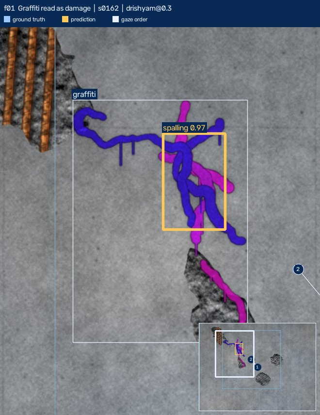 | Graffiti read as damage | s0162, drishyam@0.3: a spalling finding (confidence 0.97, step 2 at L1) lies within the bounding box of a graffiti patch and matches no ground-truth box of any class. | Chroma gate before drafting: spray paint is far more saturated than concrete or rust, so a candidate whose median saturation sits well above the surrounding concrete and outside the rust hue band is dropped as non-structural. Not implemented. |
| 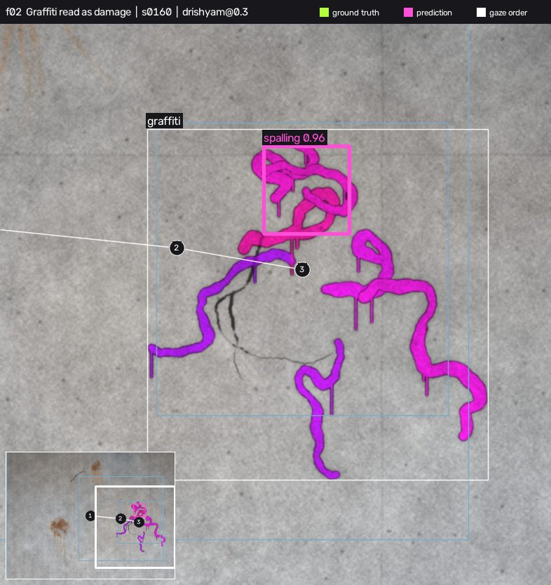 | Graffiti read as damage | s0160, drishyam@0.3: a spalling finding (confidence 0.96, step 2 at L1) lies within the bounding box of a graffiti patch and matches no ground-truth box of any class. | Chroma gate before drafting: spray paint is far more saturated than concrete or rust, so a candidate whose median saturation sits well above the surrounding concrete and outside the rust hue band is dropped as non-structural. Not implemented. |
| 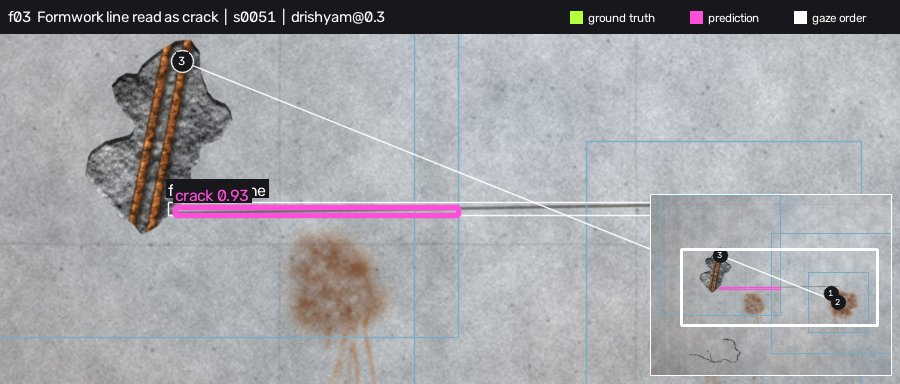 | Formwork line read as crack | s0041, drishyam@1.0: a crack finding (confidence 0.94, step 4 at L0) lies within the bounding box of a formwork line patch and matches no ground-truth box of any class. | Straightness test on the crack mask: a centreline that fits one straight line within about 1.5 px over a length of 20x its width is a formwork seam, not a crack, because real cracks meander (cv2.fitLine residual, minAreaRect aspect). Not implemented. |
| 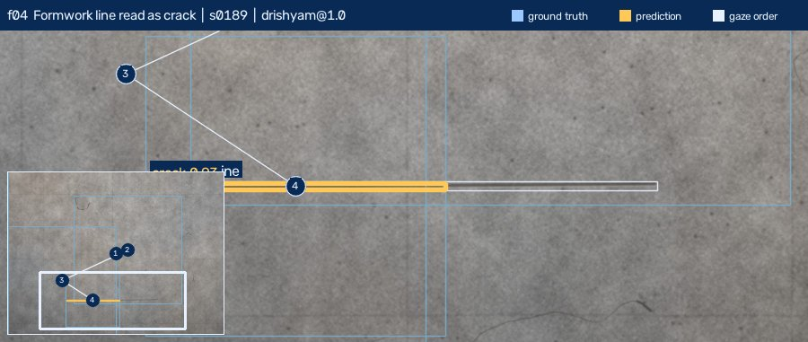 | Formwork line read as crack | s0189, drishyam@1.0: a crack finding (confidence 0.93, step 4 at L0) lies within the bounding box of a formwork line patch and matches no ground-truth box of any class. | Straightness test on the crack mask: a centreline that fits one straight line within about 1.5 px over a length of 20x its width is a formwork seam, not a crack, because real cracks meander (cv2.fitLine residual, minAreaRect aspect). Not implemented. |
| 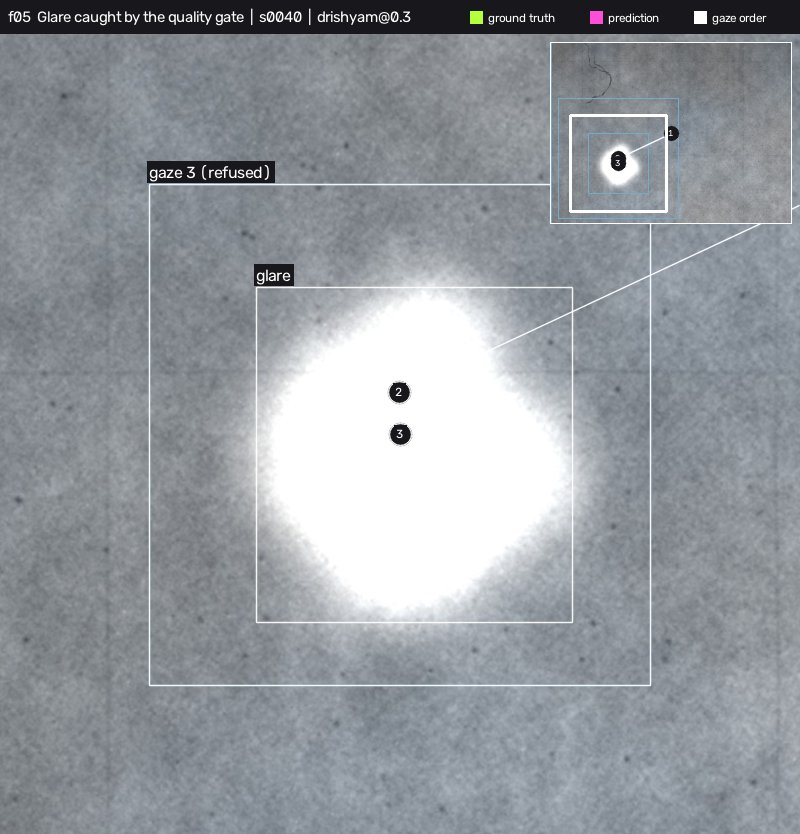 | Glare caught by the quality gate | s0040, drishyam@0.3: step 3 (L0) was refused by the quality gate (glare, sharpness 20.9) because the window covers a blown-out highlight. 0 ground-truth box(es) have their centre in that window. The gate did what it should; the cost is an area the work order silently leaves unassessed. | The gate (more than 20% blown-out pixels) works. The missing rule is bookkeeping: a refused window is written to the work order as 'not assessed' with a re-shoot suggestion, so the area never reads as clean. Not implemented. |
| 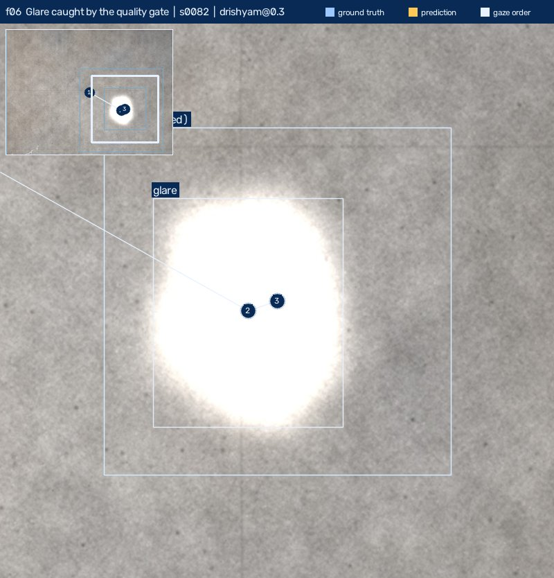 | Glare caught by the quality gate | s0082, drishyam@0.3: step 3 (L0) was refused by the quality gate (glare, sharpness 19.2) because the window covers a blown-out highlight. 0 ground-truth box(es) have their centre in that window. The gate did what it should; the cost is an area the work order silently leaves unassessed. | The gate (more than 20% blown-out pixels) works. The missing rule is bookkeeping: a refused window is written to the work order as 'not assessed' with a re-shoot suggestion, so the area never reads as clean. Not implemented. |
| 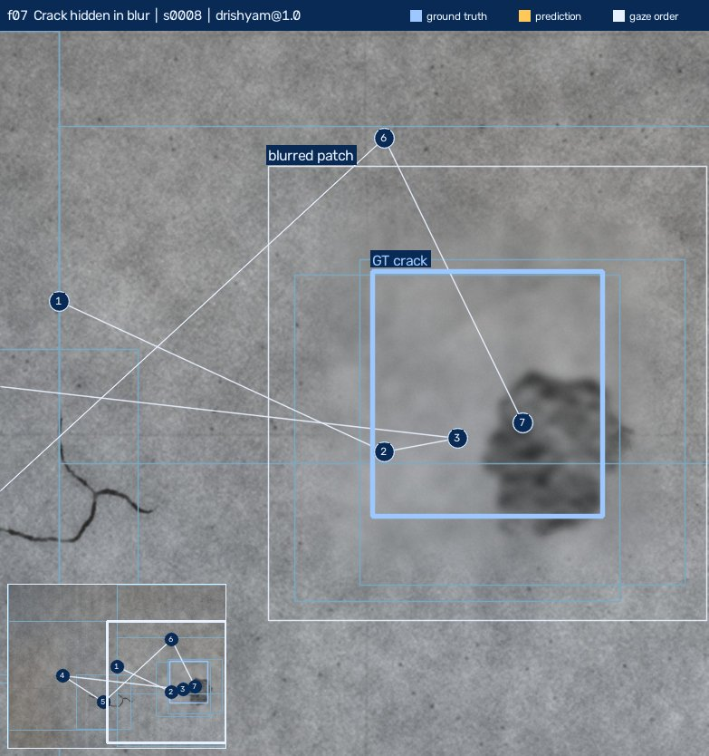 | Crack hidden in blur | s0004, drishyam@1.0: a 283x366 px crack inside a blurred patch was not found; it was looked at (step 1, L2, sharpness 43.2), the gate accepted the view, and no crack mask came out of it. | A local sharpness map: where Laplacian variance falls below the gate, report the area as unreadable and ask for a re-shoot; where the gate accepted the view, scale the sharpness threshold to the expected crack width. Not implemented. |
| 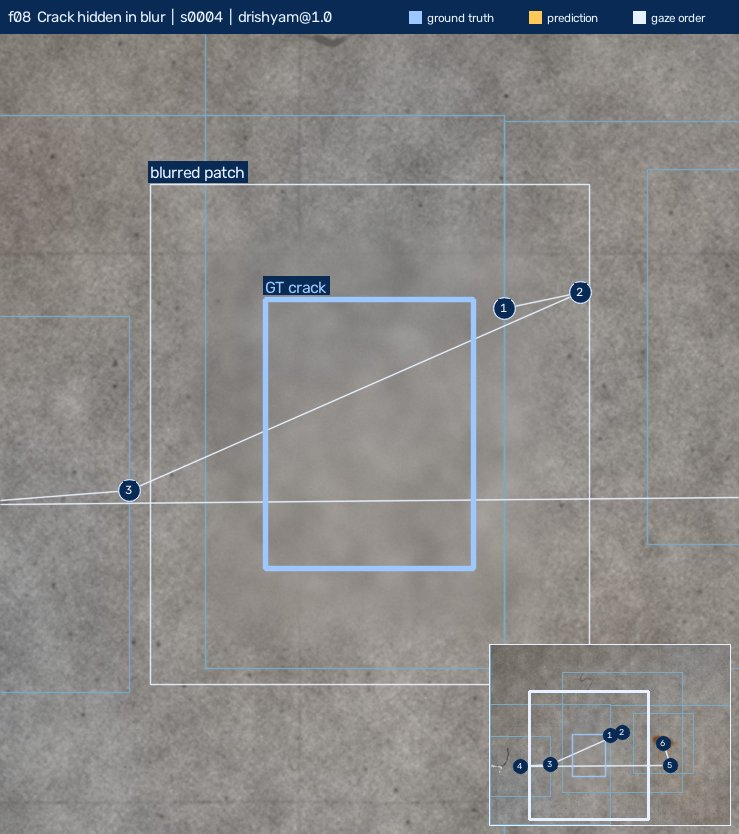 | Crack hidden in blur | s0008, drishyam@1.0: a 361x385 px crack inside a blurred patch was not found; it was looked at (step 1, L2) and the quality gate refused the view (blur, sharpness 10.1). | A local sharpness map: where Laplacian variance falls below the gate, report the area as unreadable and ask for a re-shoot; where the gate accepted the view, scale the sharpness threshold to the expected crack width. Not implemented. |
| 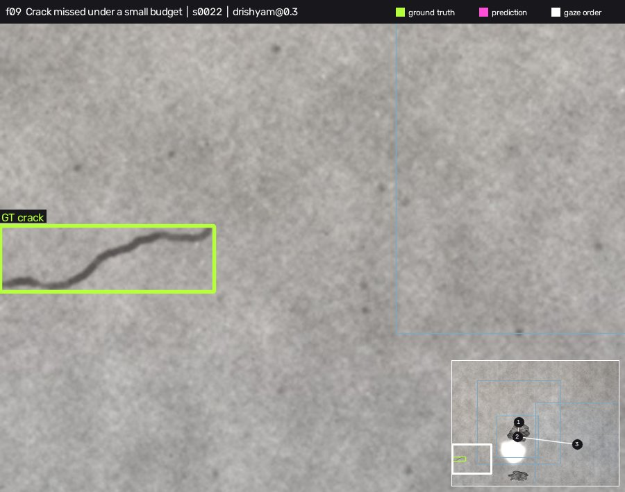 | Crack missed under a small budget | s0094, drishyam@0.3: a 44x96 px crack box is missed under the 30% cap but found by drishyam@1.0 and tiling@L0; it was looked at (step 1, L2) but no crack mask survived. | Reserve a small share of the pixel cap for a coarse sweep of low-saliency regions, or lower the stop-rule epsilon so the job does not stop while unvisited candidates remain. Both trade pixels for recall. Not implemented. |
| 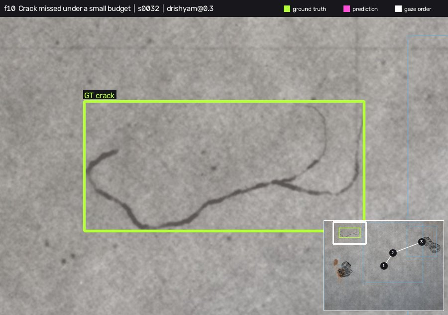 | Crack missed under a small budget | s0032, drishyam@0.3: a 354x164 px crack box is missed under the 30% cap but found by drishyam@1.0 and tiling@L0; it was looked at (step 1, L2) but no crack mask survived. | Reserve a small share of the pixel cap for a coarse sweep of low-saliency regions, or lower the stop-rule epsilon so the job does not stop while unvisited candidates remain. Both trade pixels for recall. Not implemented. |
| 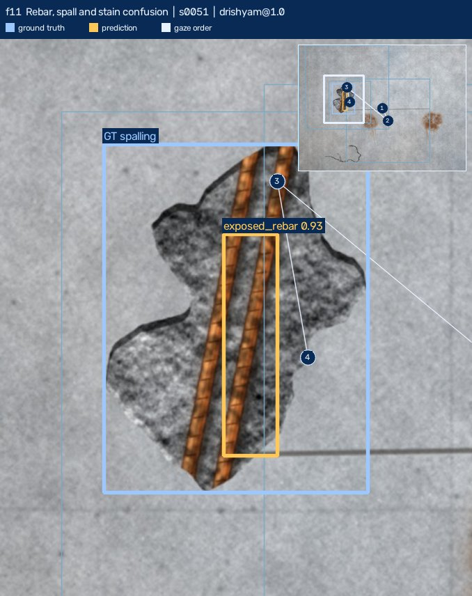 | Rebar, spall and stain confusion | s0051, drishyam@1.0: ground truth is spalling, the job reported exposed_rebar there (confidence 0.93, step 4 at L0) and no spalling finding overlaps the box. | Shape and co-occurrence rule: exposed bars need rust inside a spall rim and a linear shape (minAreaRect aspect above 3); rust with no spall rim is corrosion. Where two classes clear the threshold on one region, send it to human review instead of choosing. The rust-near-spall part exists; the review-on-ambiguity step does not. |
| 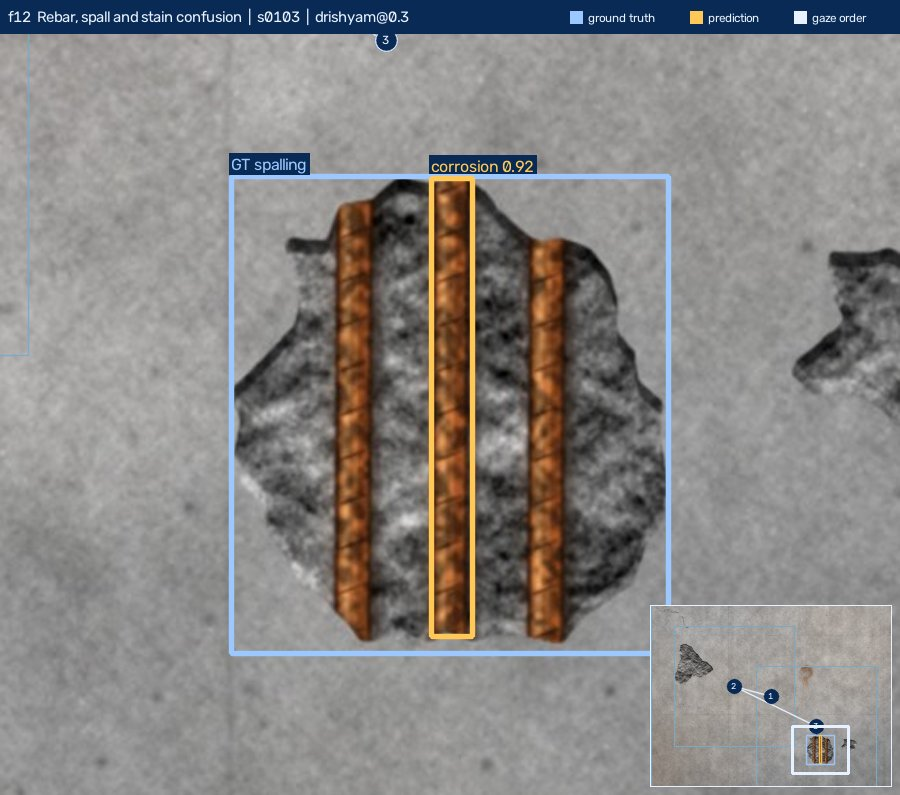 | Rebar, spall and stain confusion | s0171, drishyam@1.0: ground truth is spalling, the job reported exposed_rebar there (confidence 0.93, step 4 at L0) and no spalling finding overlaps the box. | Shape and co-occurrence rule: exposed bars need rust inside a spall rim and a linear shape (minAreaRect aspect above 3); rust with no spall rim is corrosion. Where two classes clear the threshold on one region, send it to human review instead of choosing. The rust-near-spall part exists; the review-on-ambiguity step does not. |

## 5. COOL on Graviton

Every camera move is a KleidiCV-accelerated op (`pyrDown`, `warpPerspective`,
`resize`), and there is no `filter2D` and no NumPy pixel loop on the gaze path.
The classical segmenter and the measurement step also use ops COOL does not
accelerate (`connectedComponentsWithStats`, `findContours`, CLAHE,
`adaptiveThreshold`, `Laplacian`) and a NumPy softmax; segmentation is 69 % of a
job and the KleidiCV-covered imgproc share is 9 % (`results/local-macos-x86/macro.json`). `bench/run_all.sh <arm>` runs the micro and macro benchmarks and a parity
save with a provenance block (OpenCV version, build-info hash, whether `cv2` loads from
`/opt/cool`) and `bench/parity.py` checks that two arms produce identical masks.
The same code passes CI on GitHub's free arm64 runners.

The three-arm run (COOL/c8g, stock/c8g, stock/c7i) needs the owner's AWS
account. [bench/aws_runbook.md](../bench/aws_runbook.md) is the copy-paste
sequence. It sets up the budget and stop action, launches the three arms,
which terminate themselves after 3 hours, runs them through SSM and copies the
results back, for at most about $1 per arm. `python -m bench.compare_arms results/A
results/B results/C` then writes `docs/cool_benchmark.md` (per-op
and whole-job speed-ups, $/1k images, the Amdahl split, A-vs-B mask parity and
provenance) next to the PRD's expected 1.2–1.8× op-level and 1.2–1.3× end-to-end
range.

**What COOL can buy end to end, measured.** An 8-image macro run on the local x86 laptop ([results/local-macos-x86/macro.json](../results/local-macos-x86/macro.json)) puts 9 % of a job in KleidiCV-covered imgproc, 69 % in the classical segmenter (imgproc plus NumPy), 3 % in crack thinning, 8 % in decode and 12 % in Python. So if COOL makes the covered ops 1.8× faster, a whole job gets about 1.04× faster. The gaze path itself is cheap; most of the time is in segmentation, which is where a COOL or DNN speed-up would have to land.

## 6. Human control, safety and responsible use

- Evidence-first UI: crop, measurements and gaze step before any confidence
  number; an "AI-assisted, not an inspection" banner on every finding.
- Pixels only. No millimetres without a scale reference; no safety ratings.
- Faces, people and vehicles are blurred (YuNet, NanoDet) before analysis or
  display; a photo mostly filled by a person is refused.
- The planner sees a numeric digest only. Threat model and tests:
  [security.md](security.md).

## 7. Cost

Spent so far: **$0.** Vercel Hobby (the live demo), GitHub Actions (CI on x86
and arm64), local CPU for evaluation. The $ in the UI is *modelled* at the
c8g.2xlarge + COOL rate ($0.339/h) so the curves read as a buyer's cost.

## 8. Limits and next steps

- The policy comparison holds on synthetic images, but on 200 real CODEBRIM
  photos the **classical** segmenter caps every policy at about 0.2 recall.
  Next: train the dacl10k model on Kaggle (`training/`), install it with
  `scripts/install_model.sh`, and re-run `make eval-real` with `DRISHYAM_ONNX` set.
- The COOL three-arm benchmark and the DynamoDB / SNS / CDK stack need AWS.
- The web demo is stateless; the signed `work_order.json` is its audit trail.

## 9. Reproduce

```bash
uv sync --all-extras && make test && make eval && make bench
```
