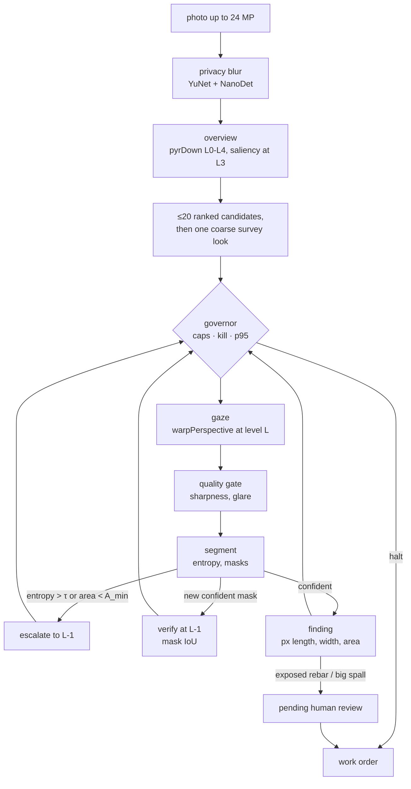

# Drishyam — submission report

*Virtual-PTZ inspection of bridge photos with an agent that spends compute in
proportion to risk.* Live demo: https://drishyam-seven.vercel.app · Code: https://github.com/vj-io/drishyam · Demo video (49 s): https://github.com/vj-io/drishyam/releases/latest/download/drishyam-demo.mp4

## 1. Problem

Bridge owners have photo backlogs they cannot inspect: the defects that matter
most (hairline cracks, early exposed rebar) are invisible at thumbnail scale, so
a tool must either tile every photo at full resolution or guess where to look.
Drishyam's bet is that *looking is cheap when it is a geometric warp*, and that
where to look next can be read from what OpenCV just measured.

## 2. What the agent does



Each job is a loop of camera moves over an image pyramid (L0 = full resolution,
L4 = 1/16):

1. **Overview.** `pyrDown` to L4; a saliency prior at L3 from `cvtColor`,
   `GaussianBlur`, `Sobel`, black-hat `morphologyEx`, `adaptiveThreshold`, CLAHE
   and a rust-hue `inRange`; up to 20 ranked candidate windows.
2. **Gaze.** `warpPerspective` renders a 512² virtual-PTZ view (pan, zoom, and
   yaw/pitch for oblique de-warp) whose pixels map back to L0 exactly.
3. **Quality gate.** Laplacian sharpness and exposure; glare and blur are logged
   and not trusted.
4. **Segment.** Per-class probabilities, masks and an entropy score. The demo
   engine is classical (evidence maps, no weights); a dacl10k ONNX model runs on
   OpenCV 5 DNN `ENGINE_NEW` with the same interface.
5. **Decide.** Escalate one level finer, centred on what it saw, when entropy
   > τ or the mask is below A_min; verify a new confident mask one level finer by
   mask IoU; log findings with length, width, area and orientation in pixels.
6. **Govern.** Before every step: kill switch, pixel / $ / seconds caps, p95
   latency against the SLA (switch to the fast model, then a coarser level),
   warp spikes, and a $ ≥ 80 % mode that verifies only critical classes.
7. **Stop** when the best remaining expected value per ms falls below a quarter
   of the realised value per ms so far.

Critical findings (exposed rebar; spalling above 40 000 px²) wait in
`pending_review`. Only a human — the web review or `drishyam review` — can
approve or reject them; nothing the agent, the MCP tools or the planner can call
reaches that transition.

## 3. Evidence that it is agentic

Every step's action is a logged function of an OpenCV output or a runtime
statistic, with a `cause`. A recorded trace (synthetic sample `bridge_03`, 30 % pixel cap, fixed clock):

```json
{"step": 1, "decision": {"action": "gaze", "args": {"x": 1500, "y": 1125, "level": 3}}, "observation": {"entropy": 0.69, "mask_area_px": 894}, "cause": "survey", "rationale": "one L3 look covers all 3 candidates before zooming; 7 looks affordable"}
{"step": 2, "decision": {"action": "escalate", "args": {"x": 1374, "y": 1226, "level": 2}}, "observation": {"entropy": 0.34, "mask_area_px": 10740}, "cause": "entropy>tau", "rationale": "entropy 0.69 > 0.5 at L3"}
{"step": 4, "decision": {"action": "verify", "args": {"x": 1597, "y": 1542, "level": 0}}, "observation": {"entropy": 0.33, "mask_area_px": 57395}, "cause": "verify-new-mask", "rationale": "new spalling mask at L1; confirming at L0"}
```

The entropy OpenCV measured on the coarse survey (0.69 > τ = 0.5) changed the next
tool call from "next candidate" to "zoom one level finer, centred on the uncertain
pixels"; a new confident spalling mask then triggered a verification one level finer.
The resulting exposed-rebar finding carries its evidence trail (`steps: [2, 3]`) and
waits in `pending_review` for a human.

Failure drills, each runnable from the UI (`chaos` toggles) and covered by tests:

| Drill | Result |
| --- | --- |
| 20 planner timeouts + 20 malformed planner replies | 40 / 40 recovered by the rule planner (`test_20_timeouts_and_20_malformed_all_recover`) |
| Forced p95 spike on the segmenter | the next step's cause is `p95>SLA` and its model is `fast` (`test_forced_p95_spike_changes_next_steps_model`) |
| KILL during a live job on Vercel | kill sent during step 3 → step 4 halted with cause `kill-switch` (verified on the production deployment) |
| $ and pixel caps | the job halts inside one step with coverage and unvisited regions reported (`test_pixel_cap_is_never_exceeded`, `test_seconds_and_usd_caps_halt`) |
| Agent tries to approve its own critical finding | `ForbiddenTransition` (`test_agent_cannot_decide_or_downgrade`) |

## 4. Evaluation

Measured on **200 held-out labelled synthetic images** (seed 7; policy changes were tuned only on a separate 60-image dev split, seed 4242, `make eval-dev`), one segmenter and one matching rule for every policy (a ground-truth box is found by a same-class component with IoU ≥ 0.3 or containing its centre; "IoU-only" drops the centre clause). The 95 % intervals are a bootstrap over images, paired across policies. "Chance" moves each policy's own boxes (same class and size) to random places in the photo and scores them again. Precision is one-to-one: in confidence order each prediction claims at most one ground-truth box, so a defect reported again from a second look is a false box; "hits per matched box" counts the predictions that land on each box found (1 = no duplicates). All of it runs on the **fixed cost model** (`--cost-model fixed`): every op the agent times costs its p50 from the `job_ops` table in `results/local-macos-x86/micro.json` on every call, so t̂, the stop rule and the governor see the same costs on a busy machine as on an idle one, and a re-run reproduces the numbers exactly. $ is that modelled time × $0.339/h (untimed Python is not charged).

| Policy | pixels (× image) | recall (95 % CI) | IoU-only recall | chance recall (IoU-only) | precision | false boxes / image | hits per matched box | $ / image (modelled) |
| --- | --- | --- | --- | --- | --- | --- | --- | --- |
| downscale once (1024 px) | 0.25 | 0.50 (0.46–0.54) | 0.43 | 0.02 (0.01) | 0.120 | 12.2 | 1.03 | 0.000030 |
| tiling, L2 grid | 0.06 | 0.44 (0.41–0.48) | 0.40 | 0.02 (0.01) | 0.148 | 8.5 | 1.04 | 0.000008 |
| tiling, L1 grid | 0.50 | 0.55 (0.52–0.59) | 0.48 | 0.02 (0.01) | 0.096 | 17.3 | 1.05 | 0.000060 |
| tiling, L0 (exhaustive, 20 % overlap) | 1.67 | 0.55 (0.51–0.59) | 0.47 | 0.03 (0.01) | 0.021 | 83.4 | 1.08 | 0.000196 |
| **Drishyam**, cap 5 % | 0.02 | **0.00** (no 512² look fits after the overview on a 3 MP image) | 0.00 | 0.00 (0.00) | – | 0.0 | – | 0.000002 |
| **Drishyam**, cap 10 % | 0.10 | **0.30** (0.27–0.34) | 0.27 | 0.01 (0.00) | 0.125 | 7.0 | 1.05 | 0.000012 |
| **Drishyam**, cap 20 % | 0.18 | **0.43** (0.39–0.47) | 0.39 | 0.02 (0.01) | 0.114 | 11.2 | 1.45 | 0.000022 |
| **Drishyam**, cap 30 % | 0.25 | **0.47** (0.44–0.51) | 0.43 | 0.02 (0.01) | 0.099 | 14.5 | 1.49 | 0.000030 |
| **Drishyam**, cap 50 % | 0.35 | **0.52** (0.49–0.56) | 0.46 | 0.04 (0.02) | 0.083 | 19.4 | 1.64 | 0.000043 |
| **Drishyam**, cap 100 % | 0.46 | **0.53** (0.50–0.57) | 0.47 | 0.05 (0.02) | 0.069 | 24.4 | 1.79 | 0.000056 |

- At a **30 % cap** Drishyam finds **0.47** of the defects using **0.25** of the image's pixels: **0.86×** exhaustive tiling's recall (95 % CI 0.80–0.93) at **0.15×** its pixels. Against a single downscale at the same pixels it is 0.96× (95 % CI 0.90–1.02): one downscale does as well.
- At a **50 % cap**: **0.52** at 0.35 of the pixels = **0.95×** tiling's recall at **0.21×** its pixels. Uncapped, the stop rule ends 182 of 200 jobs by itself, at 0.46 of the pixels with 0.97× tiling's recall. **Verdict on the PRD hypothesis (≥ 0.9× tiling recall at ≤ 0.3 of the full-resolution pixels): not met** — at 0.25 of the pixels Drishyam reaches 0.86× (its interval reaches 0.93, so 0.9 is not ruled out either). Measured against tiling's real pixel spend (1.67× the image, because tiles overlap), it reaches 0.95× at 0.21× from the 50 % cap.
- Well above chance: the same boxes at random places score 0.00 to 0.05 for every policy.
- False boxes: precision 0.099 for Drishyam at 30 % (14.5 false boxes per image) against 0.120 for one downscale (12.2) and 0.021 for exhaustive tiling (83.4). Drishyam reports a defect again from each look in its evidence trail (1.49 predictions per matched box, against 1.03 for one downscale), so it makes more false boxes than one downscale, though far fewer than exhaustive tiling.
- Hairline cracks (87 of the 227 crack boxes are 1–2 px wide; the flag is in the ground truth): exhaustive tiling finds 0.25 of them, one downscale 0.10, Drishyam 0.09 at the 30 % cap and 0.17 uncapped. Only 16 boxes are under 96² px, too few to read anything into.
- Honest caveats: the best tiling grid (L1, 0.55 at 0.50) still beats Drishyam at equal pixels, and the hysteresis segmenter shipped with this policy lifted every baseline too, so it is not a Drishyam-only gain.
- Critical false-accept rate (critical prediction with no critical ground truth): Drishyam @30 % 0.52 vs exhaustive tiling 0.79 (the PRD asks for ≤ tiling); a single downscale (0.49) and L2 tiling (0.42) are lower still.
- Agent: 100 % of steps carry a cause; 40 of 40 injected planner drills were recovered by the rule planner and 10 of 10 governor drills (the drills run on the same fixed costs, so each job reaches its injection step on any machine load); escalation rate 17 %; at the 30 % cap, 3 looks and 0.27 of the pixels per image (p50 = p95). Human-approval latency is not measured (the web demo is stateless) and the FR-21 ablations were not run.

The images are procedural (`evals/synth.py`): 2048×1536 weathered concrete with drawn cracks, spalls, efflorescence, exposed rebar and rust run-off, plus graffiti, formwork lines, water stains, blur and glare as distractors. The eight bundled samples in `public/samples/` come from the same generator. The same harness on real photos follows the synthetic results below.


(The live site's FIG. 4.1, rendered from the committed `public/results/summary.json`: bars are the 95 % intervals, dotted ticks the chance level.)

| per-class recall | crack | spalling | efflorescence | exposed_rebar | corrosion |
|---|---|---|---|---|---|
| Drishyam @30 % | 0.44 | 0.62 | 0.15 | 0.51 | 0.57 |
| tiling L0 | 0.47 | 0.70 | 0.25 | 0.52 | 0.75 |
| downscale | 0.48 | 0.57 | 0.22 | 0.44 | 0.66 |

Full numbers: [public/results/summary.json](../public/results/summary.json); every prediction and trace: [public/results/per_image.json.gz](../public/results/per_image.json.gz); failure gallery (12 measured cases from the synthetic run, 6 categories): [public/results/failures.json](../public/results/failures.json), also on the live site.

On 200 labelled synthetic images, Drishyam at a 30% pixel cap found 0.47 of ground-truth boxes using 0.25 of the image's pixels, versus 0.55 for 20%-overlap 512-px tiling using 1.67: 0.86x its recall (95% CI 0.80-0.93, 0.75x with one-box-per-class boxes, 1.23x with as-specified mixed boxes) at 0.15x its pixels, which does not meet the 0.9x-at-0.3x hypothesis. It is 0.96x a single 1024-px downscale (95% CI 0.90-1.02, 0.50 at 0.25 of the pixels), 0.86x L1 tiling (0.55 at 0.50, the best grid) and 1.07x L2 tiling (0.44 at 0.06), and 0.92x L0 tiling when a match needs IoU >= 0.3 (95% CI 0.85-0.99, no contains-the-centre clause); its own boxes placed at random would score 0.02 (0.01 with IoU only).

**Fixed costs against measured wall time.** `make eval-live` reruns the synthetic set the way the app runs, on measured wall time ([public/results/live/summary.json](../public/results/live/summary.json)), here with the machine's load average near 39 from other jobs: Drishyam at 30 % found 0.48 (0.45–0.52) at 0.25 of the pixels, 0.88× tiling (0.82–0.94), and the governor never switched the model but shrank the gaze and batched on 6 warp spikes. The stop rule ended fewer jobs at the 30 % cap (29 of 200, against 47 with fixed costs), because a measured step includes the Python around each look while the fixed model charges only the timed ops. Live numbers move with the machine; the fixed ones are the comparison. On the 60-image dev split the policy was tuned on (`make eval-dev`), the 30 % ratio to tiling is 0.96× (0.86–1.08), against 0.86× on the held-out images.

### At CODEBRIM's size: 100 synthetic images at 4608×3456

`make eval-large` builds 100 images with the same generator (seed 7) at 4608×3456, the size of most CODEBRIM photos, and runs the same harness, to test the claim that zooming should beat one downscale as photos grow. Published as it came out: [public/results/large/summary.json](../public/results/large/summary.json).

| Policy | pixels (× image) | recall (95 % CI) | IoU-only recall | chance recall | false boxes / image |
| --- | --- | --- | --- | --- | --- |
| downscale once (1024 px) | 0.05 | 0.45 (0.39–0.51) | 0.40 | 0.02 | 16.0 |
| tiling, L2 grid | 0.10 | 0.53 (0.47–0.59) | 0.48 | 0.02 | 70.4 |
| tiling, L1 grid | 0.40 | 0.53 (0.47–0.59) | 0.45 | 0.02 | 529.5 |
| tiling, L0 (exhaustive, 20 % overlap) | 1.63 | 0.32 (0.26–0.38) | 0.20 | 0.01 | 215.5 |
| **Drishyam**, cap 10 % | 0.10 | **0.43** (0.38–0.50) | 0.38 | 0.03 | 63.9 |
| **Drishyam**, cap 30 % | 0.29 | **0.50** (0.45–0.55) | 0.43 | 0.03 | 95.0 |
| **Drishyam**, cap 100 % | 0.54 | **0.51** (0.46–0.57) | 0.45 | 0.03 | 141.9 |

- Against one downscale, zooming now wins, narrowly: Drishyam at 30 % finds 0.50 against 0.45, 1.10× (95 % CI 1.01–1.20), where on the 2048×1536 set it was 0.96× (0.90–1.02). The downscale shrinks these images 4.5× instead of 2×.
- A coarse tiling grid still does better: L2 tiling finds 0.53 at 0.10 of the pixels, a third of Drishyam's. Exhaustive L0 tiling falls to 0.32 (spalling 0.16, exposed rebar 0.00): the generator scales spalls with the image, so here they are about 225 to 860 px across and a 512-px full-resolution tile often holds only part of one. The headline ratio against L0 tiling (1.58×, which formally "meets" the 0.9× target) says more about L0 tiling than about Drishyam.
- Hairline cracks (39 boxes) stay nearly invisible to every policy: 0.15 for L0 tiling, 0.10 for L1, 0.03 to 0.05 for Drishyam, 0.03 for one downscale. Uncapped, the stop rule ends 97 of 100 jobs by itself.

### Real bridge photos (CODEBRIM)

The same harness, segmenter and matching rule on **200 real inspection photos** from CODEBRIM: a seeded subset (seed 7) of the 1,052 annotated originals, mostly 4608×3456 px (2 to 24 MP), holding 1,008 defect boxes with 1,685 class labels (a box showing several defects is scored once per class) and at least 175 labels in every class. `make data` downloads and checks the 8.3 GB archive and `make eval-real` runs it; the 200 file names are committed in `evals/codebrim_eval200.txt`. The dataset's licence is non-commercial and bars sharing the photos, so only the numbers and a text description of each failure are published (the failure crops stay in the git-ignored `results/codebrim/`).

Two matching rules are reported side by side here, because on these photos they disagree: the lenient one (IoU ≥ 0.3 or containing the centre) and IoU-only. Same fixed cost model as above.

| Policy | pixels (× image) | recall (95 % CI) | IoU-only recall (95 % CI) | chance recall (IoU-only) | boxes per image |
| --- | --- | --- | --- | --- | --- |
| downscale once (1024 px) | 0.07 | 0.20 (0.17–0.23) | 0.08 (0.06–0.10) | 0.10 (0.02) | 184 |
| tiling, L2 grid | 0.10 | 0.21 (0.19–0.24) | 0.08 (0.06–0.10) | 0.09 (0.02) | 254 |
| tiling, L1 grid | 0.42 | 0.22 (0.19–0.25) | 0.08 (0.06–0.10) | 0.09 (0.02) | 930 |
| tiling, L0 (exhaustive, 20 % overlap) | 1.62 | 0.21 (0.17–0.24) | 0.06 (0.04–0.07) | 0.08 (0.01) | 3,144 |
| **Drishyam**, cap 5 % | 0.04 | **0.11** (0.08–0.14) | 0.04 (0.03–0.05) | 0.07 (0.01) | 95 |
| **Drishyam**, cap 10 % | 0.09 | **0.13** (0.11–0.17) | 0.05 (0.04–0.07) | 0.09 (0.01) | 265 |
| **Drishyam**, cap 20 % | 0.19 | **0.19** (0.16–0.22) | 0.08 (0.06–0.10) | 0.12 (0.03) | 601 |
| **Drishyam**, cap 30 % | 0.29 | **0.20** (0.17–0.23) | 0.09 (0.07–0.11) | 0.14 (0.02) | 920 |
| **Drishyam**, cap 50 % | 0.42 | **0.22** (0.19–0.26) | 0.10 (0.08–0.12) | 0.14 (0.03) | 1,324 |
| **Drishyam**, cap 100 % | 0.44 | **0.22** (0.19–0.26) | 0.10 (0.08–0.12) | 0.14 (0.03) | 1,363 |

| per-class recall | crack | spalling | efflorescence | exposed_rebar | corrosion |
|---|---|---|---|---|---|
| Drishyam @30 % | 0.31 | 0.00 | 0.05 | 0.01 | 0.53 |
| tiling L0 | 0.31 | 0.01 | 0.02 | 0.00 | 0.58 |
| downscale | 0.29 | 0.01 | 0.06 | 0.00 | 0.55 |

- **The PRD's hypothesis test (G1, defined on these photos) passes on paper and means little.** At a 30 % cap Drishyam reaches **0.97×** exhaustive tiling's recall (95 % CI 0.88–1.08, so not clearly above 0.9) at **0.18×** its pixels (1.54×, 1.26–1.92, when a match needs IoU ≥ 0.3), and 1.01× a single 1024-px downscale (0.93–1.10) that uses a quarter of its pixels. Every baseline, and Drishyam from the 20 % cap up, finds only about one labelled defect in five (0.19 to 0.22).
- **Much of that lenient score is chance.** Each policy's own boxes, moved to random places, already score 0.07 to 0.14 under the lenient rule, because thousands of boxes per image (920 for Drishyam at 30 %, 3,144 for L0 tiling) contain many ground-truth centres by luck. Under IoU-only, recall is 0.04 to 0.10 and chance 0.01 to 0.03: above chance, but low for every policy.
- **On real photos the segmenter, not where the agent looks, limits recall.** The classical engine was tuned on synthetic images. Precision (one-to-one) is 0.0005 to 0.008, and 98 to 100 % of every policy's critical predictions match no critical ground truth. It finds cracks (0.31) and corrosion (0.53) and effectively misses spalling (0.00) and exposed rebar (0.01).
- **The agent's control carries over.** 100 % of steps carry a cause; 40 of 40 planner drills and 10 of 10 governor drills recovered. With fixed costs the governor never had to step in (an earlier run on measured wall time with 8 workers saw 77 SLA breaches and 14 warp spikes). At the 30 % cap a job takes 17 looks (p50; 26 at p95), against 3 on the smaller synthetic images; uncapped, the stop rule ends all 200 jobs, at 0.44 of the pixels.
- **Failure cases** (8): cracks missed under the 30 % cap that the full budget finds, and exposed rebar or spalling reported as corrosion. They are published as text ([public/results/codebrim/failures_text.json](../public/results/codebrim/failures_text.json), and under FIG. 5 on the site); the crops stay in the git-ignored `results/codebrim/`.
- **Next:** the dacl10k-trained segmenter ([training/](../training/README.md), a Kaggle notebook) is what these numbers call for. After `scripts/install_model.sh`, `make eval-model DACL10K=<the dacl10k folder> CODEBRIM=data/codebrim` runs the leakage check between dacl10k and this subset (`evals/leakage.py`: a 9×8 dHash per image, four rotations, Hamming distance ≤ 10 of 64; written, not yet run), then this comparison and the synthetic one with `DRISHYAM_ONNX` set, refuses to compare unless each summary names the segmenter it should, and publishes the model's numbers next to these (`public/results/codebrim_dacl10k/`), leaving the classical ones in place.

Full numbers: [public/results/codebrim/summary.json](../public/results/codebrim/summary.json), also on the live site (FIG. 4.2). CODEBRIM: Mundt, Majumder, Murali, Panetsos and Ramesh, "Meta-learning Convolutional Neural Architectures for Multi-target Concrete Defect Classification with the COncrete DEfect BRidge IMage Dataset", CVPR 2019.

### Failure gallery (synthetic set)

Twelve measured failures from the synthetic run, two per category (FIG. 5 on the live site):

| Plate | Category | What happened | Rule that would catch it |
| --- | --- | --- | --- |
|  | Graffiti read as damage | s0162, drishyam@0.3: a spalling finding (confidence 0.97, step 2 at L1) lies within the bounding box of a graffiti patch and matches no ground-truth box of any class. | Chroma gate before drafting: spray paint is far more saturated than concrete or rust, so a candidate whose median saturation sits well above the surrounding concrete and outside the rust hue band is dropped as non-structural. Not implemented. |
|  | Graffiti read as damage | s0160, drishyam@0.3: a spalling finding (confidence 0.96, step 2 at L1) lies within the bounding box of a graffiti patch and matches no ground-truth box of any class. | Chroma gate before drafting: spray paint is far more saturated than concrete or rust, so a candidate whose median saturation sits well above the surrounding concrete and outside the rust hue band is dropped as non-structural. Not implemented. |
|  | Formwork line read as crack | s0041, drishyam@1.0: a crack finding (confidence 0.94, step 4 at L0) lies within the bounding box of a formwork line patch and matches no ground-truth box of any class. | Straightness test on the crack mask: a centreline that fits one straight line within about 1.5 px over a length of 20x its width is a formwork seam, not a crack, because real cracks meander (cv2.fitLine residual, minAreaRect aspect). Not implemented. |
|  | Formwork line read as crack | s0189, drishyam@1.0: a crack finding (confidence 0.93, step 4 at L0) lies within the bounding box of a formwork line patch and matches no ground-truth box of any class. | Straightness test on the crack mask: a centreline that fits one straight line within about 1.5 px over a length of 20x its width is a formwork seam, not a crack, because real cracks meander (cv2.fitLine residual, minAreaRect aspect). Not implemented. |
|  | Glare caught by the quality gate | s0040, drishyam@0.3: step 3 (L0) was refused by the quality gate (glare, sharpness 20.9) because the window covers a blown-out highlight. 0 ground-truth box(es) have their centre in that window. The gate did what it should; the cost is an area the work order silently leaves unassessed. | The gate (more than 20% blown-out pixels) works. The missing rule is bookkeeping: a refused window is written to the work order as 'not assessed' with a re-shoot suggestion, so the area never reads as clean. Not implemented. |
|  | Glare caught by the quality gate | s0082, drishyam@0.3: step 3 (L0) was refused by the quality gate (glare, sharpness 19.2) because the window covers a blown-out highlight. 0 ground-truth box(es) have their centre in that window. The gate did what it should; the cost is an area the work order silently leaves unassessed. | The gate (more than 20% blown-out pixels) works. The missing rule is bookkeeping: a refused window is written to the work order as 'not assessed' with a re-shoot suggestion, so the area never reads as clean. Not implemented. |
|  | Crack hidden in blur | s0008, drishyam@1.0: a 361x385 px crack inside a blurred patch was not found; it was looked at (step 1, L2) and the quality gate refused the view (blur, sharpness 10.1). | A local sharpness map: where Laplacian variance falls below the gate, report the area as unreadable and ask for a re-shoot; where the gate accepted the view, scale the sharpness threshold to the expected crack width. Not implemented. |
|  | Crack hidden in blur | s0004, drishyam@1.0: a 283x366 px crack inside a blurred patch was not found; it was looked at (step 1, L2, sharpness 43.2), the gate accepted the view, and no crack mask came out of it. | A local sharpness map: where Laplacian variance falls below the gate, report the area as unreadable and ask for a re-shoot; where the gate accepted the view, scale the sharpness threshold to the expected crack width. Not implemented. |
|  | Crack missed under a small budget | s0094, drishyam@0.3: a 44x96 px crack box is missed under the 30% cap but found by drishyam@1.0 and tiling@L0; it was looked at (step 1, L2) but no crack mask survived. | Reserve a small share of the pixel cap for a coarse sweep of low-saliency regions, or lower the stop-rule epsilon so the job does not stop while unvisited candidates remain. Both trade pixels for recall. Not implemented. |
|  | Crack missed under a small budget | s0032, drishyam@0.3: a 354x164 px crack box is missed under the 30% cap but found by drishyam@1.0 and tiling@L0; it was looked at (step 1, L2) but no crack mask survived. | Reserve a small share of the pixel cap for a coarse sweep of low-saliency regions, or lower the stop-rule epsilon so the job does not stop while unvisited candidates remain. Both trade pixels for recall. Not implemented. |
|  | Rebar, spall and stain confusion | s0171, drishyam@1.0: ground truth is spalling, the job reported exposed_rebar there (confidence 0.93, step 4 at L0) and no spalling finding overlaps the box. | Shape and co-occurrence rule: exposed bars need rust inside a spall rim and a linear shape (minAreaRect aspect above 3); rust with no spall rim is corrosion. Where two classes clear the threshold on one region, send it to human review instead of choosing. The rust-near-spall part exists; the review-on-ambiguity step does not. |
|  | Rebar, spall and stain confusion | s0103, drishyam@0.3: ground truth is spalling, the job reported corrosion there (confidence 0.92, step 3 at L1) and no spalling finding overlaps the box. | Shape and co-occurrence rule: exposed bars need rust inside a spall rim and a linear shape (minAreaRect aspect above 3); rust with no spall rim is corrosion. Where two classes clear the threshold on one region, send it to human review instead of choosing. The rust-near-spall part exists; the review-on-ambiguity step does not. |

## 5. COOL on Graviton

Every camera move is a KleidiCV-accelerated op (`pyrDown`, `warpPerspective`,
`resize`), and there is no `filter2D` and no NumPy pixel loop on the gaze path.
Not every op is: the classical segmenter adds `connectedComponentsWithStats` and
a NumPy softmax, and measurement adds `findContours`. In the local macro
benchmark segmentation is 69 % of a job, and the stages it times as
KleidiCV-covered (pyramid, saliency, warp, quality gate) are 9 %
(`results/local-macos-x86/macro.json`). `bench/run_all.sh <arm>` runs the micro and macro benchmarks and a parity
save with a provenance block (OpenCV version, build-info hash, whether `cv2` loads from
`/opt/cool`) and `bench/parity.py` checks that two arms produce identical masks.
The same code passes CI on GitHub's free arm64 runners.

The three-arm run (COOL/c8g, stock/c8g, stock/c7i) needs the owner's AWS
account. [bench/aws_runbook.md](../bench/aws_runbook.md) is the copy-paste
sequence. It sets up the budget and stop action, launches the three arms,
which terminate themselves after 3 hours, runs them through SSM and copies the
results back, for at most about $1 per arm. `python -m bench.compare_arms results/A
results/B results/C` then writes `docs/cool_benchmark.md` (per-op
and whole-job speed-ups, $/1k images, the Amdahl split, A-vs-B mask parity and
provenance) next to the PRD's expected 1.2–1.8× op-level and 1.2–1.3× end-to-end
range.

**What COOL can buy end to end, measured.** An 8-image macro run on the local x86 laptop ([results/local-macos-x86/macro.json](../results/local-macos-x86/macro.json)) puts 9 % of a job in KleidiCV-covered imgproc, 69 % in the classical segmenter (imgproc plus NumPy), 3 % in crack thinning, 8 % in decode and 12 % in Python. So if COOL makes the covered ops 1.8× faster, a whole job gets about 1.04× faster. The gaze path itself is cheap; most of the time is in segmentation, which is where a COOL or DNN speed-up would have to land.

## 6. Human control, safety and responsible use

- Evidence-first UI: crop, measurements and gaze step before any confidence
  number; an "AI-assisted, not an inspection" banner on every finding.
- Pixels only. No millimetres without a scale reference; no safety ratings.
- Faces, people and vehicles are blurred (YuNet, NanoDet) before analysis or
  display; a photo mostly filled by a person is refused.
- The planner sees a numeric digest only. Threat model and tests:
  [security.md](security.md).

## 7. Cost

Spent so far: **$0.** Vercel Hobby (the live demo), GitHub Actions (CI on x86
and arm64), local CPU for evaluation. The $ in the UI is *modelled* at the
c8g.2xlarge + COOL rate ($0.339/h) so the curves read as a buyer's cost.

## 8. Limits and next steps

- The policy comparison holds on synthetic images, but on 200 real CODEBRIM
  photos the **classical** segmenter caps every policy at about 0.2 recall.
  Next: train the dacl10k model on Kaggle (`training/`), install it with
  `scripts/install_model.sh`, then `make eval-model DACL10K=<dacl10k folder>`: the
  dacl10k-vs-subset leakage check (`evals/leakage.py`, written, not yet run) and the
  CODEBRIM and synthetic comparisons with `DRISHYAM_ONNX` set (section 4).
- The COOL three-arm benchmark and the DynamoDB / SNS / CDK stack need AWS.
- The web demo is stateless; the signed `work_order.json` is its audit trail.

## 9. Reproduce

```bash
uv sync --all-extras && make test && make eval && make bench
```
